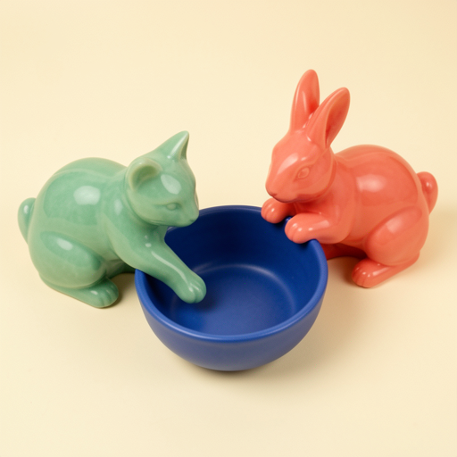
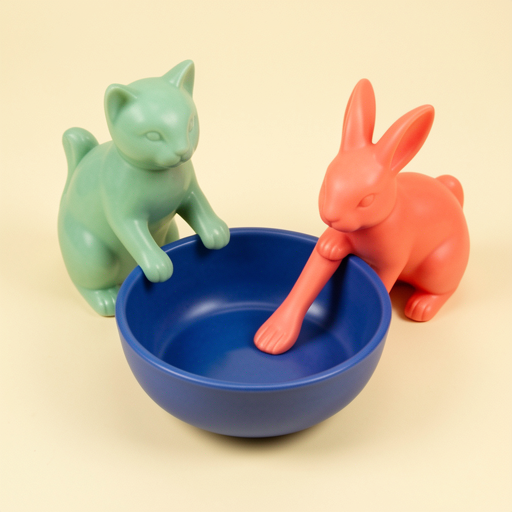
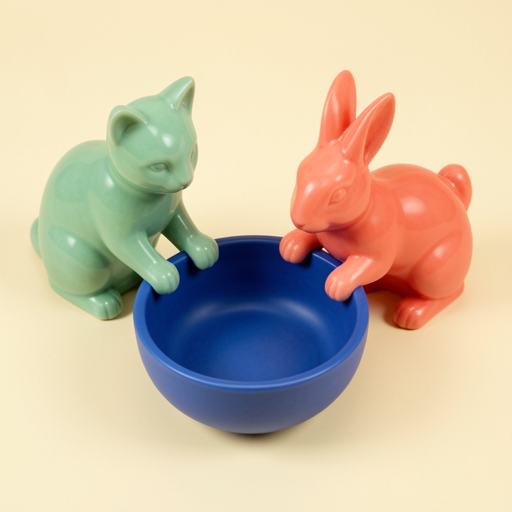
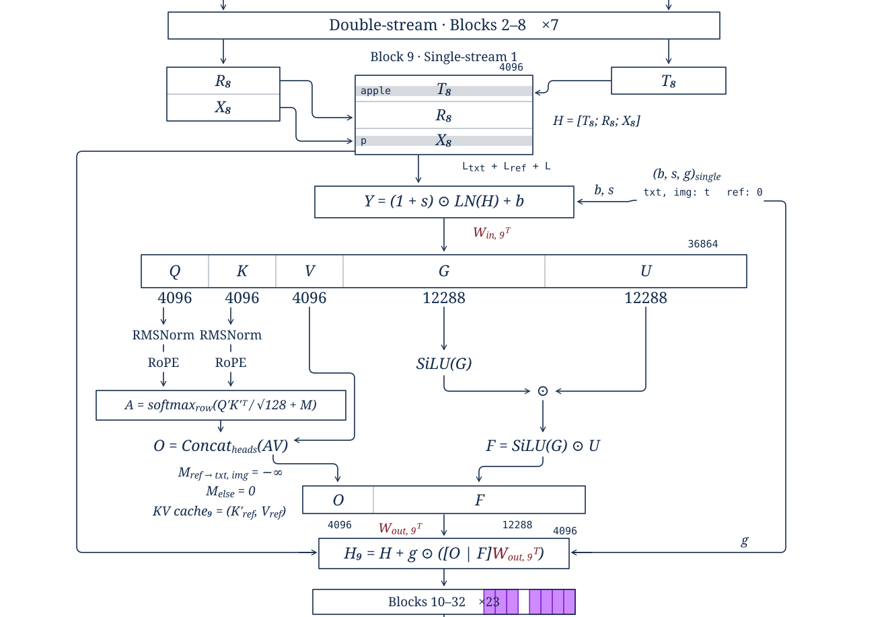

# Exp1 · FLUX 实体现象与实验审阅

[精选对照 · 原始图、提示词、测量和代码](review/evidence.md)

[70 张既有样本与完整提示词](data/prior-samples.json)　[跨场景与多轮审阅](REVIEW.md)　[网页版 Claude 阅读入口](llms.txt)　[全部数据索引](data/index.json)

## 碗底动作归属

| 原提示词 · 种子 2 | 同一种子，七块联合移植 | 平移九块的对照 |
|---|---|---|
|  |  |  |
| 要求兔爪贴碗底，实际是猫伸爪。 | 兔爪进入碗底。 | 兔爪仍停在碗沿。 |

第一次去噪时，第 3 块率先在全部三个种子出现动作主语的空间偏差。仅关闭第 5 块 H22 或调换其两次提及的注意力权重，均修复 0/3。同时移植第 25、26、27、29、30、31、32 块的单流注意力输出，修复 2/3；相同规模的平移对照修复 1/3。

## FLUX 结构图

[在线交互结构图 · 注意力偏向](https://htmlpreview.github.io/?https://github.com/NonEuclideanSpace/Exp1/blob/main/articles/flux/index.html#single-stream)　[在线交互结构图 · 干预修复](https://htmlpreview.github.io/?https://github.com/NonEuclideanSpace/Exp1/blob/main/articles/flux/intervention.html#single-stream)

紫色是七块共同移植时修复 2/3 的位置。下表可点开具体块。原图沿用作者的文字和配色，新增标记只用紫色。

| 注意力偏向 | 七块联合干预 |
|---|---|
| [第 3 块](review/blocks/3.md) · [第 4 块](review/blocks/4.md) · [第 5 块 H22](review/blocks/5.md) · [第 6 块](review/blocks/6.md) | [第 25 块](review/blocks/25.md) · [第 26 块](review/blocks/26.md) · [第 27 块](review/blocks/27.md) · [第 29 块](review/blocks/29.md) · [第 30 块](review/blocks/30.md) · [第 31 块](review/blocks/31.md) · [第 32 块](review/blocks/32.md) |

[原图逐块注意力着色](articles/flux/single-stream.svg)　[32 块的纯文本与实测读数](data/blocks)　[实验记录下载](https://github.com/NonEuclideanSpace/Exp1/releases/tag/flux-binding-20261119)

[最新实验进度和相似度×距离结果](review/live.md)

[2026-11-19 当日实验专区、Claude 读取说明](DATA_LOCATION.md)
