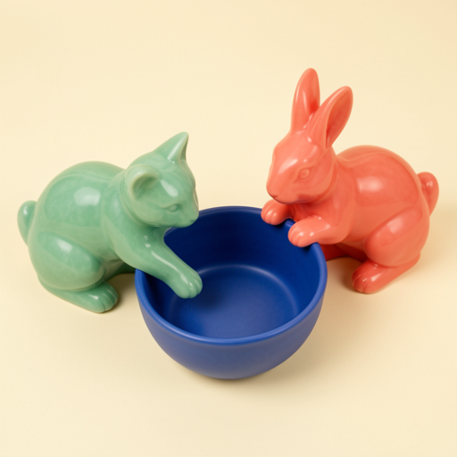
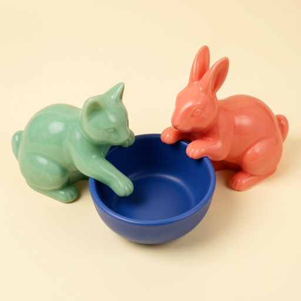

# 第 16 块 · 提示词、原图与行为

| 失败基线 | 仅移植本块注意力 | 仅移植本块前馈 |
|---|---|---|
|  |  |  |

# FLUX block 16

single_transformer_blocks[7].attn

第 16 块 · 图像对文本的联合注意力

single_transformer_blocks[7].attn · Q′K′ᵀ → softmax

动作主语和物体身份分开了

猫出现在左半图，兔出现在右半图。本块有 3/3 个种子同时出现两件事：介绍场景的 rabbit 主要指向右边，作 presses 主语的第二个 rabbit 主要指向左边。首次越过判据发生在第 3 块。

种子 2 最明显。N03 要猫爪碰碗底，实际是左边的猫做到了。N04 交换两个动作的主语后，兔仍在碗沿，伸向碗底的仍是猫。两图的种子、大小、模型、采样器和去噪步数相同。

N03 · 种子 2。要求猫爪碰碗底，兔爪碰碗沿。 https://raw.githubusercontent.com/NonEuclideanSpace/Exp1/main/articles/flux/prior-samples/N03-2.png

N03 · 种子 2。要求猫爪碰碗底，兔爪碰碗沿。
N04 · 种子 2。要求兔爪碰碗底，模型仍画成猫爪伸向碗底。 https://raw.githubusercontent.com/NonEuclideanSpace/Exp1/main/articles/flux/prior-samples/N04-2.png

N04 · 种子 2。要求兔爪碰碗底，模型仍画成猫爪伸向碗底。

两条实际提示词 · 英文与中文

N03

One shallow cobalt-blue bowl sits between a jade-green ceramic cat and a coral-pink ceramic rabbit. The cat presses one front paw flat against the inside bottom of the bowl. The rabbit touches the top rim of the same bowl with one front paw. Seen slightly from above so both contact points are visible. Matte ceramic glaze, warm ivory backdrop, soft studio light.

玉绿色陶瓷猫和珊瑚粉陶瓷兔之间放着一个浅钴蓝碗。猫的一只前爪平贴碗内底部；兔的一只前爪搭在同一个碗的上沿。从稍高处俯看，使两个接触点都可见。哑光陶瓷釉面，暖象牙色背景，柔和的棚拍光。

N04

One shallow cobalt-blue bowl sits between a jade-green ceramic cat and a coral-pink ceramic rabbit. The rabbit presses one front paw flat against the inside bottom of the bowl. The cat touches the top rim of the same bowl with one front paw. Seen slightly from above so both contact points are visible. Matte ceramic glaze, warm ivory backdrop, soft studio light.

玉绿色陶瓷猫和珊瑚粉陶瓷兔之间放着一个浅钴蓝碗。兔的一只前爪平贴碗内底部；猫的一只前爪搭在同一个碗的上沿。从稍高处俯看，使两个接触点都可见。哑光陶瓷釉面，暖象牙色背景，柔和的棚拍光。

同一词的两次提及

介绍句 rabbit 位于 token 22，动作句 rabbit 位于 token 25，从 0 计数。表中的百分数是该词得到的空间注意力中落在左半图的比例。计数门槛为介绍句不超过 45%，同时动作句达到 55%。头的占比是该头对动作词的全图质量除以全层 32 个头对同词的质量。

 | 种子 | 介绍句 rabbit 在左 | 动作句 rabbit 在左 | 同种子 N03 动作句 cat 在左 | 动作句 rabbit 的主导头 | 该头占比

 | 0 | 15.6% | 65.0% | 80.1% | H16 | 45.6%

 | 1 | 16.2% | 70.5% | 83.0% | H16 | 48.9%

 | 2 | 14.2% | 68.8% | 81.8% | H16 | 42.4%

四个去噪步的动作句 rabbit 左侧占比

 | 种子 | 第 1 步 | 第 2 步 | 第 3 步 | 第 4 步

 | 0 | 65.0% | 33.7% | 26.4% | 26.9%

 | 1 | 70.5% | 32.1% | 26.1% | 27.2%

 | 2 | 68.8% | 33.1% | 28.8% | 29.5%

成图里究竟画错了什么

种子 0。兔的前爪停在右侧碗沿，蓝色碗底空着。 https://raw.githubusercontent.com/NonEuclideanSpace/Exp1/main/articles/flux/prior-samples/N04-0.png

种子 0。兔的前爪停在右侧碗沿，蓝色碗底空着。
种子 1。兔的前爪都在碗沿，没有一爪抵住内底。 https://raw.githubusercontent.com/NonEuclideanSpace/Exp1/main/articles/flux/prior-samples/N04-1.png

种子 1。兔的前爪都在碗沿，没有一爪抵住内底。
种子 2。伸向碗底的是猫爪，兔爪仍在碗沿，角色与指令相反。 https://raw.githubusercontent.com/NonEuclideanSpace/Exp1/main/articles/flux/prior-samples/N04-2.png

种子 2。伸向碗底的是猫爪，兔爪仍在碗沿，角色与指令相反。

种子 0 和 1 的明确错误是缺少兔爪贴底；种子 2 还能看到猫接替了这个动作。这两种现象分别计入行为判读。紫色计数的对象是该块的注意力偏差。

干预与因果判读

下面的对照使用同一条 N04 提示词和相同种子。它检验替换这个块的注意力输出或前馈输出，是否让右侧兔爪真正伸进碗内。每项实验显示实际生成的图和操纵条件。查看第 16 块的云端干预原图和结论 ↗

第 16 块 H0 · 两种可见失败

N02 · 种子 2。两条围巾之间有空隙，另一只动物应只咬住同一条围巾的末端。 https://raw.githubusercontent.com/NonEuclideanSpace/Exp1/main/articles/flux/prior-samples/N02-2.png

N02 · 种子 2。两条围巾之间有空隙，另一只动物应只咬住同一条围巾的末端。
P06 · 种子 1。接触猫背的是前爪，下巴高于猫背。 https://raw.githubusercontent.com/NonEuclideanSpace/Exp1/main/articles/flux/prior-samples/P06-1.png

P06 · 种子 1。接触猫背的是前爪，下巴高于猫背。

固定实测 Q、K、V，将指定词从这一头的注意力分布移除，剩下的键重新归一化。表内是所有图像查询的 AV 输出变化量 ‖ΔAV‖/‖AV‖。N02 的条件词 bare 和动作词 bites 对这个头的输出影响远高于物件词 scarf。P06 中身体部位 chin 的影响高于动物名称。这个干预直接测到了条件词向头输出传递的信号，最终接触形状的变化在另一次成图干预中测量。

 | 样本 | 去噪步 | 移除的词 | 该头输出变化

 | N02 / 种子 2 | 1 | bites | 2.147%

 | N02 / 种子 2 | 1 | bare | 2.082%

 | N02 / 种子 2 | 1 | scarf（第一次提及） | 0.026%

 | P06 / 种子 1 | 2 | chin | 1.717%

 | P06 / 种子 1 | 2 | back | 0.421%

 | P06 / 种子 1 | 2 | rabbit | 0.007%

N02 提示词与全部原图　P06 提示词与全部原图
