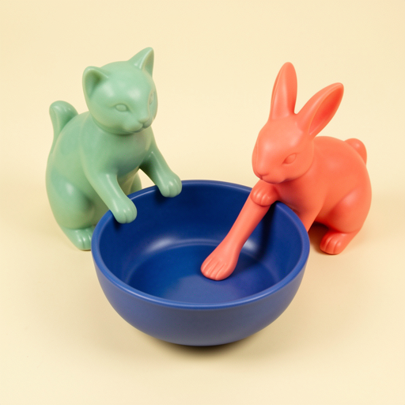
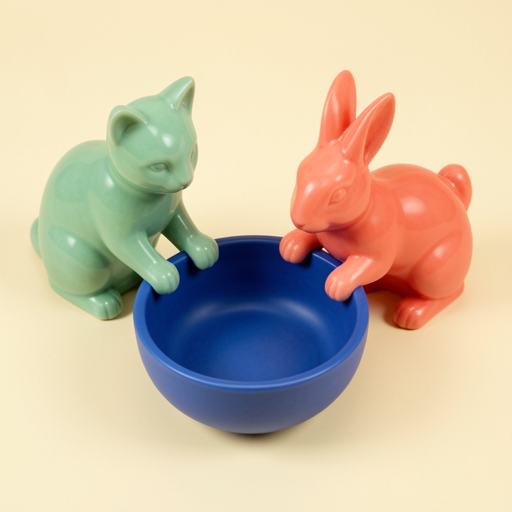

# 第 29 块 · 提示词、原图与行为

| 失败基线 | 七块共同移植 | 平移对照 |
|---|---|---|
|  |  |  |

这个块属于已在原图复核的七块组合。保持 N04 的提示词和种子，将第一去噪步第 25、26、27、29、30、31、32 块的图像注意力输出一起换成同种子正确引导图的对应输出。种子 0、2 的兔爪进入碗底，种子 1 的仍停在碗沿，修复 2/3。全组仅涉及注意力分支。

同样七个注意力块整体平移九块后，种子 0 仍能修复，但种子 2 没有，合计 1/3。种子 2 的逆向实验中，将失败图的七个输出写回本来正确的引导图，猫也向碗底伸爪，兔仍然伸爪。它使猫的错误动作重现，却没有完全覆盖兔的正确动作。

在种子 2 中单独测试了全部 32 块的注意力和前馈共 64 个分支，任一分支单独移植均未把兔爪恢复到碗底。紫色的干预图着色的是共同操作的七个块，2/3 的分母属于整个组合。该块的单独干预图可从下方查看。

# FLUX block 29

single_transformer_blocks[20].attn

第 29 块 · 图像对文本的联合注意力

single_transformer_blocks[20].attn · Q′K′ᵀ → softmax

成图干预 · 种子 2 的对照

同种子基线 · 伸向碗底的是猫。 https://raw.githubusercontent.com/NonEuclideanSpace/Exp1/main/media/bowl/orig__s2.png

同种子基线 · 伸向碗底的是猫。
七个注意力块同时移植 · 兔爪伸入碗内。 https://raw.githubusercontent.com/NonEuclideanSpace/Exp1/main/media/bowl/replicate__s2.png

七个注意力块同时移植 · 兔爪伸入碗内。
七个块整体平移九块 · 兔爪仍在碗沿。 https://raw.githubusercontent.com/NonEuclideanSpace/Exp1/main/media/bowl/replicate_control__s2.png

七个块整体平移九块 · 兔爪仍在碗沿。

本次实际提示词及引导图

One shallow cobalt-blue bowl sits between a jade-green ceramic cat and a coral-pink ceramic rabbit. The rabbit presses one front paw flat against the inside bottom of the bowl. The cat touches the top rim of the same bowl with one front paw. Seen slightly from above so both contact points are visible. Matte ceramic glaze, warm ivory backdrop, soft studio light.

玉绿色陶瓷猫和珊瑚粉陶瓷兔之间放着一个浅钴蓝碗。兔的一只前爪平贴碗内底部；猫的一只前爪搭在同一个碗的上沿。从稍高处俯看，使两个接触点都可见。哑光陶瓷釉面，暖象牙色背景，柔和的棚拍光。

移植源的提示词

Close studio photograph of two matte ceramic figurines and one shallow cobalt-blue bowl. On the LEFT a jade-green cat sits upright behind its side of the bowl, both paws resting on the upper rim. On the RIGHT a coral-pink rabbit reaches a long pink foreleg down INTO the bowl; its pink paw is pressed flat on the bottom at the center of the bowl. The blue interior is open to view around the pink paw. Slight overhead angle. Warm ivory studio background.

左边的绿猫用短爪搭住碗沿；右边的粉兔把长前爪伸到蓝碗中央，平贴碗底。稍高机位，象牙色背景，柔和棚光。

实际移植源 · 种子 2。 https://raw.githubusercontent.com/NonEuclideanSpace/Exp1/main/media/bowl/g1__s2.png

实际移植源 · 种子 2。

这个块属于已在原图复核的七块组合。保持 N04 的提示词和种子，将第一去噪步第 25、26、27、29、30、31、32 块的图像注意力输出一起换成同种子正确引导图的对应输出。种子 0、2 的兔爪进入碗底，种子 1 的仍停在碗沿，修复 2/3。全组仅涉及注意力分支。

同样七个注意力块整体平移九块后，种子 0 仍能修复，但种子 2 没有，合计 1/3。种子 2 的逆向实验中，将失败图的七个输出写回本来正确的引导图，猫也向碗底伸爪，兔仍然伸爪。它使猫的错误动作重现，却没有完全覆盖兔的正确动作。

在种子 2 中单独测试了全部 32 块的注意力和前馈共 64 个分支，任一分支单独移植均未把兔爪恢复到碗底。紫色的干预图着色的是共同操作的七个块，2/3 的分母属于整个组合。该块的单独干预图可从下方查看。

动作主语和物体身份分开了

猫出现在左半图，兔出现在右半图。本块有 0/3 个种子同时出现两件事：介绍场景的 rabbit 主要指向右边，作 presses 主语的第二个 rabbit 主要指向左边。首次越过判据发生在第 3 块。

种子 2 最明显。N03 要猫爪碰碗底，实际是左边的猫做到了。N04 交换两个动作的主语后，兔仍在碗沿，伸向碗底的仍是猫。两图的种子、大小、模型、采样器和去噪步数相同。

N03 · 种子 2。要求猫爪碰碗底，兔爪碰碗沿。 https://raw.githubusercontent.com/NonEuclideanSpace/Exp1/main/articles/flux/prior-samples/N03-2.png

N03 · 种子 2。要求猫爪碰碗底，兔爪碰碗沿。
N04 · 种子 2。要求兔爪碰碗底，模型仍画成猫爪伸向碗底。 https://raw.githubusercontent.com/NonEuclideanSpace/Exp1/main/articles/flux/prior-samples/N04-2.png

N04 · 种子 2。要求兔爪碰碗底，模型仍画成猫爪伸向碗底。

两条实际提示词 · 英文与中文

N03

One shallow cobalt-blue bowl sits between a jade-green ceramic cat and a coral-pink ceramic rabbit. The cat presses one front paw flat against the inside bottom of the bowl. The rabbit touches the top rim of the same bowl with one front paw. Seen slightly from above so both contact points are visible. Matte ceramic glaze, warm ivory backdrop, soft studio light.

玉绿色陶瓷猫和珊瑚粉陶瓷兔之间放着一个浅钴蓝碗。猫的一只前爪平贴碗内底部；兔的一只前爪搭在同一个碗的上沿。从稍高处俯看，使两个接触点都可见。哑光陶瓷釉面，暖象牙色背景，柔和的棚拍光。

N04

One shallow cobalt-blue bowl sits between a jade-green ceramic cat and a coral-pink ceramic rabbit. The rabbit presses one front paw flat against the inside bottom of the bowl. The cat touches the top rim of the same bowl with one front paw. Seen slightly from above so both contact points are visible. Matte ceramic glaze, warm ivory backdrop, soft studio light.

玉绿色陶瓷猫和珊瑚粉陶瓷兔之间放着一个浅钴蓝碗。兔的一只前爪平贴碗内底部；猫的一只前爪搭在同一个碗的上沿。从稍高处俯看，使两个接触点都可见。哑光陶瓷釉面，暖象牙色背景，柔和的棚拍光。

同一词的两次提及

介绍句 rabbit 位于 token 22，动作句 rabbit 位于 token 25，从 0 计数。表中的百分数是该词得到的空间注意力中落在左半图的比例。计数门槛为介绍句不超过 45%，同时动作句达到 55%。头的占比是该头对动作词的全图质量除以全层 32 个头对同词的质量。

 | 种子 | 介绍句 rabbit 在左 | 动作句 rabbit 在左 | 同种子 N03 动作句 cat 在左 | 动作句 rabbit 的主导头 | 该头占比

 | 0 | 19.0% | 36.6% | 90.4% | H5 | 19.3%

 | 1 | 19.7% | 42.6% | 90.5% | H5 | 16.2%

 | 2 | 19.8% | 47.4% | 90.0% | H5 | 17.9%

四个去噪步的动作句 rabbit 左侧占比

 | 种子 | 第 1 步 | 第 2 步 | 第 3 步 | 第 4 步

 | 0 | 36.6% | 20.7% | 28.4% | 14.1%

 | 1 | 42.6% | 9.3% | 20.0% | 7.6%

 | 2 | 47.4% | 14.1% | 6.5% | 20.1%

成图里究竟画错了什么

种子 0。兔的前爪停在右侧碗沿，蓝色碗底空着。 https://raw.githubusercontent.com/NonEuclideanSpace/Exp1/main/articles/flux/prior-samples/N04-0.png

种子 0。兔的前爪停在右侧碗沿，蓝色碗底空着。
种子 1。兔的前爪都在碗沿，没有一爪抵住内底。 https://raw.githubusercontent.com/NonEuclideanSpace/Exp1/main/articles/flux/prior-samples/N04-1.png

种子 1。兔的前爪都在碗沿，没有一爪抵住内底。
种子 2。伸向碗底的是猫爪，兔爪仍在碗沿，角色与指令相反。 https://raw.githubusercontent.com/NonEuclideanSpace/Exp1/main/articles/flux/prior-samples/N04-2.png

种子 2。伸向碗底的是猫爪，兔爪仍在碗沿，角色与指令相反。

种子 0 和 1 的明确错误是缺少兔爪贴底；种子 2 还能看到猫接替了这个动作。这两种现象分别计入行为判读。紫色计数的对象是该块的注意力偏差。

干预与因果判读

下面的对照使用同一条 N04 提示词和相同种子。它检验替换这个块的注意力输出或前馈输出，是否让右侧兔爪真正伸进碗内。每项实验显示实际生成的图和操纵条件。查看第 29 块的云端干预原图和结论 ↗

[分步干预、逐块移除、原始成图](../bowl-timing.md)

[同种子原始证据及对照](../evidence.md)

[两步七块分解对照 · 路由 R、值 V、文本贡献 T 的逐种子结果](../evidence.md#固定七块分开移植图像路由-r图像值-v文本贡献-t)
