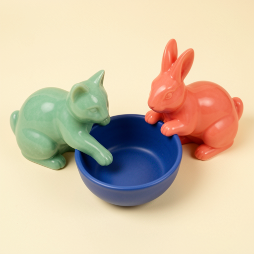
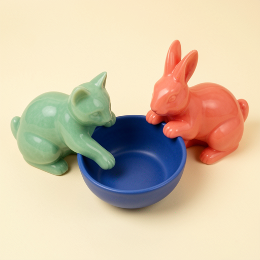

# 第 5 块 · 提示词、原图与行为

| 失败基线 | H22 交换提及权重 | H22 置零 |
|---|---|---|
|  |  |  |

第 5 块的 H22 清楚区分了同一个词的两次提及。种子 0、1、2 中，介绍句 rabbit 在这个头落到猫一侧的比例为 8.9%、20.5%、13.8%。动作主语 rabbit 在同一个头落到猫一侧的比例升到 80.9%、80.0%、77.6%。这些是逐头重放时直接测得的 QK softmax 空间分布。

保持 N04、种子和其他组件相同，在第一个去噪步只交换 H22 内两次兔、猫提及的注意力权重，兔爪贴底的修复数为 0/3。将这个头的图像输出置零，修复数也是 0/3。两个干预都保留了种子 2 中猫爪朝碗底、兔爪留在碗沿的行为。

把第 3–6 块各自最集中的一个头一起交换提及权重，修复数为 0/3。把这四个头一起置零也是 0/3。对照中的四个相邻头同样为 0/3。H22 携带了明显的主语定位偏差；以上操作已排除单靠修正 H22 权重或关闭它可以恢复这项动作。

用正确引导图的输出整体替换第 5 块注意力，真实修复 0/3；替换第 5 块前馈输出同样为 0/3。在同样的去噪步和种子下，替换全体单流注意力输出能修复种子 0、2（2/3），全体单流前馈输出修复 0/3。种子 1 的兔爪仍停在碗沿。

# FLUX block 5

transformer_blocks[4].attn

第 5 块 · 图像对文本的联合注意力

transformer_blocks[4].attn · Q′K′ᵀ → softmax

成图干预 · 种子 2 的对照

基线 · 猫爪伸入碗，兔爪停在碗沿。 https://raw.githubusercontent.com/NonEuclideanSpace/Exp1/main/media/bowl/orig__s2.png

基线 · 猫爪伸入碗，兔爪停在碗沿。
只交换 H22 的提及权重 · 兔爪仍在碗沿。 https://raw.githubusercontent.com/NonEuclideanSpace/Exp1/main/media/bowl/route_L5H22__s2.png

只交换 H22 的提及权重 · 兔爪仍在碗沿。
只清零 H22 的输出 · 猫仍向碗底伸爪。 https://raw.githubusercontent.com/NonEuclideanSpace/Exp1/main/media/bowl/zero_L5H22__s2.png

只清零 H22 的输出 · 猫仍向碗底伸爪。

本次实际提示词及引导图

One shallow cobalt-blue bowl sits between a jade-green ceramic cat and a coral-pink ceramic rabbit. The rabbit presses one front paw flat against the inside bottom of the bowl. The cat touches the top rim of the same bowl with one front paw. Seen slightly from above so both contact points are visible. Matte ceramic glaze, warm ivory backdrop, soft studio light.

玉绿色陶瓷猫和珊瑚粉陶瓷兔之间放着一个浅钴蓝碗。兔的一只前爪平贴碗内底部；猫的一只前爪搭在同一个碗的上沿。从稍高处俯看，使两个接触点都可见。哑光陶瓷釉面，暖象牙色背景，柔和的棚拍光。

第 5 块的 H22 清楚区分了同一个词的两次提及。种子 0、1、2 中，介绍句 rabbit 在这个头落到猫一侧的比例为 8.9%、20.5%、13.8%。动作主语 rabbit 在同一个头落到猫一侧的比例升到 80.9%、80.0%、77.6%。这些是逐头重放时直接测得的 QK softmax 空间分布。

保持 N04、种子和其他组件相同，在第一个去噪步只交换 H22 内两次兔、猫提及的注意力权重，兔爪贴底的修复数为 0/3。将这个头的图像输出置零，修复数也是 0/3。两个干预都保留了种子 2 中猫爪朝碗底、兔爪留在碗沿的行为。

把第 3–6 块各自最集中的一个头一起交换提及权重，修复数为 0/3。把这四个头一起置零也是 0/3。对照中的四个相邻头同样为 0/3。H22 携带了明显的主语定位偏差；以上操作已排除单靠修正 H22 权重或关闭它可以恢复这项动作。

用正确引导图的输出整体替换第 5 块注意力，真实修复 0/3；替换第 5 块前馈输出同样为 0/3。在同样的去噪步和种子下，替换全体单流注意力输出能修复种子 0、2（2/3），全体单流前馈输出修复 0/3。种子 1 的兔爪仍停在碗沿。

动作主语和物体身份分开了

猫出现在左半图，兔出现在右半图。本块有 3/3 个种子同时出现两件事：介绍场景的 rabbit 主要指向右边，作 presses 主语的第二个 rabbit 主要指向左边。首次越过判据发生在第 3 块。

种子 2 最明显。N03 要猫爪碰碗底，实际是左边的猫做到了。N04 交换两个动作的主语后，兔仍在碗沿，伸向碗底的仍是猫。两图的种子、大小、模型、采样器和去噪步数相同。

N03 · 种子 2。要求猫爪碰碗底，兔爪碰碗沿。 https://raw.githubusercontent.com/NonEuclideanSpace/Exp1/main/articles/flux/prior-samples/N03-2.png

N03 · 种子 2。要求猫爪碰碗底，兔爪碰碗沿。
N04 · 种子 2。要求兔爪碰碗底，模型仍画成猫爪伸向碗底。 https://raw.githubusercontent.com/NonEuclideanSpace/Exp1/main/articles/flux/prior-samples/N04-2.png

N04 · 种子 2。要求兔爪碰碗底，模型仍画成猫爪伸向碗底。

两条实际提示词 · 英文与中文

N03

One shallow cobalt-blue bowl sits between a jade-green ceramic cat and a coral-pink ceramic rabbit. The cat presses one front paw flat against the inside bottom of the bowl. The rabbit touches the top rim of the same bowl with one front paw. Seen slightly from above so both contact points are visible. Matte ceramic glaze, warm ivory backdrop, soft studio light.

玉绿色陶瓷猫和珊瑚粉陶瓷兔之间放着一个浅钴蓝碗。猫的一只前爪平贴碗内底部；兔的一只前爪搭在同一个碗的上沿。从稍高处俯看，使两个接触点都可见。哑光陶瓷釉面，暖象牙色背景，柔和的棚拍光。

N04

One shallow cobalt-blue bowl sits between a jade-green ceramic cat and a coral-pink ceramic rabbit. The rabbit presses one front paw flat against the inside bottom of the bowl. The cat touches the top rim of the same bowl with one front paw. Seen slightly from above so both contact points are visible. Matte ceramic glaze, warm ivory backdrop, soft studio light.

玉绿色陶瓷猫和珊瑚粉陶瓷兔之间放着一个浅钴蓝碗。兔的一只前爪平贴碗内底部；猫的一只前爪搭在同一个碗的上沿。从稍高处俯看，使两个接触点都可见。哑光陶瓷釉面，暖象牙色背景，柔和的棚拍光。

同一词的两次提及

介绍句 rabbit 位于 token 22，动作句 rabbit 位于 token 25，从 0 计数。表中的百分数是该词得到的空间注意力中落在左半图的比例。计数门槛为介绍句不超过 45%，同时动作句达到 55%。头的占比是该头对动作词的全图质量除以全层 32 个头对同词的质量。

 | 种子 | 介绍句 rabbit 在左 | 动作句 rabbit 在左 | 同种子 N03 动作句 cat 在左 | 动作句 rabbit 的主导头 | 该头占比

 | 0 | 9.9% | 74.0% | 86.5% | H22 | 75.6%

 | 1 | 20.4% | 72.8% | 84.6% | H22 | 72.9%

 | 2 | 14.0% | 71.8% | 82.4% | H22 | 77.5%

四个去噪步的动作句 rabbit 左侧占比

 | 种子 | 第 1 步 | 第 2 步 | 第 3 步 | 第 4 步

 | 0 | 74.0% | 27.9% | 6.3% | 11.6%

 | 1 | 72.8% | 28.0% | 6.1% | 10.9%

 | 2 | 71.8% | 33.5% | 10.3% | 11.7%

成图里究竟画错了什么

种子 0。兔的前爪停在右侧碗沿，蓝色碗底空着。 https://raw.githubusercontent.com/NonEuclideanSpace/Exp1/main/articles/flux/prior-samples/N04-0.png

种子 0。兔的前爪停在右侧碗沿，蓝色碗底空着。
种子 1。兔的前爪都在碗沿，没有一爪抵住内底。 https://raw.githubusercontent.com/NonEuclideanSpace/Exp1/main/articles/flux/prior-samples/N04-1.png

种子 1。兔的前爪都在碗沿，没有一爪抵住内底。
种子 2。伸向碗底的是猫爪，兔爪仍在碗沿，角色与指令相反。 https://raw.githubusercontent.com/NonEuclideanSpace/Exp1/main/articles/flux/prior-samples/N04-2.png

种子 2。伸向碗底的是猫爪，兔爪仍在碗沿，角色与指令相反。

种子 0 和 1 的明确错误是缺少兔爪贴底；种子 2 还能看到猫接替了这个动作。这两种现象分别计入行为判读。紫色计数的对象是该块的注意力偏差。

干预与因果判读

下面的对照使用同一条 N04 提示词和相同种子。它检验替换这个块的注意力输出或前馈输出，是否让右侧兔爪真正伸进碗内。每项实验显示实际生成的图和操纵条件。查看第 5 块的云端干预原图和结论 ↗

[分步干预、逐块移除、原始成图](../bowl-timing.md)

[同种子原始证据及对照](../evidence.md)
