# 动作归属的因果干预

原提示词要求粉色兔爪贴住碗底、绿色猫爪留在碗沿。以下比较固定模型、原提示词、种子和四步去噪，只改变从同种子 G1 正确图移入的注意力输出。全局块号从 1 起算，头号从 0 起算。

第 5 双流块 H22 对动作主语 rabbit 的空间注意力有 77.6%–80.9% 落到猫侧。交换该头的两次提及权重或关闭该头，各恢复 0/3。

全局第 25、26、27、29、30、31、32 块中，联合替换图像查询的注意力输出，单独第一个去噪步恢复 2/3，连续前两步恢复 3/3。只换第一次去噪的全部单流前馈输出恢复 0/3。种子 2 上逐个删去七块中的任何一块，两只动物的爪都停回碗沿；种子 0 上七次删块仍恢复兔爪贴底。测试这七块的选择使用了种子 2。

[逐条件结果](../data/bowl-timing-reviewed.json) · [供体提示词](../data/guide-prompts.json) · [各样本原提示词](../data/bowl-samples.json)

以下为模型原图。判读依据是兔前腿是否连续连到碗内、猫爪是否留在碗沿。判读由 AI 看图完成。

|干预|种子 0|种子 1|种子 2|
|---|---|---|---|
|原始失败|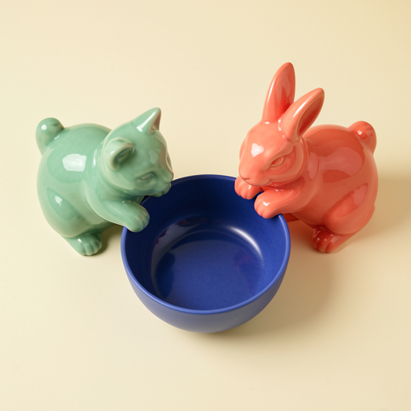|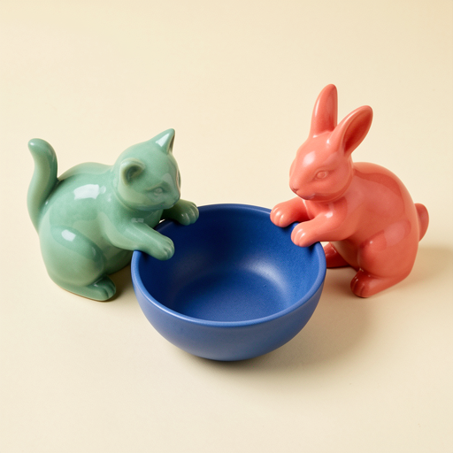||
|第一步七块|||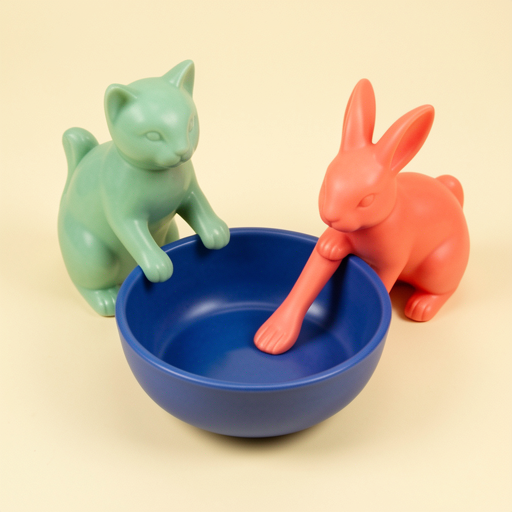|
|前两步七块|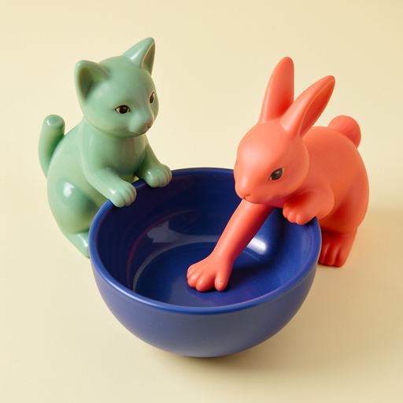|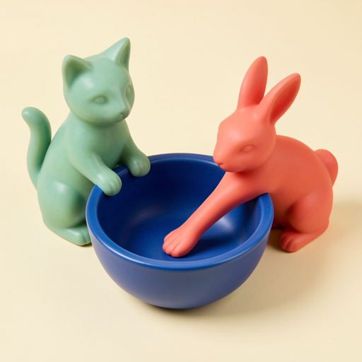|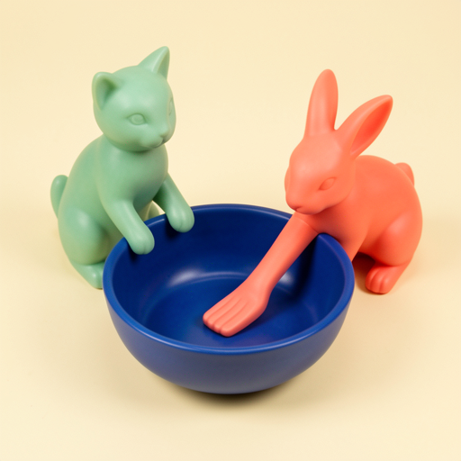|
|四步七块|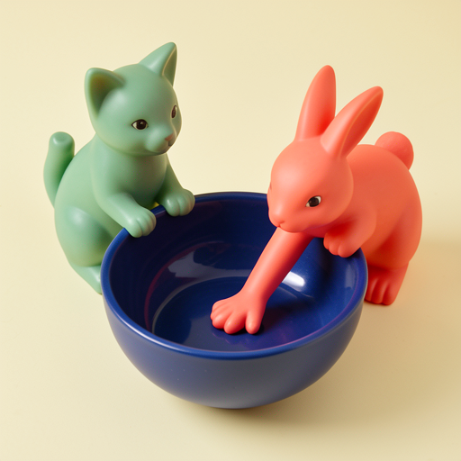|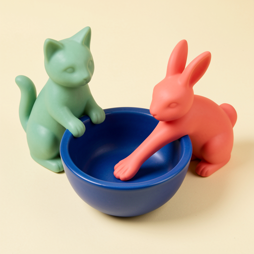||
|第一步少换第 25 块||||
|第一步少换第 26 块|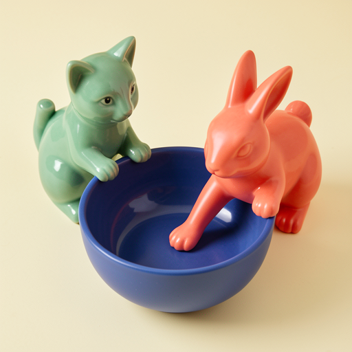|||
|第一步少换第 27 块||||
|第一步少换第 29 块||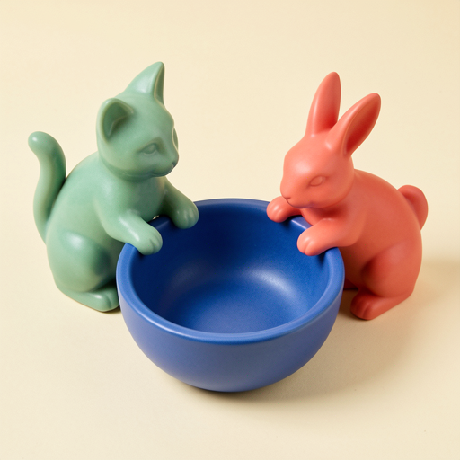|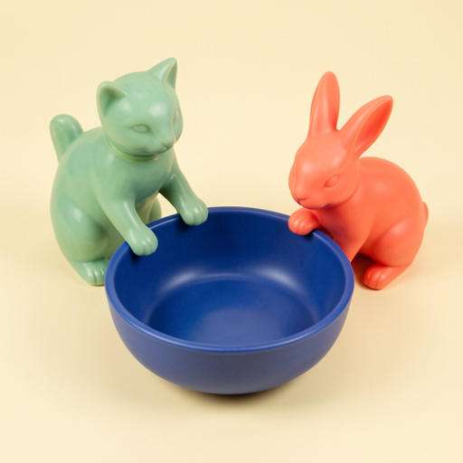|
|第一步少换第 30 块|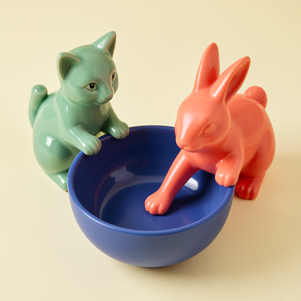|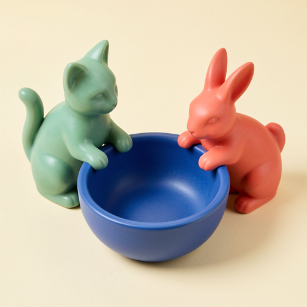||
|第一步少换第 31 块|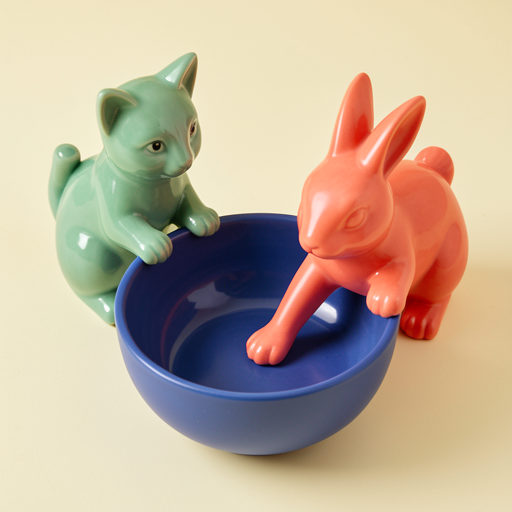||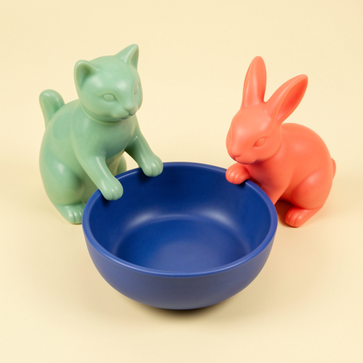|
|第一步少换第 32 块|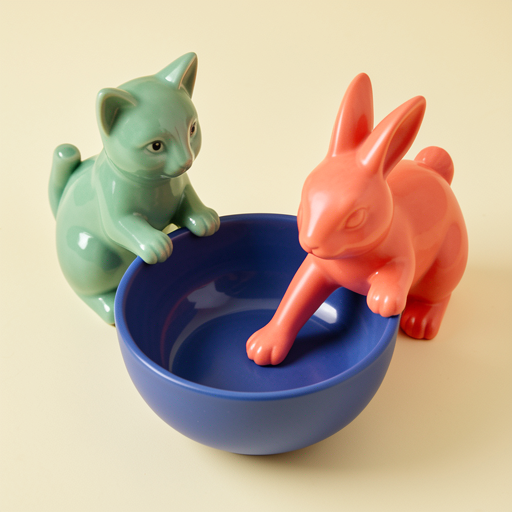||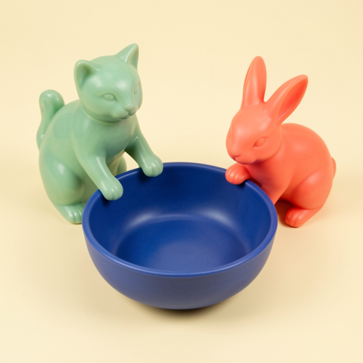|
