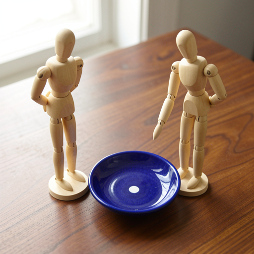
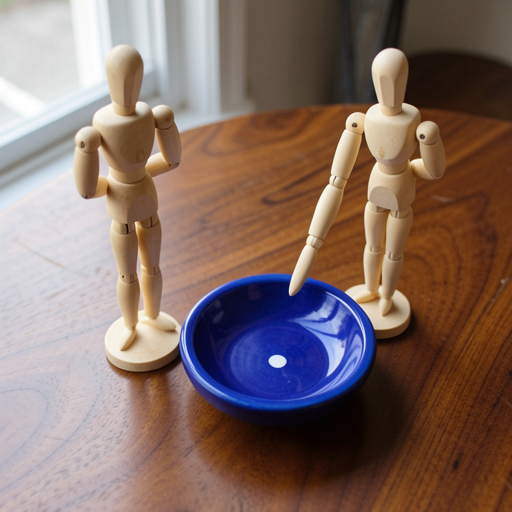
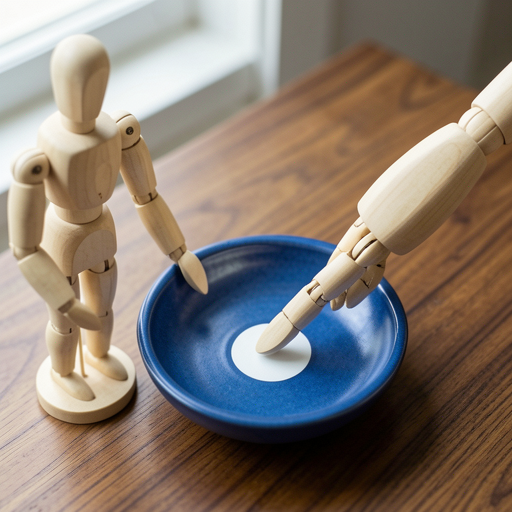

# 旁观者与明确接触指令

仅判断由右侧伸出的指尖是否触到白点，独立记录两个身体是否可见。左边人偶把手背在身后时，右侧触点 0/4。明确说出指尖应遮挡白点的表述中，突出触点的版本 4/4 形成接触，但三张裁去了右人偶全部或大部分身体；另一版本保留两个身体，有 1/4 形成接触。两个版本改变了文字内容和构图。

[英文提示词](../data/hypothesis-tests/error-panel/contact-calibration/design.json) · [逐条件读数](../data/hypothesis-tests/error-panel/contact-calibration/visual-readout.json)

|条件|21|22|23|24|
|---|---|---|---|---|
|idle|||||
|contact-first|||||
|rim-first|||||
