# N04 · 动作归属的原始证据

[收件提示词和 token 原记录](../data/evidence/N04/recipient-tokens.json) · [供体 G1 原提示词](../data/evidence/N04/donor-prompts.json) · [干预源代码](../data/evidence/N04/intervention-source.py)

同一行固定随机种子。模型为 FLUX.2-klein-9b-kv，512 × 512，4 个去噪步。全局块号从 1 起算，源码的块下标和头号从 0 起算。种子 2 用于选择七块组合，种子 0、1 用于复测。

|种子|原提示词|第 5 块 H22 置零|第一步七块|同规模平移对照|前两步七块|
|---|---|---|---|---|---|
|0|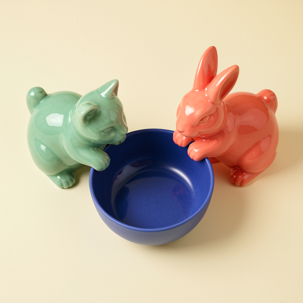|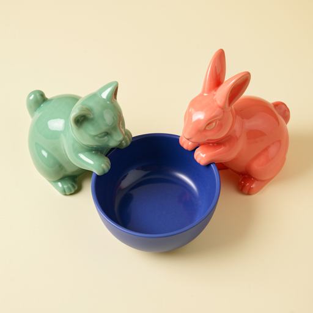|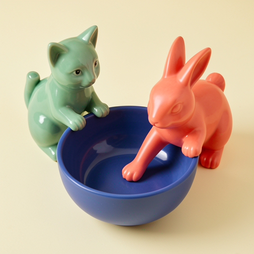|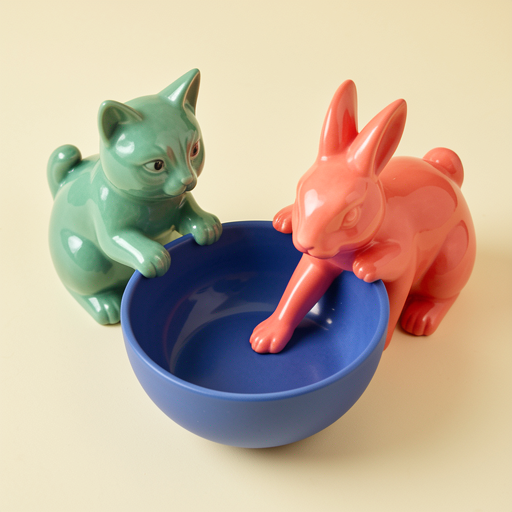|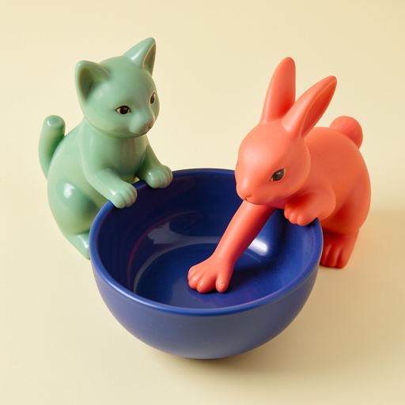|
|1|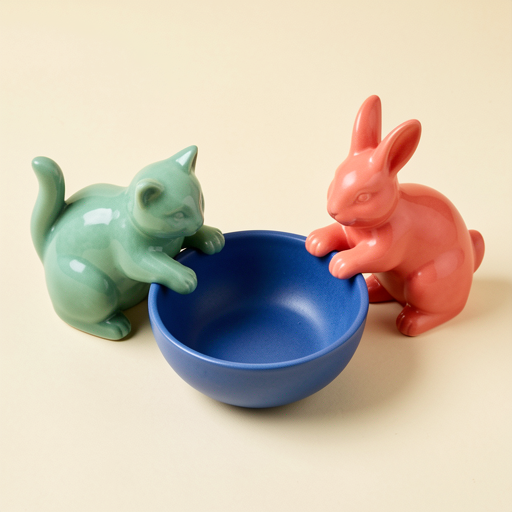|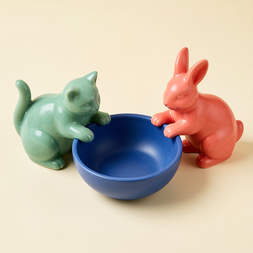|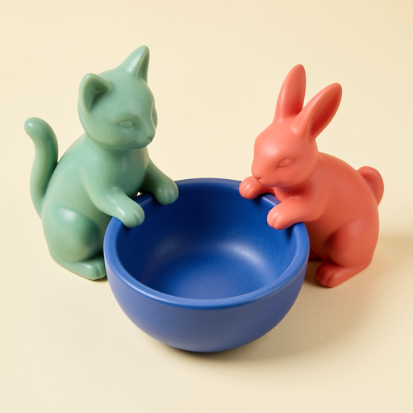|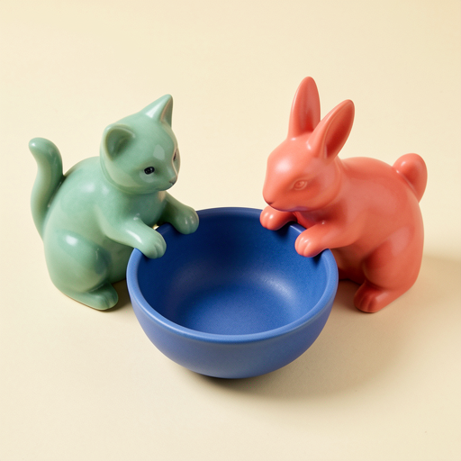|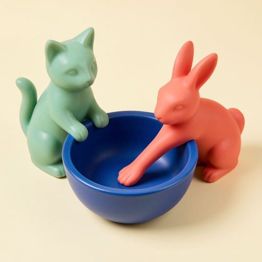|
|2||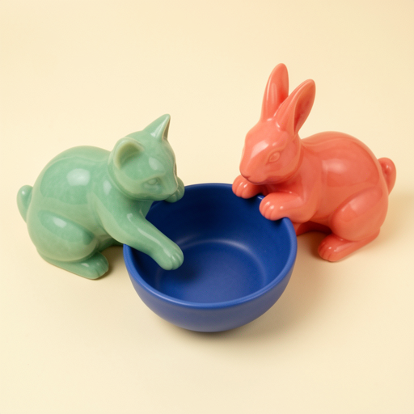|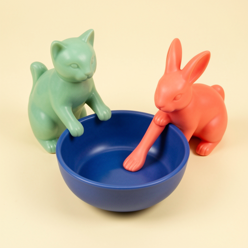|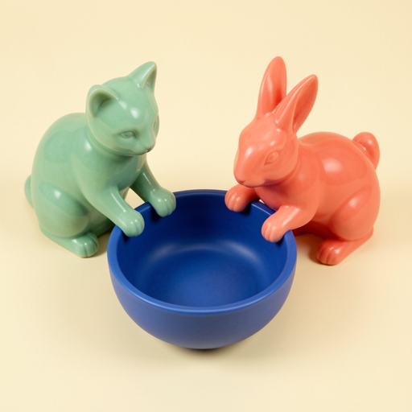|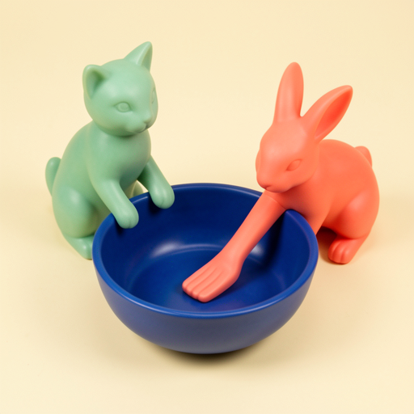|

第 5 块 H22 的原始 CSV 保留词组序号、种子以及左右半幅的注意力质量。作图用的左侧占比为 mass_left / (mass_left + mass_right)。两个 rabbit 在原提示词中的 token 下标为 22、25。

[H22 原始测量行](../data/evidence/N04/head-22-occurrences.csv) · [逐块移除与时间对照](bowl-timing.md) · [原始逐条件数值](../data/bowl-measurements.json) · [碗内颜色代理指标代码](../data/evidence/N04/region-score.py)

## 固定七块，分开移植图像路由 R、图像值 V、文本贡献 T

R 是图像查询对图像键的注意力权重，保留联合 softmax 的图文竞争。V 是对齐图像网格的值向量。T 是注意力总输出减去图像来源的 R·V。下面每个实验均用相同种子的 G1 提供选中分量。copy 是原始分量重构，RVT 是供体三项重构，whole 直接移入供体输出。

[原始数值](../data/evidence/N04/factor-readout.json) · [计算代码](../data/evidence/N04/factor-source.py)

|去噪步与种子|原图|只换 R|只换 V|只换 T|换 RT|换 VT|整项对照|
|---|---|---|---|---|---|---|---|
|1 / 0|[原图](../media/bowl/routing-values/step1_base__s0.png)|[原图](../media/bowl/routing-values/step1_R__s0.png)|[原图](../media/bowl/routing-values/step1_V__s0.png)|[原图](../media/bowl/routing-values/step1_T__s0.png)|[原图](../media/bowl/routing-values/step1_RT__s0.png)|[原图](../media/bowl/routing-values/step1_VT__s0.png)|[原图](../media/bowl/routing-values/step1_whole__s0.png)|
|1 / 1|[原图](../media/bowl/routing-values/step1_base__s1.png)|[原图](../media/bowl/routing-values/step1_R__s1.png)|[原图](../media/bowl/routing-values/step1_V__s1.png)|[原图](../media/bowl/routing-values/step1_T__s1.png)|[原图](../media/bowl/routing-values/step1_RT__s1.png)|[原图](../media/bowl/routing-values/step1_VT__s1.png)|[原图](../media/bowl/routing-values/step1_whole__s1.png)|
|1 / 2|[原图](../media/bowl/routing-values/step1_base__s2.png)|[原图](../media/bowl/routing-values/step1_R__s2.png)|[原图](../media/bowl/routing-values/step1_V__s2.png)|[原图](../media/bowl/routing-values/step1_T__s2.png)|[原图](../media/bowl/routing-values/step1_RT__s2.png)|[原图](../media/bowl/routing-values/step1_VT__s2.png)|[原图](../media/bowl/routing-values/step1_whole__s2.png)|
|12 / 0|[原图](../media/bowl/routing-values/step12_base__s0.png)|[原图](../media/bowl/routing-values/step12_R__s0.png)|[原图](../media/bowl/routing-values/step12_V__s0.png)|[原图](../media/bowl/routing-values/step12_T__s0.png)|[原图](../media/bowl/routing-values/step12_RT__s0.png)|[原图](../media/bowl/routing-values/step12_VT__s0.png)|[原图](../media/bowl/routing-values/step12_whole__s0.png)|
|12 / 1|[原图](../media/bowl/routing-values/step12_base__s1.png)|[原图](../media/bowl/routing-values/step12_R__s1.png)|[原图](../media/bowl/routing-values/step12_V__s1.png)|[原图](../media/bowl/routing-values/step12_T__s1.png)|[原图](../media/bowl/routing-values/step12_RT__s1.png)|[原图](../media/bowl/routing-values/step12_VT__s1.png)|[原图](../media/bowl/routing-values/step12_whole__s1.png)|
|12 / 2|[原图](../media/bowl/routing-values/step12_base__s2.png)|[原图](../media/bowl/routing-values/step12_R__s2.png)|[原图](../media/bowl/routing-values/step12_V__s2.png)|[原图](../media/bowl/routing-values/step12_T__s2.png)|[原图](../media/bowl/routing-values/step12_RT__s2.png)|[原图](../media/bowl/routing-values/step12_VT__s2.png)|[原图](../media/bowl/routing-values/step12_whole__s2.png)|

[原图视觉判读表 · 评分来源、种子和端点](../data/evidence/N04/visual-readout.json)
