# 两处缠绕

每行依次为种子 0、1、2、3、4。判读与图片分开放置。

## 简单

背包肩带缠着水壶，登山靴鞋带缠着藤蔓。

完整英文提示词

A weathered backpack and one hiking boot sit on a mossy trail. The backpack strap winds around a metal canteen. The boot lace winds around a hanging vine. Soft natural light, still-life photograph, clear view of the contact points.

0 | 1 | 2 | 3 | 4
--- | --- | --- | --- | ---
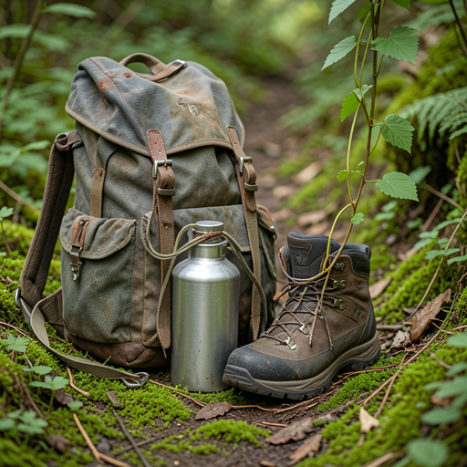 | 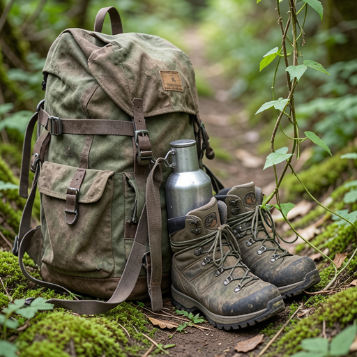 | 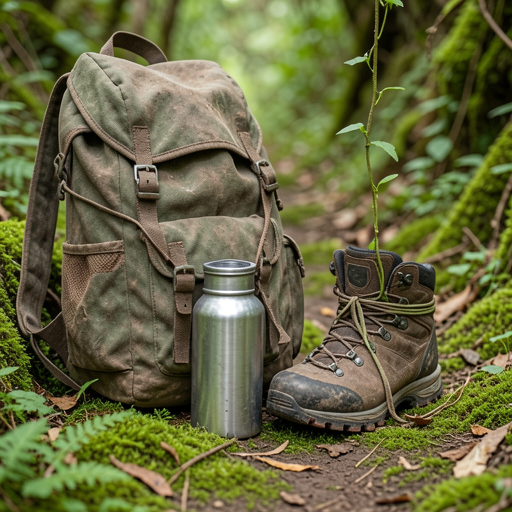 | 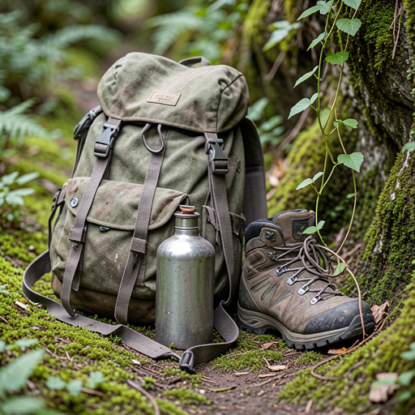 | 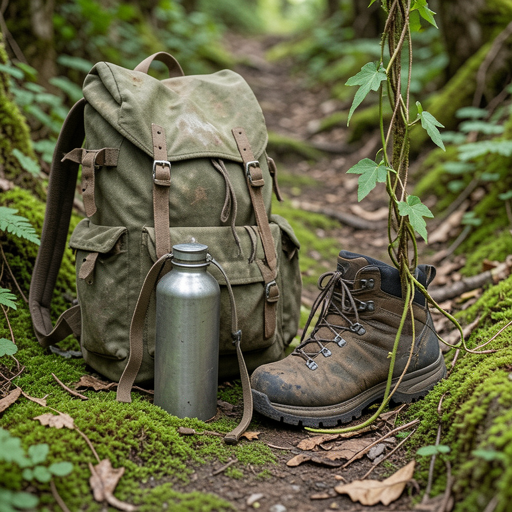
绕水壶　背包带　｜　绕藤蔓　鞋带 | 绕水壶　背包带　｜　绕藤蔓　鞋带 | 绕水壶　背包带　｜　绕藤蔓　鞋带 | 绕水壶　背包带　｜　绕藤蔓　鞋带 | 绕水壶　背包带　｜　绕藤蔓　鞋带

## 交换角色

背包肩带缠着藤蔓，登山靴鞋带缠着水壶。

完整英文提示词

A weathered backpack and one hiking boot sit on a mossy trail. The backpack strap winds around a hanging vine. The boot lace winds around a metal canteen. Soft natural light, still-life photograph, clear view of the contact points.

0 | 1 | 2 | 3 | 4
--- | --- | --- | --- | ---
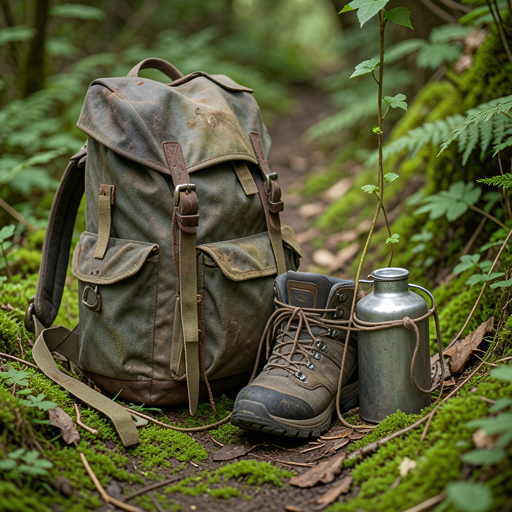 | 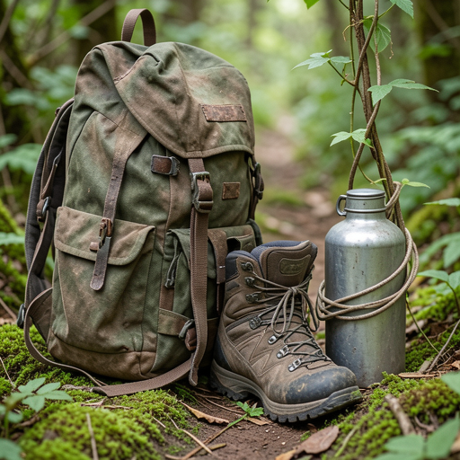 | 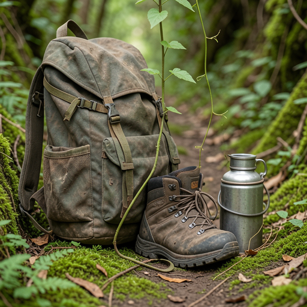 | 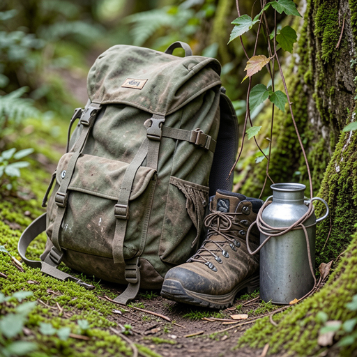 | 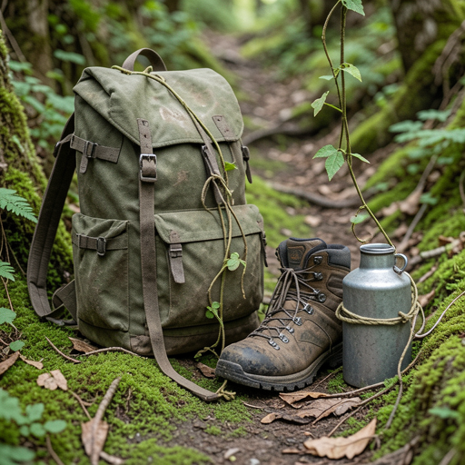
绕水壶　背包带　｜　绕藤蔓　鞋带 | 绕水壶　背包带　｜　绕藤蔓　鞋带 | 绕水壶　都没有　｜　绕藤蔓　两者 | 绕水壶　背包带　｜　绕藤蔓　鞋带 | 绕水壶　背包带　｜　绕藤蔓　鞋带

## LongBench 原始输入

背包肩带缠着水壶，登山靴鞋带缠着藤蔓。

完整英文提示词

A rusted lantern sways from a crooked branch above a muddy trail, its weak amber glow pulsing like a heartbeat in the dim twilight, casting elongated shadows that dance with the flicker. The light reflects faintly in a puddle below, its surface rippling with the breath of the forest and the distant, mournful wail of a train whistle echoing through the fog. The mist rolls in from the far side of the woods, softening the edges of trees and turning the landscape into a watercolor of grays and browns. A weathered backpack leans precariously against the tree, one strap tangled around a half-buried canteen, its metal cap slightly open, leaking a slow, silvery mist that mingles with the fog and glints like starlight in the lantern’s glow. The trail ahead is littered with fallen leaves, their edges curled like burned parchment, and a single hiking boot, its laces snarled around a low-hanging vine that seems to be growing toward the light. A rusted bicycle frame, its tires flat and spokes snapped, lies half-buried in the mud, one wheel still spinning slowly as if caught in a mechanical reverie, turning just enough to catch the light and send it skittering off into the mist. A fox-shaped shadow darts through the fog but lingers just long enough to pause by the lantern, its eyes reflecting the light in an uncanny green hue before melting into the vapor again. Nearby, a tattered map spills from the backpack, pinned by a corkscrew that somehow remains upright despite the mud beneath it. The map appears to show a trail that loops infinitely back on itself, the ink blurred and bleeding into the page as if it's unraveling with the forest. A bottle of ink, still half-full, sits on a small rock near the map, its stopper missing, the ink pooling into a shallow depression and forming a tiny, still pool that mirrors the sky above. High above, the clouds move slowly, yet their movement is mirrored in the ink and the fog, as if the scene is layered in multiple realities. A pocket watch, half-open, lies face-down in the dirt, its hands spinning backward while a moth perches on the glass, its wings casting shadows that twist like cursive script across the map. A long branch extends from the tree into the fog, bearing not leaves but tiny mirrors that catch and scatter the lantern’s light in a thousand directions, creating the illusion of fireflies trapped in a silent ballet. The train whistle sounds again, but now it seems to come from both behind and in front, as if the tracks themselves loop and twist through the forest, hidden from sight but present in the vibrations of the earth. A small fire crackles in a ring of stones nearby, its flames tinged an impossible violet, burning from a heap of wet twigs and dead leaves that refuse to smolder except at the very core, where the light seems to draw the fire from the darkness. A crow, one wing strangely elongated and feathery at the edges, watches the fire from a low branch, its reflection visible in the puddle below but moving slightly out of sync, as if trapped in a different moment. The air hums with the quiet tension of transformation, the boundary between object and memory, reality and reverie, dissolving like the edges of the fog. The lantern flickers, and for a moment, it glows brighter, illuminating a figure in the distance—tall, motionless, and cloaked in mist, its face hidden beneath a hat, its silhouette framed by the trees like a shadow from another world. Then, just as suddenly, the light dims, the figure vanishes, and the forest returns to its layered stillness, the only movement the slow turn of the bicycle wheel and the endless loop of the train’s call.

0 | 1 | 2 | 3 | 4
--- | --- | --- | --- | ---
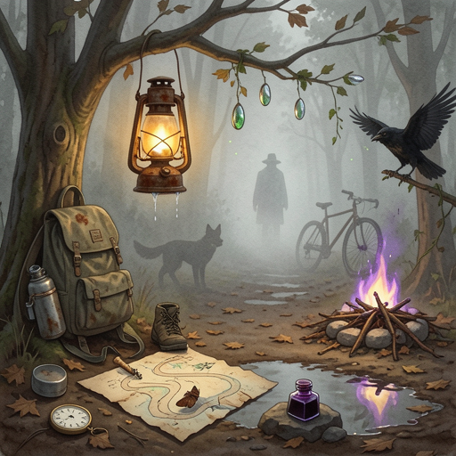 | 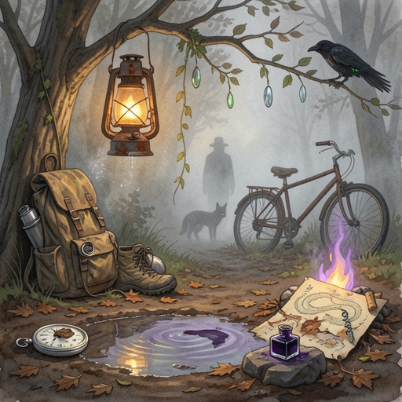 | 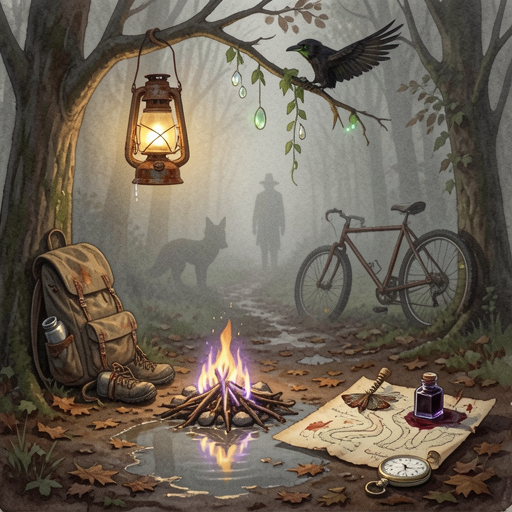 | 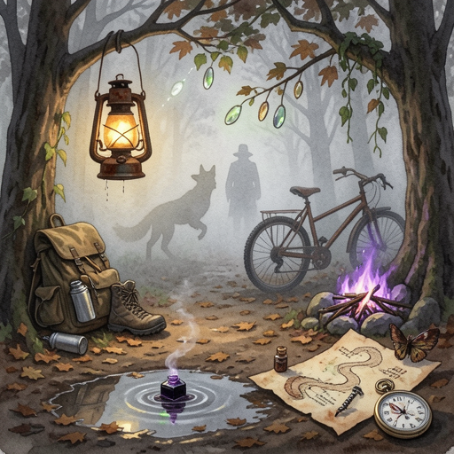 | 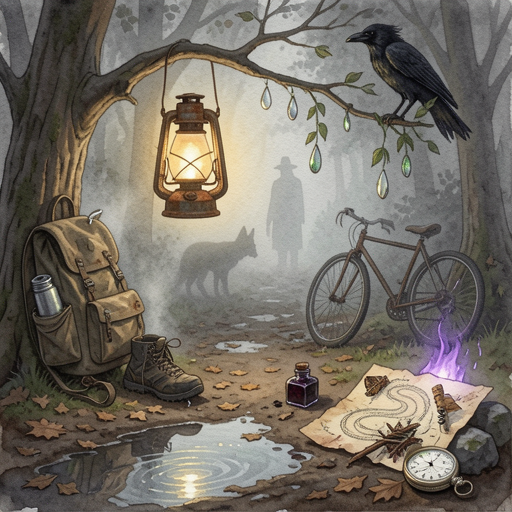
绕水壶　背包带　｜　绕藤蔓　看不清 | 绕水壶　背包带　｜　绕藤蔓　看不清 | 绕水壶　背包带　｜　绕藤蔓　看不清 | 绕水壶　背包带　｜　绕藤蔓　看不清 | 绕水壶　背包带　｜　绕藤蔓　看不清

## 多轮编辑 · 简单 · 种子 0

**swap**　绕水壶　背包带　｜　绕藤蔓　鞋带

Wrap the backpack strap around the vine and wrap the boot lace around the canteen. Preserve the background, camera angle and all other objects.

[输入图](https://raw.githubusercontent.com/NonEuclideanSpace/Exp1/main/media/cross/C02A/seed-0/final.png)　[完整输出图](https://raw.githubusercontent.com/NonEuclideanSpace/Exp1/main/media/turns/C02A/seed-0/swap/final.png)

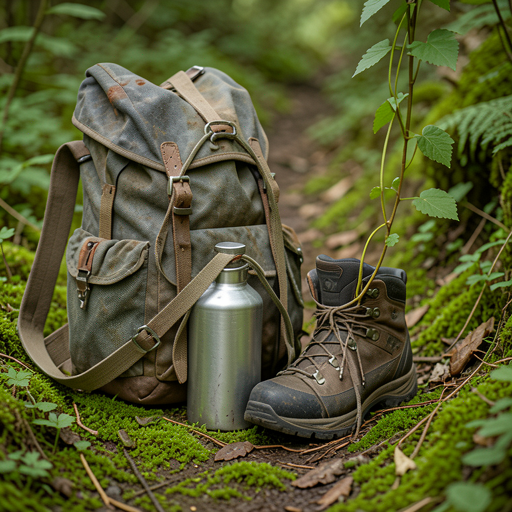

**swap_then_marble**　绕水壶　背包带　｜　绕藤蔓　鞋带

Add exactly one small, vivid violet glass marble to the lower-left foreground of the scene. Preserve the people, objects, colors, and their relationships.

[输入图](https://raw.githubusercontent.com/NonEuclideanSpace/Exp1/main/media/turns/C02A/seed-0/swap/final.png)　[完整输出图](https://raw.githubusercontent.com/NonEuclideanSpace/Exp1/main/media/turns/C02A/seed-0/swap_then_marble/final.png)

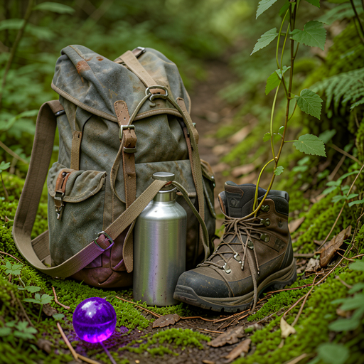

**undo**　绕水壶　背包带　｜　绕藤蔓　鞋带

Wrap the backpack strap around the canteen and wrap the boot lace around the vine. Preserve the background, camera angle and all other objects.

[输入图](https://raw.githubusercontent.com/NonEuclideanSpace/Exp1/main/media/turns/C02A/seed-0/swap_then_marble/final.png)　[完整输出图](https://raw.githubusercontent.com/NonEuclideanSpace/Exp1/main/media/turns/C02A/seed-0/undo/final.png)

**marble**　绕水壶　背包带　｜　绕藤蔓　鞋带

Add exactly one small, vivid violet glass marble to the lower-left foreground of the scene. Preserve the people, objects, colors, and their relationships.

[输入图](https://raw.githubusercontent.com/NonEuclideanSpace/Exp1/main/media/cross/C02A/seed-0/final.png)　[完整输出图](https://raw.githubusercontent.com/NonEuclideanSpace/Exp1/main/media/turns/C02A/seed-0/marble/final.png)

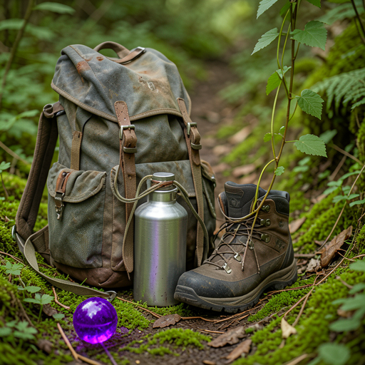

**marble_then_swap**　绕水壶　背包带　｜　绕藤蔓　鞋带

Wrap the backpack strap around the vine and wrap the boot lace around the canteen. Preserve the background, camera angle and all other objects.

[输入图](https://raw.githubusercontent.com/NonEuclideanSpace/Exp1/main/media/turns/C02A/seed-0/marble/final.png)　[完整输出图](https://raw.githubusercontent.com/NonEuclideanSpace/Exp1/main/media/turns/C02A/seed-0/marble_then_swap/final.png)

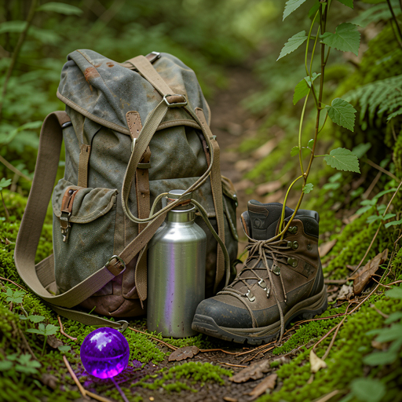

**combined**　绕水壶　背包带　｜　绕藤蔓　鞋带

Wrap the backpack strap around the vine and wrap the boot lace around the canteen. Add exactly one small, vivid violet glass marble to the lower-left foreground of the scene. Preserve the people, objects, colors, and their relationships.

[输入图](https://raw.githubusercontent.com/NonEuclideanSpace/Exp1/main/media/cross/C02A/seed-0/final.png)　[完整输出图](https://raw.githubusercontent.com/NonEuclideanSpace/Exp1/main/media/turns/C02A/seed-0/combined/final.png)

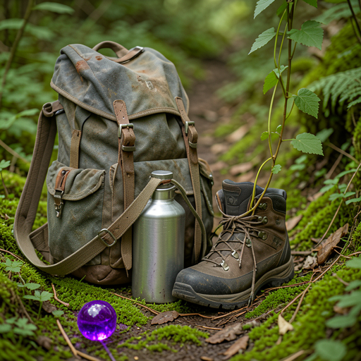

## 多轮编辑 · 简单 · 种子 1

**swap**　绕水壶　背包带　｜　绕藤蔓　鞋带

Wrap the backpack strap around the vine and wrap the boot lace around the canteen. Preserve the background, camera angle and all other objects.

[输入图](https://raw.githubusercontent.com/NonEuclideanSpace/Exp1/main/media/cross/C02A/seed-1/final.png)　[完整输出图](https://raw.githubusercontent.com/NonEuclideanSpace/Exp1/main/media/turns/C02A/seed-1/swap/final.png)

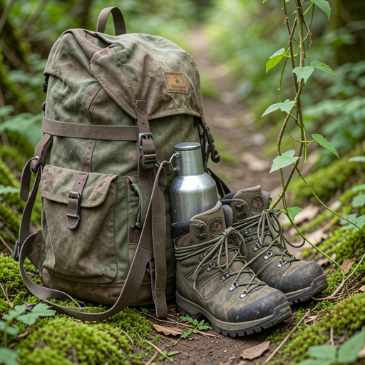

**swap_then_marble**　绕水壶　背包带　｜　绕藤蔓　鞋带

Add exactly one small, vivid violet glass marble to the lower-left foreground of the scene. Preserve the people, objects, colors, and their relationships.

[输入图](https://raw.githubusercontent.com/NonEuclideanSpace/Exp1/main/media/turns/C02A/seed-1/swap/final.png)　[完整输出图](https://raw.githubusercontent.com/NonEuclideanSpace/Exp1/main/media/turns/C02A/seed-1/swap_then_marble/final.png)

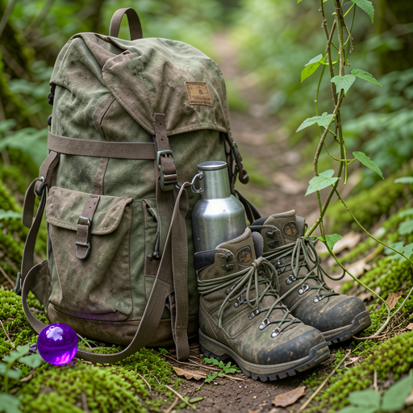

**undo**　绕水壶　背包带　｜　绕藤蔓　鞋带

Wrap the backpack strap around the canteen and wrap the boot lace around the vine. Preserve the background, camera angle and all other objects.

[输入图](https://raw.githubusercontent.com/NonEuclideanSpace/Exp1/main/media/turns/C02A/seed-1/swap_then_marble/final.png)　[完整输出图](https://raw.githubusercontent.com/NonEuclideanSpace/Exp1/main/media/turns/C02A/seed-1/undo/final.png)

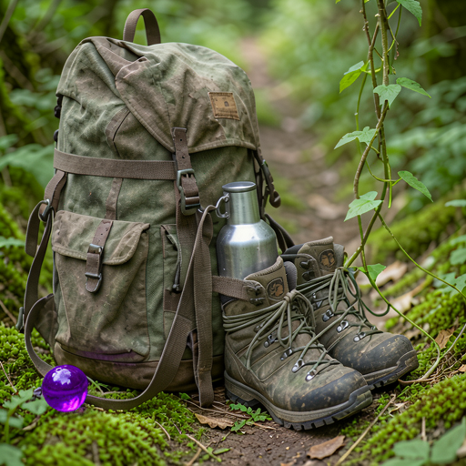

**marble**　绕水壶　背包带　｜　绕藤蔓　鞋带

Add exactly one small, vivid violet glass marble to the lower-left foreground of the scene. Preserve the people, objects, colors, and their relationships.

[输入图](https://raw.githubusercontent.com/NonEuclideanSpace/Exp1/main/media/cross/C02A/seed-1/final.png)　[完整输出图](https://raw.githubusercontent.com/NonEuclideanSpace/Exp1/main/media/turns/C02A/seed-1/marble/final.png)

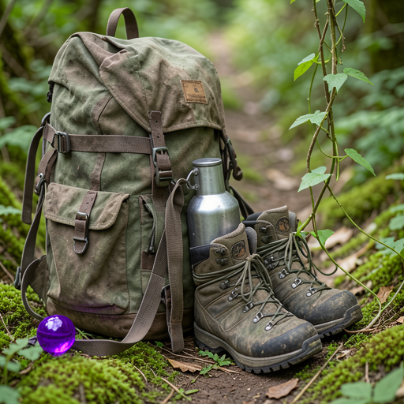

**marble_then_swap**　绕水壶　背包带　｜　绕藤蔓　鞋带

Wrap the backpack strap around the vine and wrap the boot lace around the canteen. Preserve the background, camera angle and all other objects.

[输入图](https://raw.githubusercontent.com/NonEuclideanSpace/Exp1/main/media/turns/C02A/seed-1/marble/final.png)　[完整输出图](https://raw.githubusercontent.com/NonEuclideanSpace/Exp1/main/media/turns/C02A/seed-1/marble_then_swap/final.png)

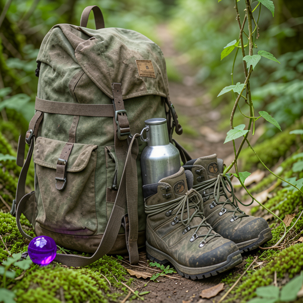

**combined**　绕水壶　背包带　｜　绕藤蔓　鞋带

Wrap the backpack strap around the vine and wrap the boot lace around the canteen. Add exactly one small, vivid violet glass marble to the lower-left foreground of the scene. Preserve the people, objects, colors, and their relationships.

[输入图](https://raw.githubusercontent.com/NonEuclideanSpace/Exp1/main/media/cross/C02A/seed-1/final.png)　[完整输出图](https://raw.githubusercontent.com/NonEuclideanSpace/Exp1/main/media/turns/C02A/seed-1/combined/final.png)

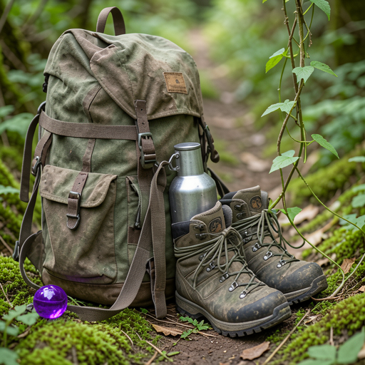

## 多轮编辑 · 简单 · 种子 2

**swap**　绕水壶　背包带　｜　绕藤蔓　鞋带

Wrap the backpack strap around the vine and wrap the boot lace around the canteen. Preserve the background, camera angle and all other objects.

[输入图](https://raw.githubusercontent.com/NonEuclideanSpace/Exp1/main/media/cross/C02A/seed-2/final.png)　[完整输出图](https://raw.githubusercontent.com/NonEuclideanSpace/Exp1/main/media/turns/C02A/seed-2/swap/final.png)

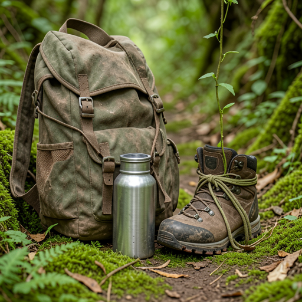

**swap_then_marble**　绕水壶　都没有　｜　绕藤蔓　两者

Add exactly one small, vivid violet glass marble to the lower-left foreground of the scene. Preserve the people, objects, colors, and their relationships.

[输入图](https://raw.githubusercontent.com/NonEuclideanSpace/Exp1/main/media/turns/C02A/seed-2/swap/final.png)　[完整输出图](https://raw.githubusercontent.com/NonEuclideanSpace/Exp1/main/media/turns/C02A/seed-2/swap_then_marble/final.png)

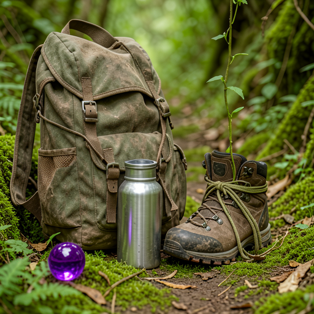

**undo**　绕水壶　都没有　｜　绕藤蔓　两者

Wrap the backpack strap around the canteen and wrap the boot lace around the vine. Preserve the background, camera angle and all other objects.

[输入图](https://raw.githubusercontent.com/NonEuclideanSpace/Exp1/main/media/turns/C02A/seed-2/swap_then_marble/final.png)　[完整输出图](https://raw.githubusercontent.com/NonEuclideanSpace/Exp1/main/media/turns/C02A/seed-2/undo/final.png)

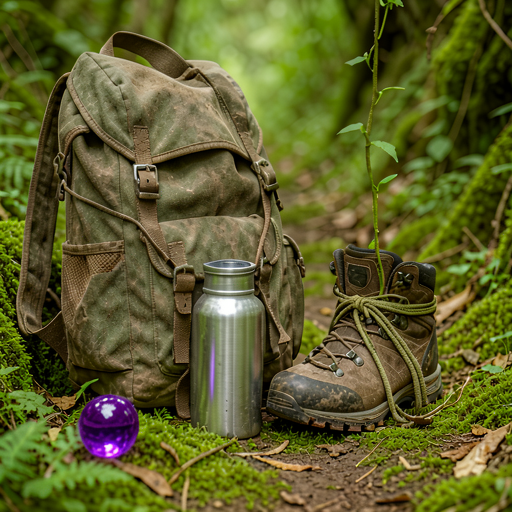

**marble**　绕水壶　都没有　｜　绕藤蔓　两者

Add exactly one small, vivid violet glass marble to the lower-left foreground of the scene. Preserve the people, objects, colors, and their relationships.

[输入图](https://raw.githubusercontent.com/NonEuclideanSpace/Exp1/main/media/cross/C02A/seed-2/final.png)　[完整输出图](https://raw.githubusercontent.com/NonEuclideanSpace/Exp1/main/media/turns/C02A/seed-2/marble/final.png)

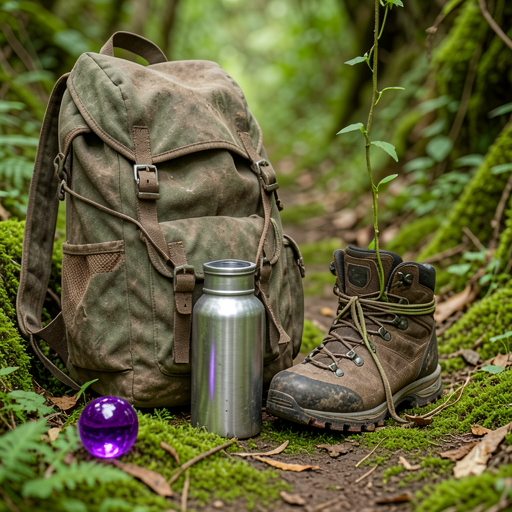

**marble_then_swap**　绕水壶　都没有　｜　绕藤蔓　两者

Wrap the backpack strap around the vine and wrap the boot lace around the canteen. Preserve the background, camera angle and all other objects.

[输入图](https://raw.githubusercontent.com/NonEuclideanSpace/Exp1/main/media/turns/C02A/seed-2/marble/final.png)　[完整输出图](https://raw.githubusercontent.com/NonEuclideanSpace/Exp1/main/media/turns/C02A/seed-2/marble_then_swap/final.png)

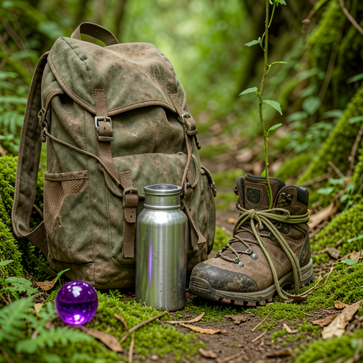

**combined**　绕水壶　都没有　｜　绕藤蔓　两者

Wrap the backpack strap around the vine and wrap the boot lace around the canteen. Add exactly one small, vivid violet glass marble to the lower-left foreground of the scene. Preserve the people, objects, colors, and their relationships.

[输入图](https://raw.githubusercontent.com/NonEuclideanSpace/Exp1/main/media/cross/C02A/seed-2/final.png)　[完整输出图](https://raw.githubusercontent.com/NonEuclideanSpace/Exp1/main/media/turns/C02A/seed-2/combined/final.png)

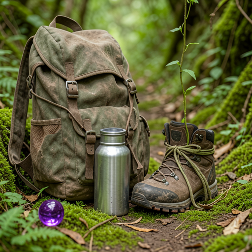

## 多轮编辑 · 复杂 · 种子 0

**swap**　绕水壶　背包带　｜　绕藤蔓　看不清

Wrap the backpack strap around the vine and wrap the boot lace around the canteen. Preserve the background, camera angle and all other objects.

[输入图](https://raw.githubusercontent.com/NonEuclideanSpace/Exp1/main/media/cross/C02L/seed-0/final.png)　[完整输出图](https://raw.githubusercontent.com/NonEuclideanSpace/Exp1/main/media/turns/C02L/seed-0/swap/final.png)

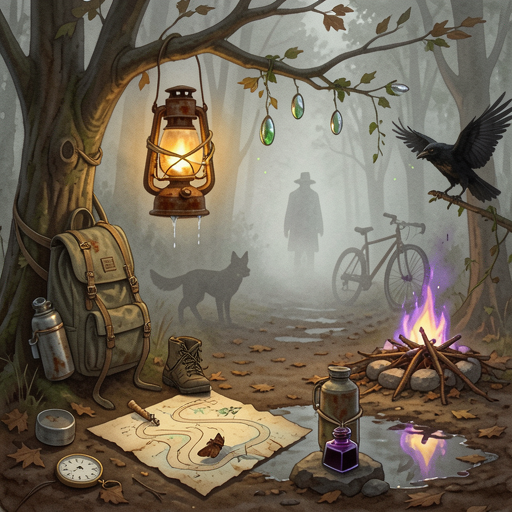

**swap_then_marble**　绕水壶　背包带　｜　绕藤蔓　看不清

Add exactly one small, vivid violet glass marble to the lower-left foreground of the scene. Preserve the people, objects, colors, and their relationships.

[输入图](https://raw.githubusercontent.com/NonEuclideanSpace/Exp1/main/media/turns/C02L/seed-0/swap/final.png)　[完整输出图](https://raw.githubusercontent.com/NonEuclideanSpace/Exp1/main/media/turns/C02L/seed-0/swap_then_marble/final.png)

**undo**　绕水壶　背包带　｜　绕藤蔓　看不清

Wrap the backpack strap around the canteen and wrap the boot lace around the vine. Preserve the background, camera angle and all other objects.

[输入图](https://raw.githubusercontent.com/NonEuclideanSpace/Exp1/main/media/turns/C02L/seed-0/swap_then_marble/final.png)　[完整输出图](https://raw.githubusercontent.com/NonEuclideanSpace/Exp1/main/media/turns/C02L/seed-0/undo/final.png)

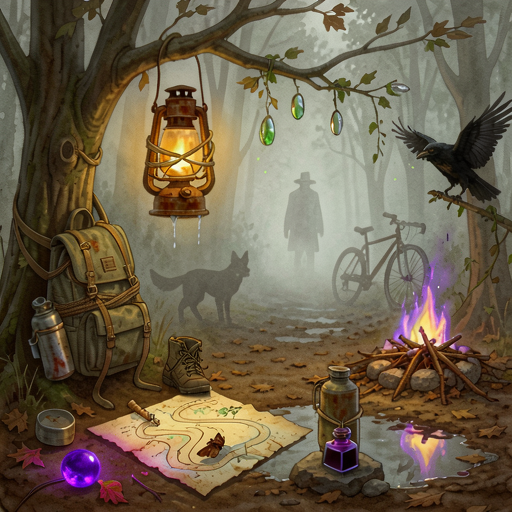

**marble**　绕水壶　背包带　｜　绕藤蔓　看不清

Add exactly one small, vivid violet glass marble to the lower-left foreground of the scene. Preserve the people, objects, colors, and their relationships.

[输入图](https://raw.githubusercontent.com/NonEuclideanSpace/Exp1/main/media/cross/C02L/seed-0/final.png)　[完整输出图](https://raw.githubusercontent.com/NonEuclideanSpace/Exp1/main/media/turns/C02L/seed-0/marble/final.png)

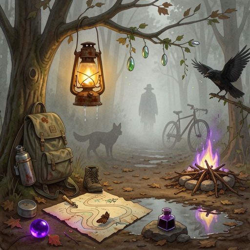

**marble_then_swap**　绕水壶　背包带　｜　绕藤蔓　看不清

Wrap the backpack strap around the vine and wrap the boot lace around the canteen. Preserve the background, camera angle and all other objects.

[输入图](https://raw.githubusercontent.com/NonEuclideanSpace/Exp1/main/media/turns/C02L/seed-0/marble/final.png)　[完整输出图](https://raw.githubusercontent.com/NonEuclideanSpace/Exp1/main/media/turns/C02L/seed-0/marble_then_swap/final.png)

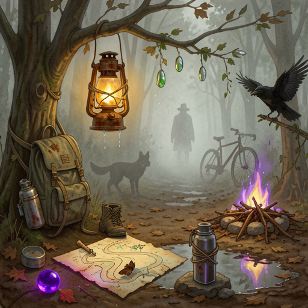

**combined**　绕水壶　背包带　｜　绕藤蔓　看不清

Wrap the backpack strap around the vine and wrap the boot lace around the canteen. Add exactly one small, vivid violet glass marble to the lower-left foreground of the scene. Preserve the people, objects, colors, and their relationships.

[输入图](https://raw.githubusercontent.com/NonEuclideanSpace/Exp1/main/media/cross/C02L/seed-0/final.png)　[完整输出图](https://raw.githubusercontent.com/NonEuclideanSpace/Exp1/main/media/turns/C02L/seed-0/combined/final.png)

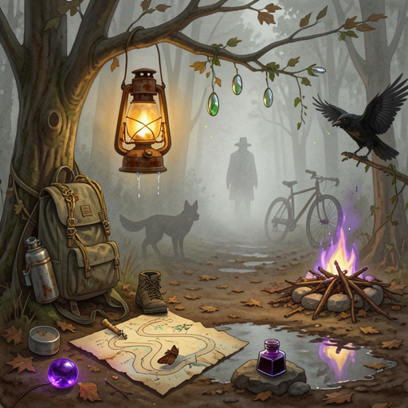

## 多轮编辑 · 复杂 · 种子 1

**swap**　绕水壶　背包带　｜　绕藤蔓　看不清

Wrap the backpack strap around the vine and wrap the boot lace around the canteen. Preserve the background, camera angle and all other objects.

[输入图](https://raw.githubusercontent.com/NonEuclideanSpace/Exp1/main/media/cross/C02L/seed-1/final.png)　[完整输出图](https://raw.githubusercontent.com/NonEuclideanSpace/Exp1/main/media/turns/C02L/seed-1/swap/final.png)

**swap_then_marble**　绕水壶　背包带　｜　绕藤蔓　两者

Add exactly one small, vivid violet glass marble to the lower-left foreground of the scene. Preserve the people, objects, colors, and their relationships.

[输入图](https://raw.githubusercontent.com/NonEuclideanSpace/Exp1/main/media/turns/C02L/seed-1/swap/final.png)　[完整输出图](https://raw.githubusercontent.com/NonEuclideanSpace/Exp1/main/media/turns/C02L/seed-1/swap_then_marble/final.png)

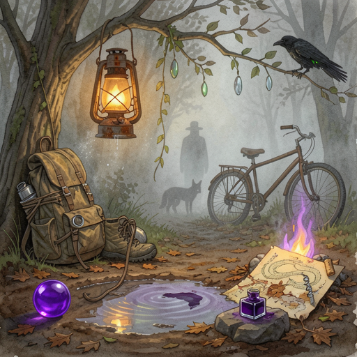

**undo**　绕水壶　背包带　｜　绕藤蔓　两者

Wrap the backpack strap around the canteen and wrap the boot lace around the vine. Preserve the background, camera angle and all other objects.

[输入图](https://raw.githubusercontent.com/NonEuclideanSpace/Exp1/main/media/turns/C02L/seed-1/swap_then_marble/final.png)　[完整输出图](https://raw.githubusercontent.com/NonEuclideanSpace/Exp1/main/media/turns/C02L/seed-1/undo/final.png)

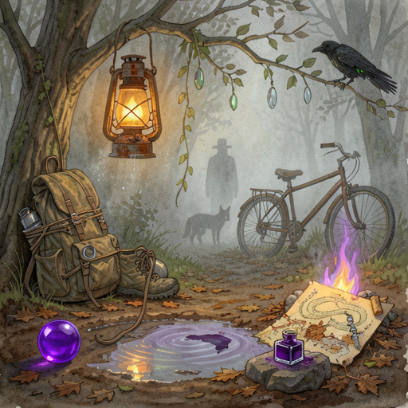

**marble**　绕水壶　背包带　｜　绕藤蔓　看不清

Add exactly one small, vivid violet glass marble to the lower-left foreground of the scene. Preserve the people, objects, colors, and their relationships.

[输入图](https://raw.githubusercontent.com/NonEuclideanSpace/Exp1/main/media/cross/C02L/seed-1/final.png)　[完整输出图](https://raw.githubusercontent.com/NonEuclideanSpace/Exp1/main/media/turns/C02L/seed-1/marble/final.png)

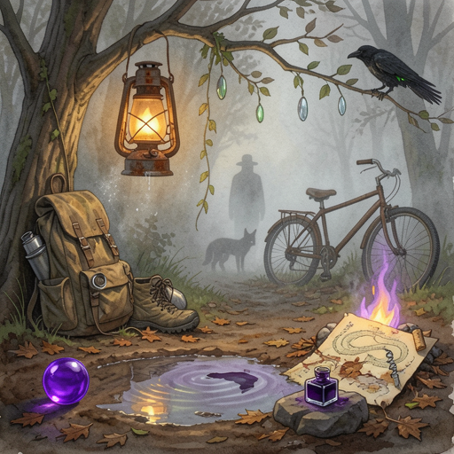

**marble_then_swap**　绕水壶　背包带　｜　绕藤蔓　看不清

Wrap the backpack strap around the vine and wrap the boot lace around the canteen. Preserve the background, camera angle and all other objects.

[输入图](https://raw.githubusercontent.com/NonEuclideanSpace/Exp1/main/media/turns/C02L/seed-1/marble/final.png)　[完整输出图](https://raw.githubusercontent.com/NonEuclideanSpace/Exp1/main/media/turns/C02L/seed-1/marble_then_swap/final.png)

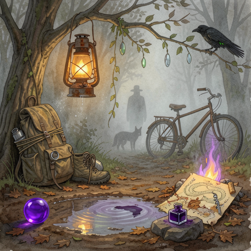

**combined**　绕水壶　背包带　｜　绕藤蔓　看不清

Wrap the backpack strap around the vine and wrap the boot lace around the canteen. Add exactly one small, vivid violet glass marble to the lower-left foreground of the scene. Preserve the people, objects, colors, and their relationships.

[输入图](https://raw.githubusercontent.com/NonEuclideanSpace/Exp1/main/media/cross/C02L/seed-1/final.png)　[完整输出图](https://raw.githubusercontent.com/NonEuclideanSpace/Exp1/main/media/turns/C02L/seed-1/combined/final.png)

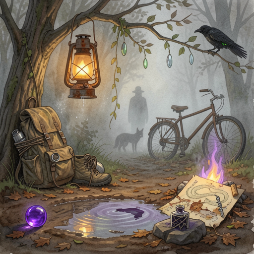

## 多轮编辑 · 复杂 · 种子 2

**swap**　绕水壶　背包带　｜　绕藤蔓　看不清

Wrap the backpack strap around the vine and wrap the boot lace around the canteen. Preserve the background, camera angle and all other objects.

[输入图](https://raw.githubusercontent.com/NonEuclideanSpace/Exp1/main/media/cross/C02L/seed-2/final.png)　[完整输出图](https://raw.githubusercontent.com/NonEuclideanSpace/Exp1/main/media/turns/C02L/seed-2/swap/final.png)

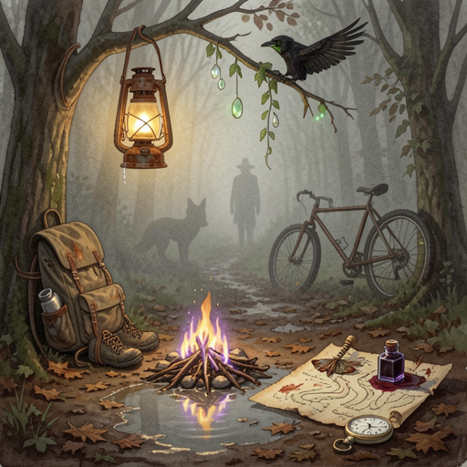

**swap_then_marble**　绕水壶　背包带　｜　绕藤蔓　看不清

Add exactly one small, vivid violet glass marble to the lower-left foreground of the scene. Preserve the people, objects, colors, and their relationships.

[输入图](https://raw.githubusercontent.com/NonEuclideanSpace/Exp1/main/media/turns/C02L/seed-2/swap/final.png)　[完整输出图](https://raw.githubusercontent.com/NonEuclideanSpace/Exp1/main/media/turns/C02L/seed-2/swap_then_marble/final.png)

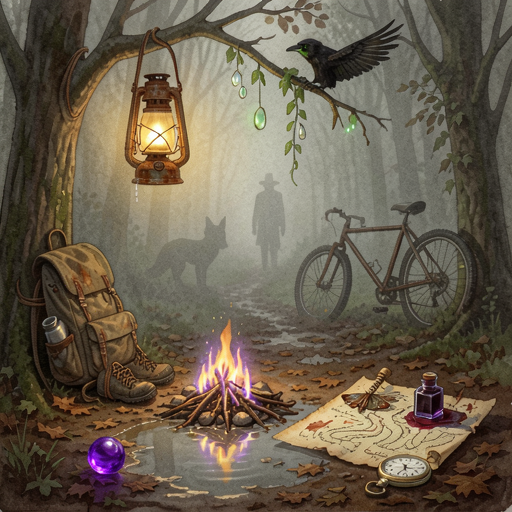

**undo**　绕水壶　背包带　｜　绕藤蔓　看不清

Wrap the backpack strap around the canteen and wrap the boot lace around the vine. Preserve the background, camera angle and all other objects.

[输入图](https://raw.githubusercontent.com/NonEuclideanSpace/Exp1/main/media/turns/C02L/seed-2/swap_then_marble/final.png)　[完整输出图](https://raw.githubusercontent.com/NonEuclideanSpace/Exp1/main/media/turns/C02L/seed-2/undo/final.png)

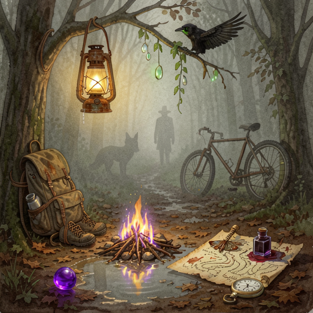

**marble**　绕水壶　背包带　｜　绕藤蔓　看不清

Add exactly one small, vivid violet glass marble to the lower-left foreground of the scene. Preserve the people, objects, colors, and their relationships.

[输入图](https://raw.githubusercontent.com/NonEuclideanSpace/Exp1/main/media/cross/C02L/seed-2/final.png)　[完整输出图](https://raw.githubusercontent.com/NonEuclideanSpace/Exp1/main/media/turns/C02L/seed-2/marble/final.png)

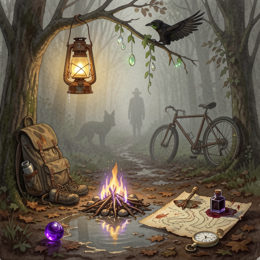

**marble_then_swap**　绕水壶　背包带　｜　绕藤蔓　看不清

Wrap the backpack strap around the vine and wrap the boot lace around the canteen. Preserve the background, camera angle and all other objects.

[输入图](https://raw.githubusercontent.com/NonEuclideanSpace/Exp1/main/media/turns/C02L/seed-2/marble/final.png)　[完整输出图](https://raw.githubusercontent.com/NonEuclideanSpace/Exp1/main/media/turns/C02L/seed-2/marble_then_swap/final.png)

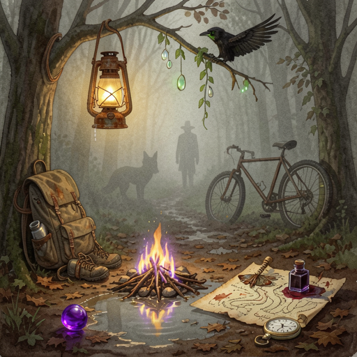

**combined**　绕水壶　背包带　｜　绕藤蔓　看不清

Wrap the backpack strap around the vine and wrap the boot lace around the canteen. Add exactly one small, vivid violet glass marble to the lower-left foreground of the scene. Preserve the people, objects, colors, and their relationships.

[输入图](https://raw.githubusercontent.com/NonEuclideanSpace/Exp1/main/media/cross/C02L/seed-2/final.png)　[完整输出图](https://raw.githubusercontent.com/NonEuclideanSpace/Exp1/main/media/turns/C02L/seed-2/combined/final.png)

