# 工具的哪一端接触

每行依次为种子 0、1、2、3、4。判读与图片分开放置。

## 简单

螺丝刀的金属尖端接触怀表，黄柄指向外。

完整英文提示词

On a watchmaker’s bench, a yellow-handled screwdriver lies horizontally beside a half-assembled pocket watch. The chrome tip just touches the watch movement. The yellow handle points away. Soft natural light, still-life photograph, clear view of the contact points.

0 | 1 | 2 | 3 | 4
--- | --- | --- | --- | ---
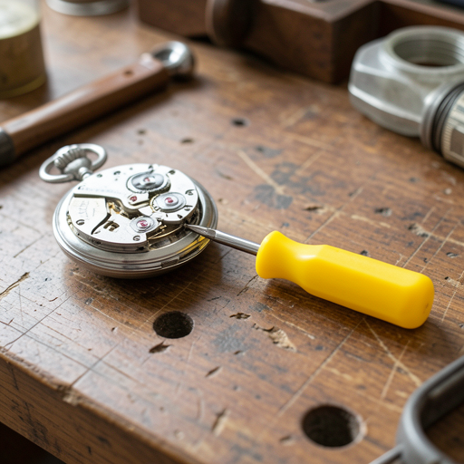 | 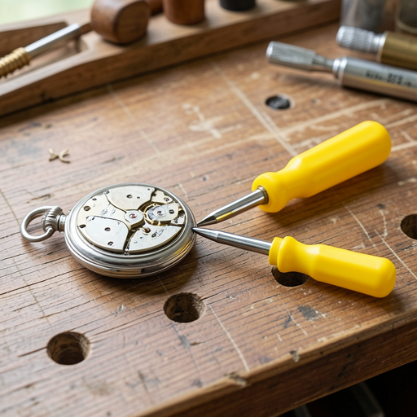 | 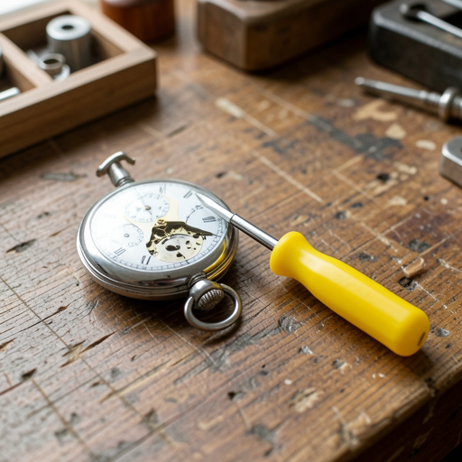 | 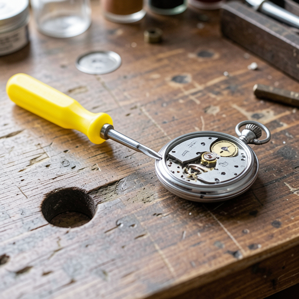 | 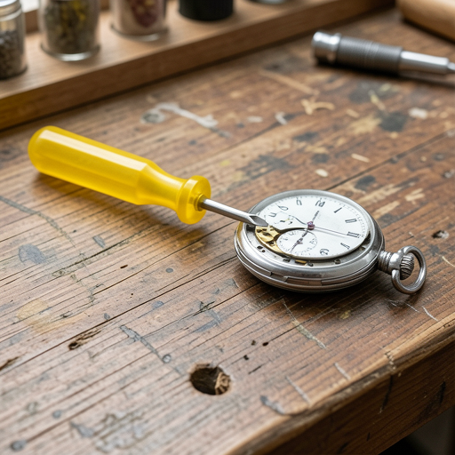
接触怀表　螺丝刀尖端　｜　指向外侧　螺丝刀黄柄 | 接触怀表　螺丝刀尖端　｜　指向外侧　螺丝刀黄柄 | 接触怀表　螺丝刀黄柄　｜　指向外侧　两者 | 接触怀表　螺丝刀尖端　｜　指向外侧　螺丝刀黄柄 | 接触怀表　螺丝刀尖端　｜　指向外侧　螺丝刀黄柄

## 交换角色

螺丝刀的黄柄底端接触怀表，金属尖端指向外。

完整英文提示词

On a watchmaker’s bench, a yellow-handled screwdriver lies horizontally beside a half-assembled pocket watch. The yellow handle just touches the watch movement. The chrome tip points away. Soft natural light, still-life photograph, clear view of the contact points.

0 | 1 | 2 | 3 | 4
--- | --- | --- | --- | ---
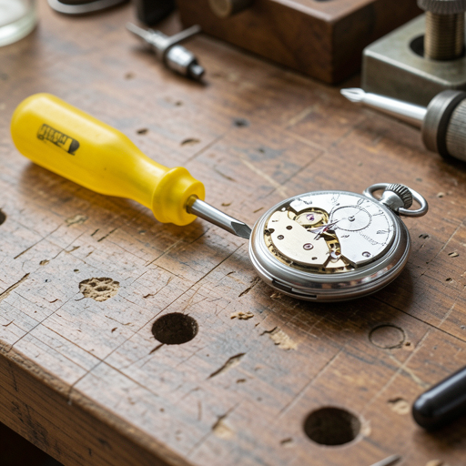 | 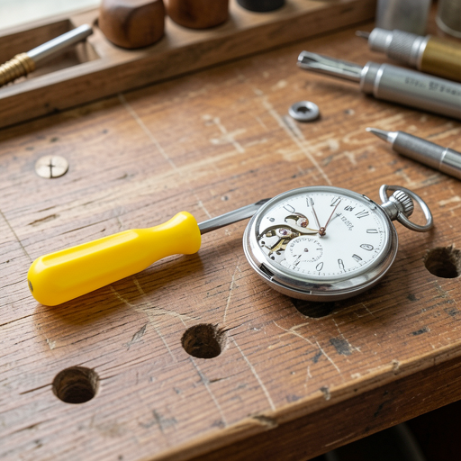 | 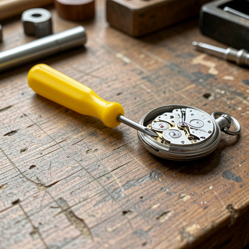 | 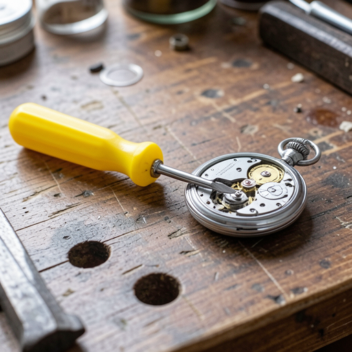 | 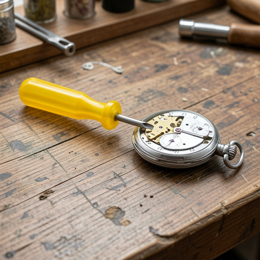
接触怀表　螺丝刀尖端　｜　指向外侧　螺丝刀黄柄 | 接触怀表　螺丝刀黄柄　｜　指向外侧　螺丝刀尖端 | 接触怀表　螺丝刀尖端　｜　指向外侧　螺丝刀黄柄 | 接触怀表　螺丝刀尖端　｜　指向外侧　螺丝刀黄柄 | 接触怀表　螺丝刀尖端　｜　指向外侧　螺丝刀黄柄

## LongBench 原始输入

螺丝刀的金属尖端接触怀表，黄柄指向外。

完整英文提示词

In the dim amber glow of a flickering desk lamp, the yellow screwdriver lies still, its polished chrome tip just grazing the delicate skeleton of a half-assembled pocket watch, as if it paused mid-repair to observe the surreal dance unfolding around it. A brass gear, no larger than a thimble, rolls perilously close to the edge of the workbench, caught in a momentary tug-of-war between a steaming coffee mug and a frayed, humming electrical cord coiled like a sleeping serpent. Above, the wrench hangs suspended from a nail, as if frozen mid-swing in an eternal loop of motion, the rusted tool caught in a perfect arc, defying gravity yet remaining fixed in time like a still from an unfinished film. Below the bench, the floor is a mosaic of scattered tools, spilled ink, and tangled wires, each object contributing to a sense of arrested momentum, as though the workshop itself were holding its breath. A small clock on the far wall ticks backwards, its numbers rearranging in real time—6 becoming 9, 3 becoming 8—while a tiny figure, barely the size of a thumbtack, walks along the rim of the coffee mug, its boots splashing through steam like a child wading through mist. Nearby, a compass spins wildly on a scrap of paper, its needle twitching not north, but toward a floating magnifying glass that hovers inches above the bench, casting upside-down shadows of the tools below. The magnifying glass, in turn, focuses a concentrated beam of light onto a patch of the workbench where a small, winding spiral staircase appears and disappears in pulses, its steps flickering in and out of existence as if stitched from light and memory. A mechanical bird perched on a nail above the bench tilts its head, its beak clicking in rhythm with the backwards clock, and it releases a single metallic feather that drifts down, momentarily altering the trajectory of the gear as it rolls toward the edge. A book with no title lies open on the bench, its pages turning by themselves to reveal sketches of tools that do not exist, yet seem to pulse with a quiet logic that binds the scene together. The bench itself appears to shift subtly under the weight of paradox—its grain warping slightly, its surface dimpling in response to the gravity of impossible events. Above the bird, a ceiling fan rotates slowly in the opposite direction of the world, its blades trailing motes of dust that spiral upward into a hidden trapdoor. From the door, faint light leaks out in rhythmic bursts, like the blinking of an eye, while a single gear from the bench occasionally vanishes and reappears inside it, suggesting a connection between the two realms. The entire workshop is a delicate balance of motion and stillness, contradiction and harmony, as if time, space, and logic have conspired to create a place where objects not only interact, but *remember* each other. And yet, the yellow screwdriver remains at the center of it all—silent, unassuming, and possibly the only key to unlocking the strange, layered truth that binds this impossible moment together.

0 | 1 | 2 | 3 | 4
--- | --- | --- | --- | ---
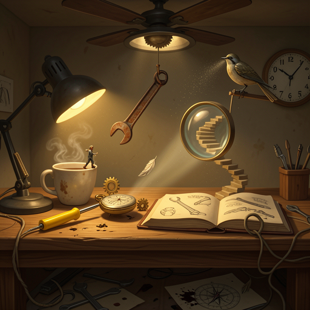 | 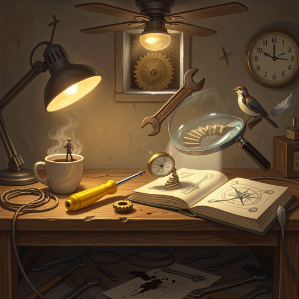 | 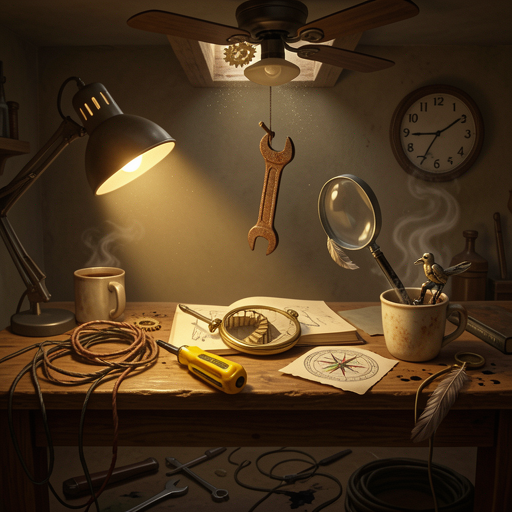 | 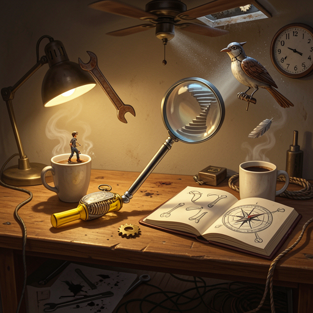 | 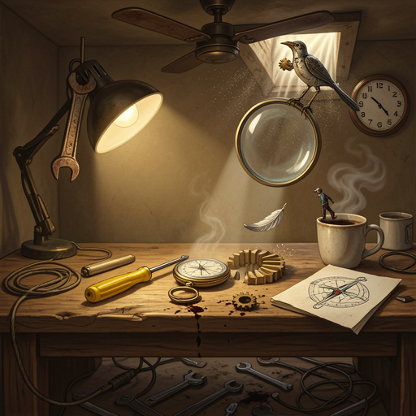
接触怀表　螺丝刀黄柄　｜　指向外侧　螺丝刀黄柄 | 接触怀表　螺丝刀黄柄　｜　指向外侧　螺丝刀黄柄 | 接触怀表　两者　｜　指向外侧　两者 | 接触怀表　螺丝刀黄柄　｜　指向外侧　都没有 | 接触怀表　螺丝刀黄柄　｜　指向外侧　螺丝刀黄柄
