# 乌鸦抓握

每行依次为种子 0、1、2、3、4。判读与图片分开放置。

## 简单

乌鸦双脚抓钢丝，喙叼钥匙。

完整英文提示词

A black raven and a rusty key hang beside a sagging wire. The raven grips the wire with its feet and holds the key in its beak. Show both points of contact. Soft natural light, still-life photograph, clear view of the contact points.

0 | 1 | 2 | 3 | 4
--- | --- | --- | --- | ---
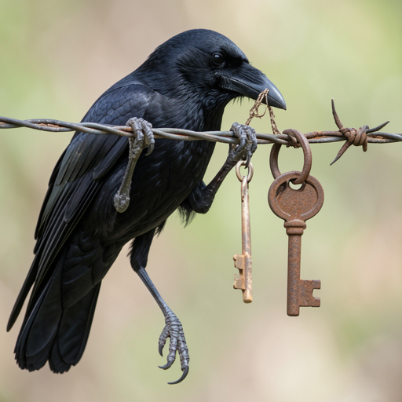 |  | 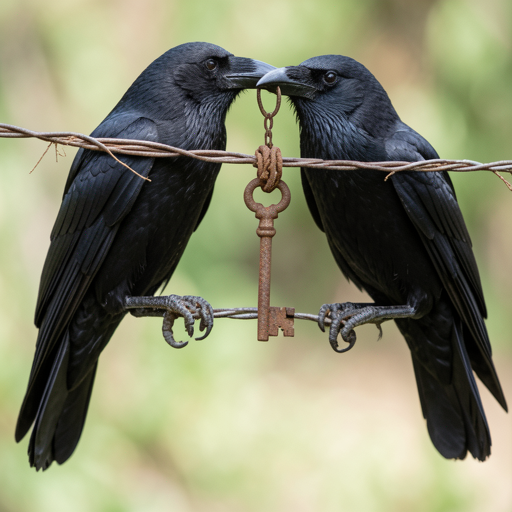 | 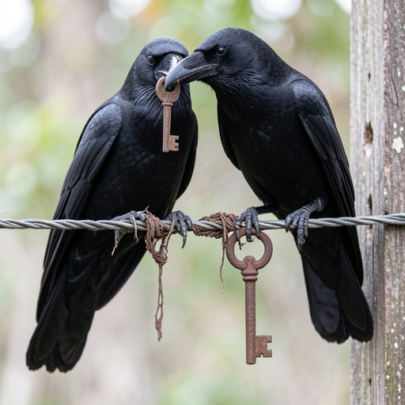 | 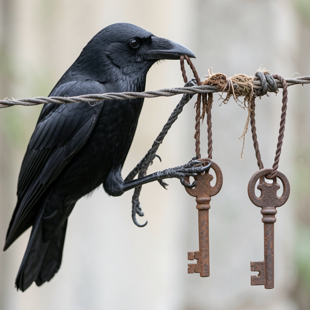
在乌鸦脚下或脚中　铁丝　｜　在乌鸦嘴里　钥匙 | 在乌鸦脚下或脚中　铁丝　｜　在乌鸦嘴里　钥匙 | 在乌鸦脚下或脚中　两者　｜　在乌鸦嘴里　两者 | 在乌鸦脚下或脚中　两者　｜　在乌鸦嘴里　两者 | 在乌鸦脚下或脚中　两者　｜　在乌鸦嘴里　两者

## 交换角色

乌鸦双脚抓钥匙，喙咬钢丝。

完整英文提示词

A black raven and a rusty key hang beside a sagging wire. The raven grips the key with its feet and holds the wire in its beak. Show both points of contact. Soft natural light, still-life photograph, clear view of the contact points.

0 | 1 | 2 | 3 | 4
--- | --- | --- | --- | ---
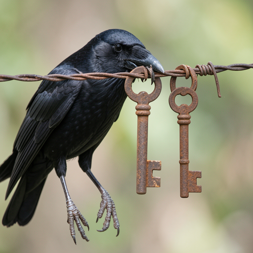 | 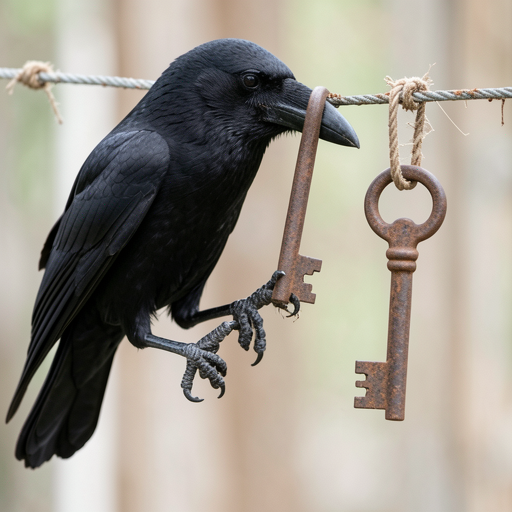 | 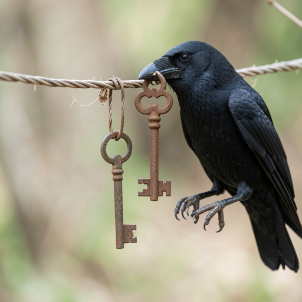 | 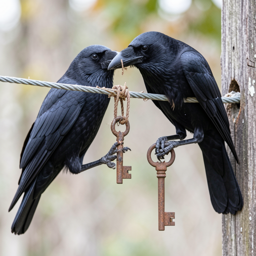 | 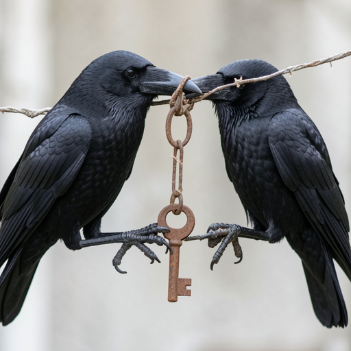
在乌鸦脚下或脚中　铁丝　｜　在乌鸦嘴里　钥匙 | 在乌鸦脚下或脚中　钥匙　｜　在乌鸦嘴里　铁丝 | 在乌鸦脚下或脚中　钥匙　｜　在乌鸦嘴里　铁丝 | 在乌鸦脚下或脚中　两者　｜　在乌鸦嘴里　两者 | 在乌鸦脚下或脚中　钥匙　｜　在乌鸦嘴里　钥匙

## LongBench 原始输入

乌鸦双脚抓钢丝，喙叼钥匙。

完整英文提示词

The sun hung low, bleeding a deep amber through the thinning mist, casting long shadows across the rust-colored meadow that stretched toward a jagged, unreal horizon where mountains folded into themselves like paper. A weathered leather belt, its brass buckle worn smooth by time, dangled from a splintered wooden fence post, its ribbon tattered and snagged on the wood’s toothed grain. A single muddy hiking boot, left behind like a forgotten anchor, leaned against the post, its laces fanning out into the grass like veins, each strand catching glints of light as the wind tugged at them. Between the laces, the tall grass swayed, and in its midst, a red poppy trembled—its petal edges catching dewdrops that shimmered like tiny mirrors, reflecting the sky in distorted fragments. The boot’s shadow, cast like a charcoal drawing, pooled over the grass and swallowed a folded map that lay half-buried in the earth. The map’s edges curled with damp, the ink smudged, but its surface still bore the ghost of a route that looped through impossible terrain—where rivers bent backward and roads led in two directions at once. Above the fence, a raven perched on a sagging wire, one eye closed as if dreaming, its beak gently clutching a rusted key that hung by a thread from a dead branch overhead. Below, a rusted chain looped through the fence’s railings, half-buried in the earth and snaking away into the meadow, its links interlocked with the roots of an ancient oak whose bark had grown into the metal, fusing them in a strange symbiosis. At the tree’s base, a stone lantern sat inverted, spilling not light but something darker—perhaps memory or shadow, curling upward in tendrils that caught on the raven’s wings. The lantern’s glass had shattered and regrown in crystalline lattices, now acting as a prism that refracted the setting sun into a spectrum that danced across the chain, turning each link a shifting jewel of fire and blue. Behind the fence, a winding path vanished into a curtain of willow branches that moved of their own accord, their leaves whispering in a language that might have once been wind but now sounded like a voice just out of reach. Along the path, the grass grew in spirals, twisting around buried artifacts—compasses spinning aimlessly, bottles half-buried with their stoppers missing, and old boots worn through but still laced with purpose. In one corner of the scene, a pocket watch lay open on a patch of thorny brambles, its hands frozen at 3:33, its gears caught in a perpetual state of turning and not turning. Beside it, a single glove, blackened and cracked, reached toward the watch as if to stop time or perhaps restart it, fingers half-sunken into the earth as if the soil had begun to reclaim the hand. Above it all, the sky was not merely painted but layered, each stratum revealing another world glimpsed through translucent veils—forests that floated like clouds, cities suspended upside down, and rivers that glowed with the memory of stars. The air hummed with an almost imperceptible vibration, a tension between stillness and motion, as if the world itself were holding its breath, waiting for the moment when the key would turn, the map would unroll, and the raven would fly—not forward, but into the past, where the fence might still be whole, the boot clean, and the poppy still in bud.

0 | 1 | 2 | 3 | 4
--- | --- | --- | --- | ---
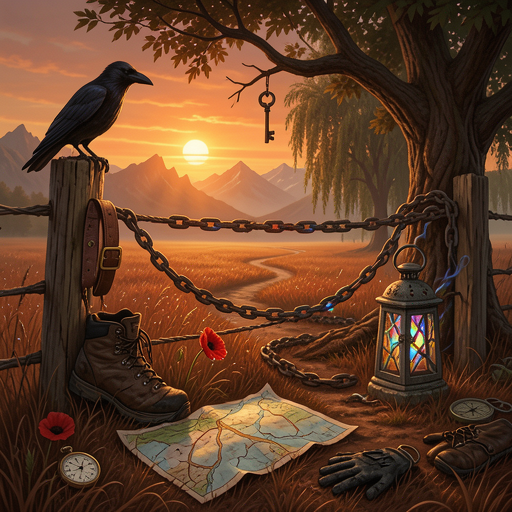 | 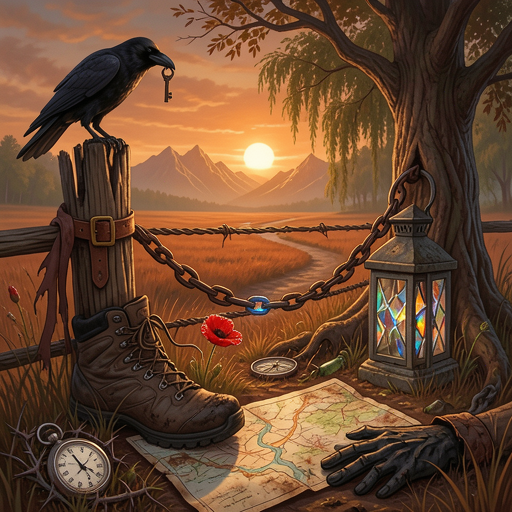 | 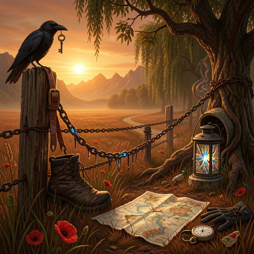 | 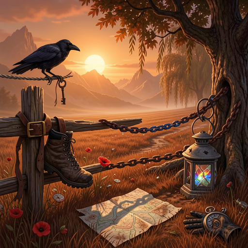 | 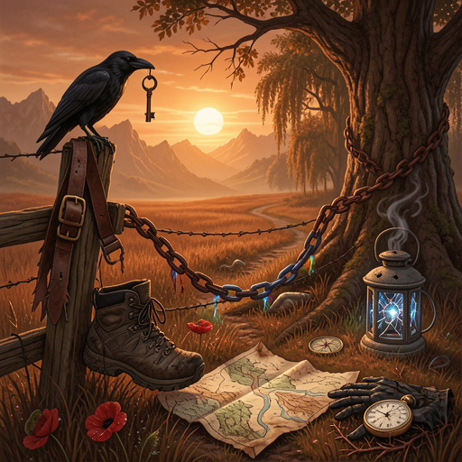
在乌鸦脚下或脚中　钥匙　｜　在乌鸦嘴里　都没有 | 在乌鸦脚下或脚中　两者　｜　在乌鸦嘴里　两者 | 在乌鸦脚下或脚中　钥匙　｜　在乌鸦嘴里　钥匙 | 在乌鸦脚下或脚中　钥匙　｜　在乌鸦嘴里　都没有 | 在乌鸦脚下或脚中　钥匙　｜　在乌鸦嘴里　两者

## 多轮编辑 · 简单 · 种子 0

**swap**　在乌鸦脚下或脚中　铁丝　｜　在乌鸦嘴里　钥匙

Place the rusty key in the grip of the raven’s feet and the wire in its beak. Preserve the background, camera angle and all other objects.

[输入图](https://raw.githubusercontent.com/NonEuclideanSpace/Exp1/main/media/cross/C07A/seed-0/final.png)　[完整输出图](https://raw.githubusercontent.com/NonEuclideanSpace/Exp1/main/media/turns/C07A/seed-0/swap/final.png)

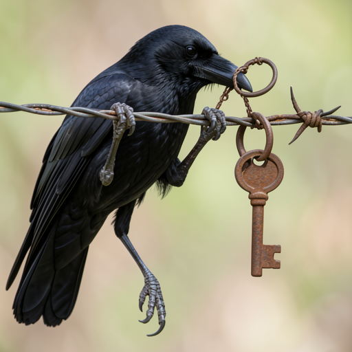

**swap_then_marble**　在乌鸦脚下或脚中　铁丝　｜　在乌鸦嘴里　钥匙

Add exactly one small, vivid violet glass marble to the lower-left foreground of the scene. Preserve the people, objects, colors, and their relationships.

[输入图](https://raw.githubusercontent.com/NonEuclideanSpace/Exp1/main/media/turns/C07A/seed-0/swap/final.png)　[完整输出图](https://raw.githubusercontent.com/NonEuclideanSpace/Exp1/main/media/turns/C07A/seed-0/swap_then_marble/final.png)

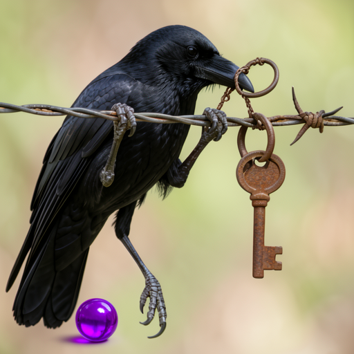

**undo**　在乌鸦脚下或脚中　铁丝　｜　在乌鸦嘴里　钥匙

Place the wire in the grip of the raven’s feet and the rusty key in its beak. Preserve the background, camera angle and all other objects.

[输入图](https://raw.githubusercontent.com/NonEuclideanSpace/Exp1/main/media/turns/C07A/seed-0/swap_then_marble/final.png)　[完整输出图](https://raw.githubusercontent.com/NonEuclideanSpace/Exp1/main/media/turns/C07A/seed-0/undo/final.png)

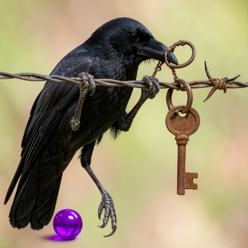

**marble**　在乌鸦脚下或脚中　铁丝　｜　在乌鸦嘴里　钥匙

Add exactly one small, vivid violet glass marble to the lower-left foreground of the scene. Preserve the people, objects, colors, and their relationships.

[输入图](https://raw.githubusercontent.com/NonEuclideanSpace/Exp1/main/media/cross/C07A/seed-0/final.png)　[完整输出图](https://raw.githubusercontent.com/NonEuclideanSpace/Exp1/main/media/turns/C07A/seed-0/marble/final.png)

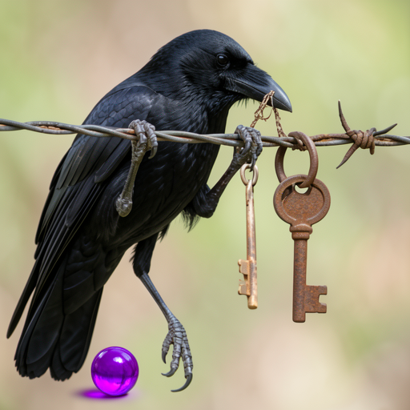

**marble_then_swap**　在乌鸦脚下或脚中　铁丝　｜　在乌鸦嘴里　钥匙

Place the rusty key in the grip of the raven’s feet and the wire in its beak. Preserve the background, camera angle and all other objects.

[输入图](https://raw.githubusercontent.com/NonEuclideanSpace/Exp1/main/media/turns/C07A/seed-0/marble/final.png)　[完整输出图](https://raw.githubusercontent.com/NonEuclideanSpace/Exp1/main/media/turns/C07A/seed-0/marble_then_swap/final.png)

**combined**　在乌鸦脚下或脚中　铁丝　｜　在乌鸦嘴里　钥匙

Place the rusty key in the grip of the raven’s feet and the wire in its beak. Add exactly one small, vivid violet glass marble to the lower-left foreground of the scene. Preserve the people, objects, colors, and their relationships.

[输入图](https://raw.githubusercontent.com/NonEuclideanSpace/Exp1/main/media/cross/C07A/seed-0/final.png)　[完整输出图](https://raw.githubusercontent.com/NonEuclideanSpace/Exp1/main/media/turns/C07A/seed-0/combined/final.png)

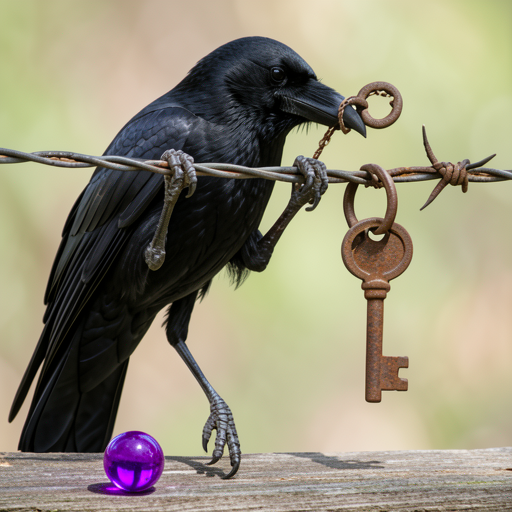

## 多轮编辑 · 简单 · 种子 1

**swap**　在乌鸦脚下或脚中　铁丝　｜　在乌鸦嘴里　钥匙

Place the rusty key in the grip of the raven’s feet and the wire in its beak. Preserve the background, camera angle and all other objects.

[输入图](https://raw.githubusercontent.com/NonEuclideanSpace/Exp1/main/media/cross/C07A/seed-1/final.png)　[完整输出图](https://raw.githubusercontent.com/NonEuclideanSpace/Exp1/main/media/turns/C07A/seed-1/swap/final.png)

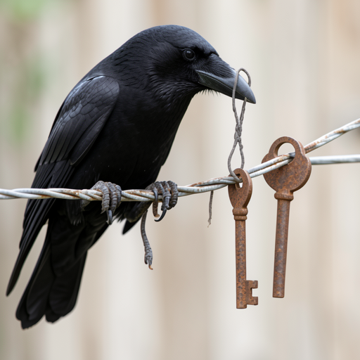

**swap_then_marble**　在乌鸦脚下或脚中　铁丝　｜　在乌鸦嘴里　钥匙

Add exactly one small, vivid violet glass marble to the lower-left foreground of the scene. Preserve the people, objects, colors, and their relationships.

[输入图](https://raw.githubusercontent.com/NonEuclideanSpace/Exp1/main/media/turns/C07A/seed-1/swap/final.png)　[完整输出图](https://raw.githubusercontent.com/NonEuclideanSpace/Exp1/main/media/turns/C07A/seed-1/swap_then_marble/final.png)

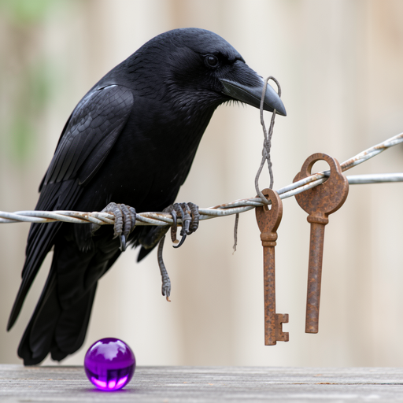

**undo**　在乌鸦脚下或脚中　铁丝　｜　在乌鸦嘴里　钥匙

Place the wire in the grip of the raven’s feet and the rusty key in its beak. Preserve the background, camera angle and all other objects.

[输入图](https://raw.githubusercontent.com/NonEuclideanSpace/Exp1/main/media/turns/C07A/seed-1/swap_then_marble/final.png)　[完整输出图](https://raw.githubusercontent.com/NonEuclideanSpace/Exp1/main/media/turns/C07A/seed-1/undo/final.png)

**marble**　在乌鸦脚下或脚中　铁丝　｜　在乌鸦嘴里　钥匙

Add exactly one small, vivid violet glass marble to the lower-left foreground of the scene. Preserve the people, objects, colors, and their relationships.

[输入图](https://raw.githubusercontent.com/NonEuclideanSpace/Exp1/main/media/cross/C07A/seed-1/final.png)　[完整输出图](https://raw.githubusercontent.com/NonEuclideanSpace/Exp1/main/media/turns/C07A/seed-1/marble/final.png)

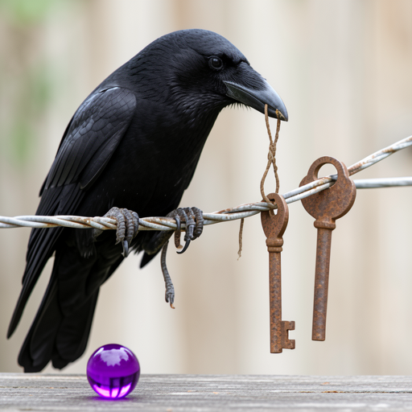

**marble_then_swap**　在乌鸦脚下或脚中　铁丝　｜　在乌鸦嘴里　钥匙

Place the rusty key in the grip of the raven’s feet and the wire in its beak. Preserve the background, camera angle and all other objects.

[输入图](https://raw.githubusercontent.com/NonEuclideanSpace/Exp1/main/media/turns/C07A/seed-1/marble/final.png)　[完整输出图](https://raw.githubusercontent.com/NonEuclideanSpace/Exp1/main/media/turns/C07A/seed-1/marble_then_swap/final.png)

**combined**　在乌鸦脚下或脚中　铁丝　｜　在乌鸦嘴里　钥匙

Place the rusty key in the grip of the raven’s feet and the wire in its beak. Add exactly one small, vivid violet glass marble to the lower-left foreground of the scene. Preserve the people, objects, colors, and their relationships.

[输入图](https://raw.githubusercontent.com/NonEuclideanSpace/Exp1/main/media/cross/C07A/seed-1/final.png)　[完整输出图](https://raw.githubusercontent.com/NonEuclideanSpace/Exp1/main/media/turns/C07A/seed-1/combined/final.png)

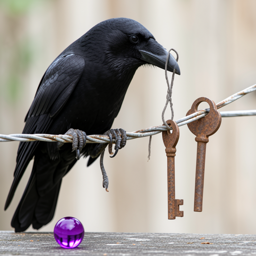

## 多轮编辑 · 简单 · 种子 2

**swap**　在乌鸦脚下或脚中　两者　｜　在乌鸦嘴里　两者

Place the rusty key in the grip of the raven’s feet and the wire in its beak. Preserve the background, camera angle and all other objects.

[输入图](https://raw.githubusercontent.com/NonEuclideanSpace/Exp1/main/media/cross/C07A/seed-2/final.png)　[完整输出图](https://raw.githubusercontent.com/NonEuclideanSpace/Exp1/main/media/turns/C07A/seed-2/swap/final.png)

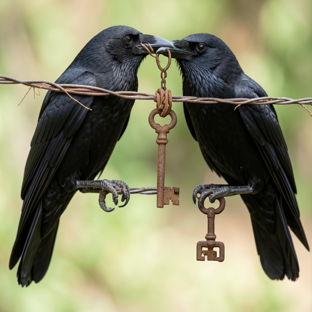

**swap_then_marble**　在乌鸦脚下或脚中　两者　｜　在乌鸦嘴里　两者

Add exactly one small, vivid violet glass marble to the lower-left foreground of the scene. Preserve the people, objects, colors, and their relationships.

[输入图](https://raw.githubusercontent.com/NonEuclideanSpace/Exp1/main/media/turns/C07A/seed-2/swap/final.png)　[完整输出图](https://raw.githubusercontent.com/NonEuclideanSpace/Exp1/main/media/turns/C07A/seed-2/swap_then_marble/final.png)

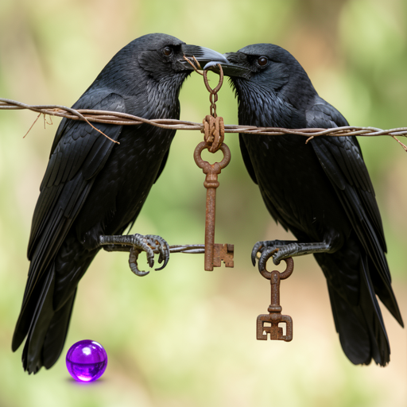

**undo**　在乌鸦脚下或脚中　钥匙　｜　在乌鸦嘴里　钥匙

Place the wire in the grip of the raven’s feet and the rusty key in its beak. Preserve the background, camera angle and all other objects.

[输入图](https://raw.githubusercontent.com/NonEuclideanSpace/Exp1/main/media/turns/C07A/seed-2/swap_then_marble/final.png)　[完整输出图](https://raw.githubusercontent.com/NonEuclideanSpace/Exp1/main/media/turns/C07A/seed-2/undo/final.png)

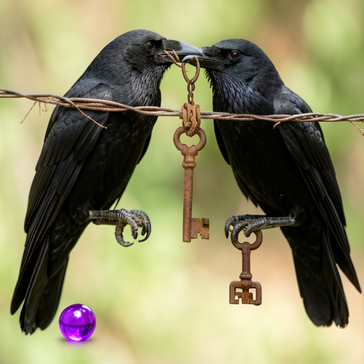

**marble**　在乌鸦脚下或脚中　两者　｜　在乌鸦嘴里　两者

Add exactly one small, vivid violet glass marble to the lower-left foreground of the scene. Preserve the people, objects, colors, and their relationships.

[输入图](https://raw.githubusercontent.com/NonEuclideanSpace/Exp1/main/media/cross/C07A/seed-2/final.png)　[完整输出图](https://raw.githubusercontent.com/NonEuclideanSpace/Exp1/main/media/turns/C07A/seed-2/marble/final.png)

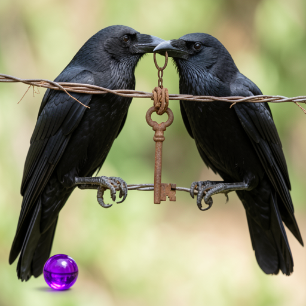

**marble_then_swap**　在乌鸦脚下或脚中　两者　｜　在乌鸦嘴里　两者

Place the rusty key in the grip of the raven’s feet and the wire in its beak. Preserve the background, camera angle and all other objects.

[输入图](https://raw.githubusercontent.com/NonEuclideanSpace/Exp1/main/media/turns/C07A/seed-2/marble/final.png)　[完整输出图](https://raw.githubusercontent.com/NonEuclideanSpace/Exp1/main/media/turns/C07A/seed-2/marble_then_swap/final.png)

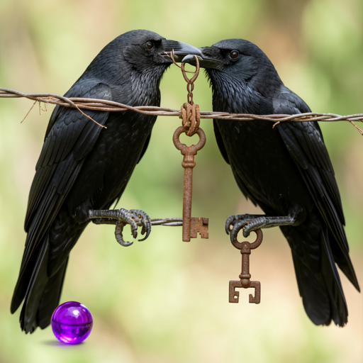

**combined**　在乌鸦脚下或脚中　钥匙　｜　在乌鸦嘴里　铁丝

Place the rusty key in the grip of the raven’s feet and the wire in its beak. Add exactly one small, vivid violet glass marble to the lower-left foreground of the scene. Preserve the people, objects, colors, and their relationships.

[输入图](https://raw.githubusercontent.com/NonEuclideanSpace/Exp1/main/media/cross/C07A/seed-2/final.png)　[完整输出图](https://raw.githubusercontent.com/NonEuclideanSpace/Exp1/main/media/turns/C07A/seed-2/combined/final.png)

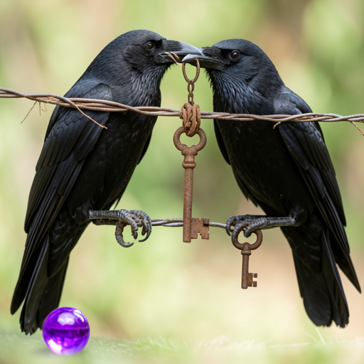

## 多轮编辑 · 复杂 · 种子 0

**swap**　在乌鸦脚下或脚中　钥匙　｜　在乌鸦嘴里　钥匙

Place the rusty key in the grip of the raven’s feet and the wire in its beak. Preserve the background, camera angle and all other objects.

[输入图](https://raw.githubusercontent.com/NonEuclideanSpace/Exp1/main/media/cross/C07L/seed-0/final.png)　[完整输出图](https://raw.githubusercontent.com/NonEuclideanSpace/Exp1/main/media/turns/C07L/seed-0/swap/final.png)

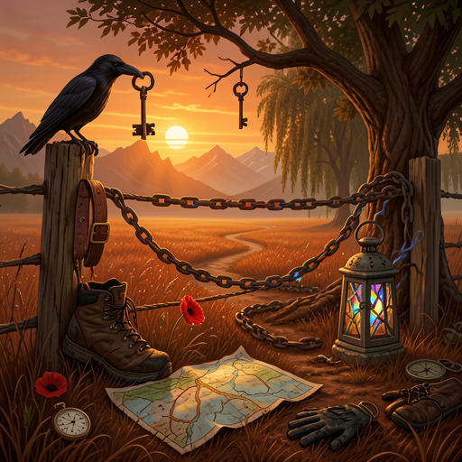

**swap_then_marble**　在乌鸦脚下或脚中　钥匙　｜　在乌鸦嘴里　钥匙

Add exactly one small, vivid violet glass marble to the lower-left foreground of the scene. Preserve the people, objects, colors, and their relationships.

[输入图](https://raw.githubusercontent.com/NonEuclideanSpace/Exp1/main/media/turns/C07L/seed-0/swap/final.png)　[完整输出图](https://raw.githubusercontent.com/NonEuclideanSpace/Exp1/main/media/turns/C07L/seed-0/swap_then_marble/final.png)

**undo**　在乌鸦脚下或脚中　钥匙　｜　在乌鸦嘴里　钥匙

Place the wire in the grip of the raven’s feet and the rusty key in its beak. Preserve the background, camera angle and all other objects.

[输入图](https://raw.githubusercontent.com/NonEuclideanSpace/Exp1/main/media/turns/C07L/seed-0/swap_then_marble/final.png)　[完整输出图](https://raw.githubusercontent.com/NonEuclideanSpace/Exp1/main/media/turns/C07L/seed-0/undo/final.png)

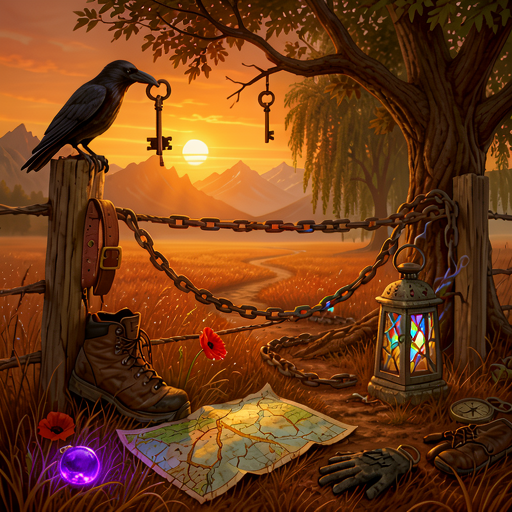

**marble**　在乌鸦脚下或脚中　都没有　｜　在乌鸦嘴里　两者

Add exactly one small, vivid violet glass marble to the lower-left foreground of the scene. Preserve the people, objects, colors, and their relationships.

[输入图](https://raw.githubusercontent.com/NonEuclideanSpace/Exp1/main/media/cross/C07L/seed-0/final.png)　[完整输出图](https://raw.githubusercontent.com/NonEuclideanSpace/Exp1/main/media/turns/C07L/seed-0/marble/final.png)

**marble_then_swap**　在乌鸦脚下或脚中　钥匙　｜　在乌鸦嘴里　钥匙

Place the rusty key in the grip of the raven’s feet and the wire in its beak. Preserve the background, camera angle and all other objects.

[输入图](https://raw.githubusercontent.com/NonEuclideanSpace/Exp1/main/media/turns/C07L/seed-0/marble/final.png)　[完整输出图](https://raw.githubusercontent.com/NonEuclideanSpace/Exp1/main/media/turns/C07L/seed-0/marble_then_swap/final.png)

**combined**　在乌鸦脚下或脚中　钥匙　｜　在乌鸦嘴里　钥匙

Place the rusty key in the grip of the raven’s feet and the wire in its beak. Add exactly one small, vivid violet glass marble to the lower-left foreground of the scene. Preserve the people, objects, colors, and their relationships.

[输入图](https://raw.githubusercontent.com/NonEuclideanSpace/Exp1/main/media/cross/C07L/seed-0/final.png)　[完整输出图](https://raw.githubusercontent.com/NonEuclideanSpace/Exp1/main/media/turns/C07L/seed-0/combined/final.png)

## 多轮编辑 · 复杂 · 种子 1

**swap**　在乌鸦脚下或脚中　两者　｜　在乌鸦嘴里　两者

Place the rusty key in the grip of the raven’s feet and the wire in its beak. Preserve the background, camera angle and all other objects.

[输入图](https://raw.githubusercontent.com/NonEuclideanSpace/Exp1/main/media/cross/C07L/seed-1/final.png)　[完整输出图](https://raw.githubusercontent.com/NonEuclideanSpace/Exp1/main/media/turns/C07L/seed-1/swap/final.png)

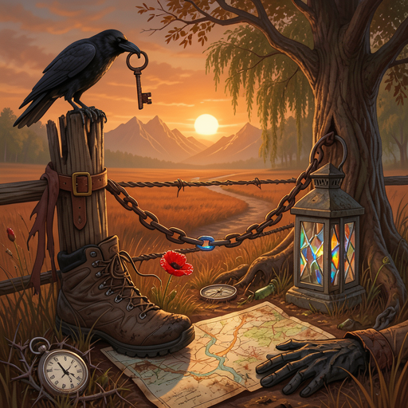

**swap_then_marble**　在乌鸦脚下或脚中　两者　｜　在乌鸦嘴里　两者

Add exactly one small, vivid violet glass marble to the lower-left foreground of the scene. Preserve the people, objects, colors, and their relationships.

[输入图](https://raw.githubusercontent.com/NonEuclideanSpace/Exp1/main/media/turns/C07L/seed-1/swap/final.png)　[完整输出图](https://raw.githubusercontent.com/NonEuclideanSpace/Exp1/main/media/turns/C07L/seed-1/swap_then_marble/final.png)

**undo**　在乌鸦脚下或脚中　两者　｜　在乌鸦嘴里　两者

Place the wire in the grip of the raven’s feet and the rusty key in its beak. Preserve the background, camera angle and all other objects.

[输入图](https://raw.githubusercontent.com/NonEuclideanSpace/Exp1/main/media/turns/C07L/seed-1/swap_then_marble/final.png)　[完整输出图](https://raw.githubusercontent.com/NonEuclideanSpace/Exp1/main/media/turns/C07L/seed-1/undo/final.png)

**marble**　在乌鸦脚下或脚中　两者　｜　在乌鸦嘴里　两者

Add exactly one small, vivid violet glass marble to the lower-left foreground of the scene. Preserve the people, objects, colors, and their relationships.

[输入图](https://raw.githubusercontent.com/NonEuclideanSpace/Exp1/main/media/cross/C07L/seed-1/final.png)　[完整输出图](https://raw.githubusercontent.com/NonEuclideanSpace/Exp1/main/media/turns/C07L/seed-1/marble/final.png)

**marble_then_swap**　在乌鸦脚下或脚中　两者　｜　在乌鸦嘴里　两者

Place the rusty key in the grip of the raven’s feet and the wire in its beak. Preserve the background, camera angle and all other objects.

[输入图](https://raw.githubusercontent.com/NonEuclideanSpace/Exp1/main/media/turns/C07L/seed-1/marble/final.png)　[完整输出图](https://raw.githubusercontent.com/NonEuclideanSpace/Exp1/main/media/turns/C07L/seed-1/marble_then_swap/final.png)

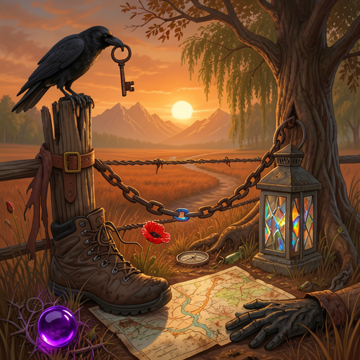

**combined**　在乌鸦脚下或脚中　两者　｜　在乌鸦嘴里　两者

Place the rusty key in the grip of the raven’s feet and the wire in its beak. Add exactly one small, vivid violet glass marble to the lower-left foreground of the scene. Preserve the people, objects, colors, and their relationships.

[输入图](https://raw.githubusercontent.com/NonEuclideanSpace/Exp1/main/media/cross/C07L/seed-1/final.png)　[完整输出图](https://raw.githubusercontent.com/NonEuclideanSpace/Exp1/main/media/turns/C07L/seed-1/combined/final.png)

## 多轮编辑 · 复杂 · 种子 2

**swap**　在乌鸦脚下或脚中　钥匙　｜　在乌鸦嘴里　两者

Place the rusty key in the grip of the raven’s feet and the wire in its beak. Preserve the background, camera angle and all other objects.

[输入图](https://raw.githubusercontent.com/NonEuclideanSpace/Exp1/main/media/cross/C07L/seed-2/final.png)　[完整输出图](https://raw.githubusercontent.com/NonEuclideanSpace/Exp1/main/media/turns/C07L/seed-2/swap/final.png)

**swap_then_marble**　在乌鸦脚下或脚中　钥匙　｜　在乌鸦嘴里　两者

Add exactly one small, vivid violet glass marble to the lower-left foreground of the scene. Preserve the people, objects, colors, and their relationships.

[输入图](https://raw.githubusercontent.com/NonEuclideanSpace/Exp1/main/media/turns/C07L/seed-2/swap/final.png)　[完整输出图](https://raw.githubusercontent.com/NonEuclideanSpace/Exp1/main/media/turns/C07L/seed-2/swap_then_marble/final.png)

**undo**　在乌鸦脚下或脚中　钥匙　｜　在乌鸦嘴里　两者

Place the wire in the grip of the raven’s feet and the rusty key in its beak. Preserve the background, camera angle and all other objects.

[输入图](https://raw.githubusercontent.com/NonEuclideanSpace/Exp1/main/media/turns/C07L/seed-2/swap_then_marble/final.png)　[完整输出图](https://raw.githubusercontent.com/NonEuclideanSpace/Exp1/main/media/turns/C07L/seed-2/undo/final.png)

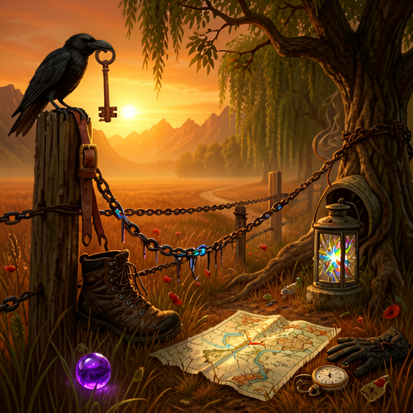

**marble**　在乌鸦脚下或脚中　钥匙　｜　在乌鸦嘴里　钥匙

Add exactly one small, vivid violet glass marble to the lower-left foreground of the scene. Preserve the people, objects, colors, and their relationships.

[输入图](https://raw.githubusercontent.com/NonEuclideanSpace/Exp1/main/media/cross/C07L/seed-2/final.png)　[完整输出图](https://raw.githubusercontent.com/NonEuclideanSpace/Exp1/main/media/turns/C07L/seed-2/marble/final.png)

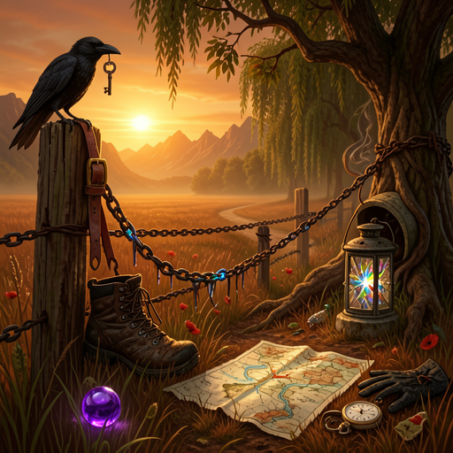

**marble_then_swap**　在乌鸦脚下或脚中　钥匙　｜　在乌鸦嘴里　两者

Place the rusty key in the grip of the raven’s feet and the wire in its beak. Preserve the background, camera angle and all other objects.

[输入图](https://raw.githubusercontent.com/NonEuclideanSpace/Exp1/main/media/turns/C07L/seed-2/marble/final.png)　[完整输出图](https://raw.githubusercontent.com/NonEuclideanSpace/Exp1/main/media/turns/C07L/seed-2/marble_then_swap/final.png)

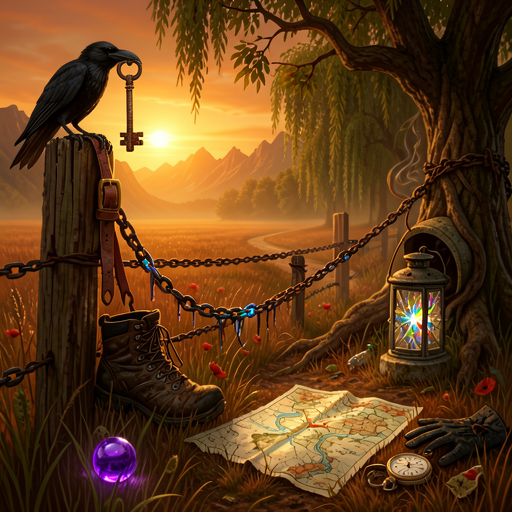

**combined**　在乌鸦脚下或脚中　钥匙　｜　在乌鸦嘴里　钥匙

Place the rusty key in the grip of the raven’s feet and the wire in its beak. Add exactly one small, vivid violet glass marble to the lower-left foreground of the scene. Preserve the people, objects, colors, and their relationships.

[输入图](https://raw.githubusercontent.com/NonEuclideanSpace/Exp1/main/media/cross/C07L/seed-2/final.png)　[完整输出图](https://raw.githubusercontent.com/NonEuclideanSpace/Exp1/main/media/turns/C07L/seed-2/combined/final.png)

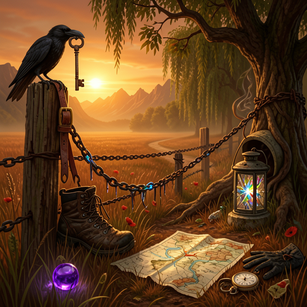
