# 人和倒影

每行依次为种子 0、1、2、3、4。判读与图片分开放置。

## 简单

孩子拿木棍，水洼倒影中的孩子拿红气球。

完整英文提示词

A child kneels beside a still puddle in a park. In the real scene the child holds a short stick. In the reflection the child holds a red balloon instead. Show the actual hand and the reflected hand. Soft natural light, still-life photograph, clear view of the contact points.

0 | 1 | 2 | 3 | 4
--- | --- | --- | --- | ---
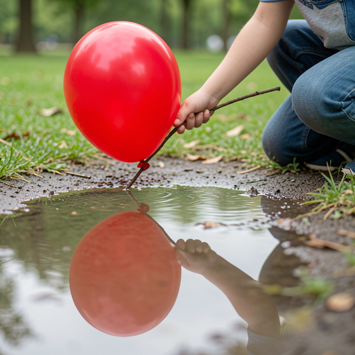 | 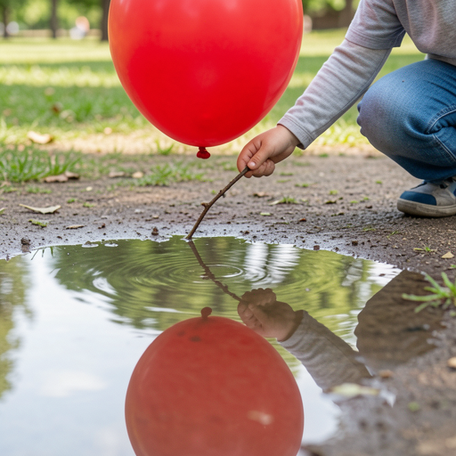 | 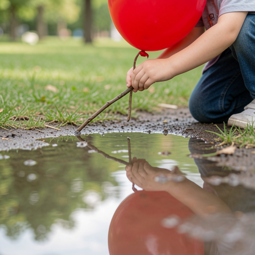 | 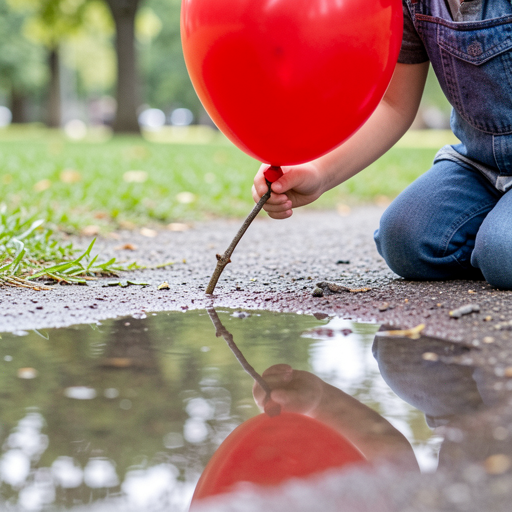 | 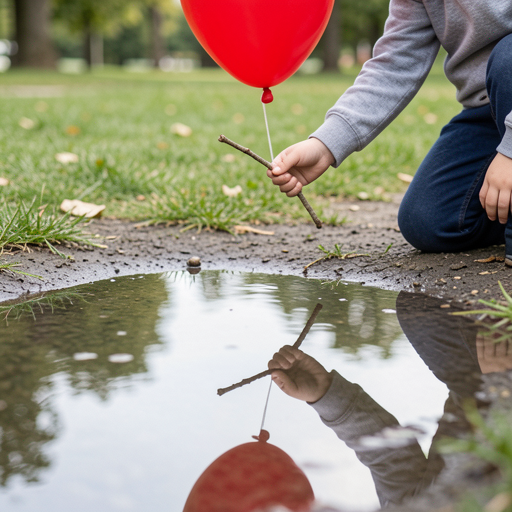
真人手中　两者　｜　倒影手中　两者 | 真人手中　两者　｜　倒影手中　两者 | 真人手中　两者　｜　倒影手中　两者 | 真人手中　两者　｜　倒影手中　两者 | 真人手中　两者　｜　倒影手中　两者

## 交换角色

孩子拿红气球，水洼倒影中的孩子拿木棍。

完整英文提示词

A child kneels beside a still puddle in a park. In the real scene the child holds a red balloon. In the reflection the child holds a short stick instead. Show the actual hand and the reflected hand. Soft natural light, still-life photograph, clear view of the contact points.

0 | 1 | 2 | 3 | 4
--- | --- | --- | --- | ---
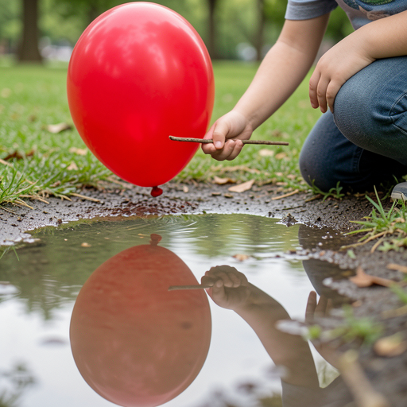 | 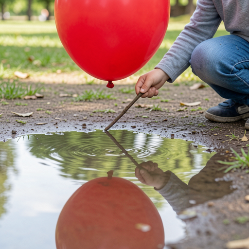 | 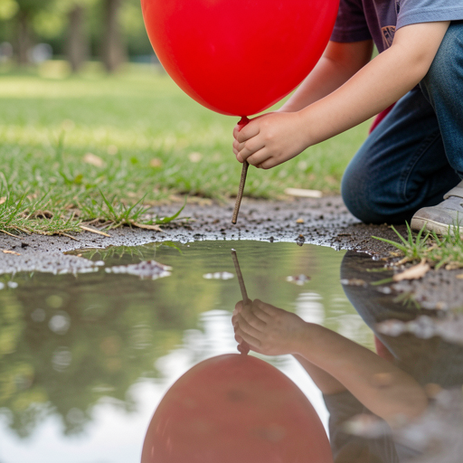 | 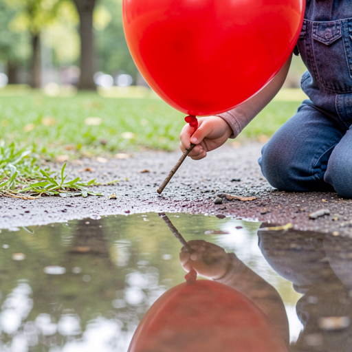 | 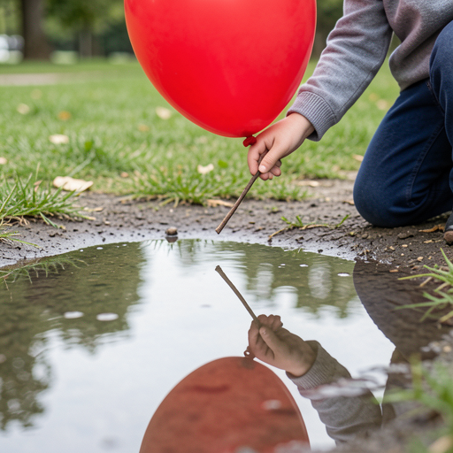
真人手中　两者　｜　倒影手中　两者 | 真人手中　两者　｜　倒影手中　两者 | 真人手中　红气球　｜　倒影手中　两者 | 真人手中　两者　｜　倒影手中　两者 | 真人手中　两者　｜　倒影手中　两者

## LongBench 原始输入

孩子拿木棍，水洼倒影中的孩子拿红气球。

完整英文提示词

In the golden haze of a midday sun that seems to hang impossibly still, the park is a tableau of delicate absurdity and subtle motion. A pigeon, one wing half-lifted as if in flight yet rooted to the spot, pecks rhythmically at a fast-food wrapper, its grease-stained edges fluttering as if stirred by a phantom breeze. The bench beneath it is carved with cryptic symbols that seem to shift when the sun glints off them, though no one but a passing cloud appears to notice. Beside the bench, a backpack slowly rolls forward on the grass—not pulled or pushed, but gliding in a slow arc toward a bicycle that leans at an impossible angle against a tree whose trunk twists like a Möbius strip. The bicycle wobbles, yet never falls, its wheels turning backward in a silent loop as if caught in a loop of time.

Nearby, a child, no older than five, kneels in the dirt, drawing a crooked smiley face with a stick that flickers between solidity and translucence, its shadow trailing slightly behind like a thought half-formed. The dirt itself feels malleable and slightly sentient, as if it’s cooperating in the sketch, shifting and coiling into new patterns each time the stick strikes the ground. Just beyond the child’s knee lies a puddle that should not exist in this heat, but it does, and in it reflects not just the hazy blue sky, but a second version of the scene—except here, the child is holding a red balloon instead of a stick, and the bicycle is upright and stationary. The two versions bleed at the edges, the water distorting one world into the next, the reflection growing clearer and more real with every second.

A gust of wind that never came brushes the edge of the child’s hood, lifting it just enough to reveal a face that is both familiar and unknown—perhaps a self the child might have been, or will be. The wrapper under the pigeon now shows a message in a shifting, unreadable language, the symbols rearranging with each peck until it becomes a new sentence in a language that feels almost comprehensible. The backpack rolls faster now, its zipper half-open, spilling a mix of sand, old film reels, and a clock that ticks in reverse, its hands spiraling backward in time. The sand falls in a spiral pattern around the grass, forming a ring that glows faintly, and within that ring, the grass stops growing—petrified in a loop of green stillness.

The tree’s roots have burrowed into the bench, and from its base, a series of doors appear—each slightly ajar, leading to spaces that are clearly not there. One reveals a bustling city skyline at night; another shows a desert drenched in perpetual rain. These doorways flicker, their contents changing as the observer shifts their gaze, as if the scene itself is aware of being watched. The stick the child uses leaves behind trails of light that connect the pigeon, the backpack, the bicycle, and the puddle, forming a constellation of causality in the dirt that pulses gently with a rhythm like a heartbeat.

The air is thick with a kind of dream-logic, where time loops and space folds, yet everything feels grounded in a reality just slightly askew. The pigeon occasionally lifts its head to glance at the backpack as it rolls closer, and in that glance, it seems to recognize something—itself perhaps, or a memory that isn’t its own. The child laughs softly, not at anything specific, but at the strange harmony of the scene, their voice catching on the wind that never blows. The sun still hovers overhead, unmoved and yet deeply engaged in this silent dance of paradox and wonder, and for a moment, the world feels both infinite and intimate, stitched together by invisible threads of meaning that no one understands, yet all feel.

0 | 1 | 2 | 3 | 4
--- | --- | --- | --- | ---
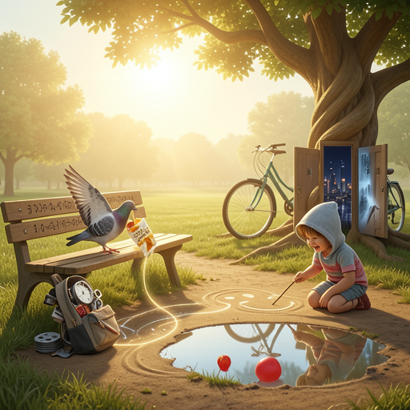 | 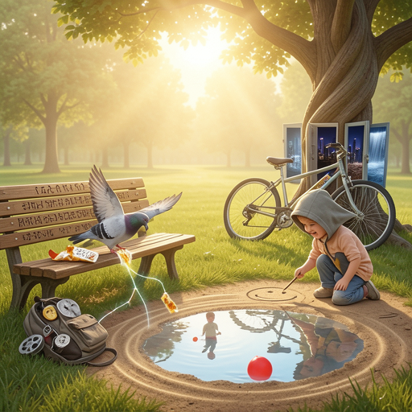 | 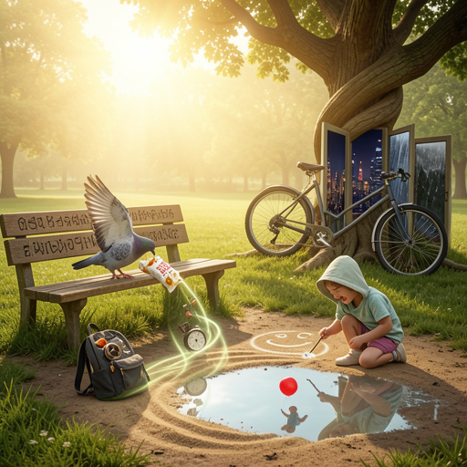 | 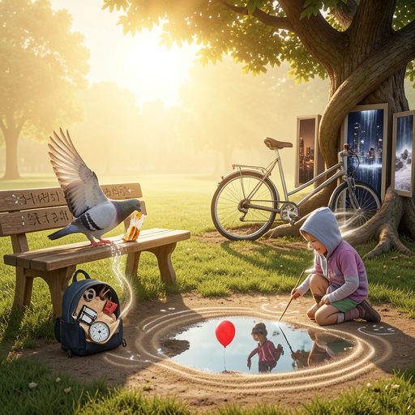 | 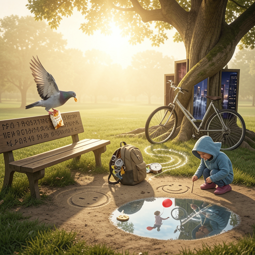
真人手中　木棍　｜　倒影手中　两者 | 真人手中　木棍　｜　倒影手中　两者 | 真人手中　木棍　｜　倒影手中　两者 | 真人手中　木棍　｜　倒影手中　两者 | 真人手中　两者　｜　倒影手中　两者
