# 鸟与狐狸

每行依次为种子 0、1、2、3、4。判读与图片分开放置。

## 简单

乌鸦在梯子最高一档，小狐狸藏在桶后。

完整英文提示词

A short wooden ladder and a bucket stand in a garden. A black raven sits on the highest rung. A small red fox peeks out from behind the bucket. Soft natural light, still-life photograph, clear view of the contact points.

0 | 1 | 2 | 3 | 4
--- | --- | --- | --- | ---
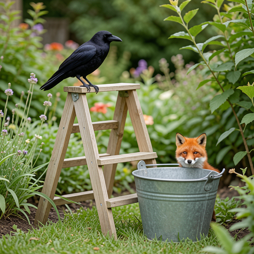 | 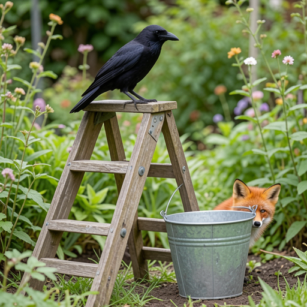 | 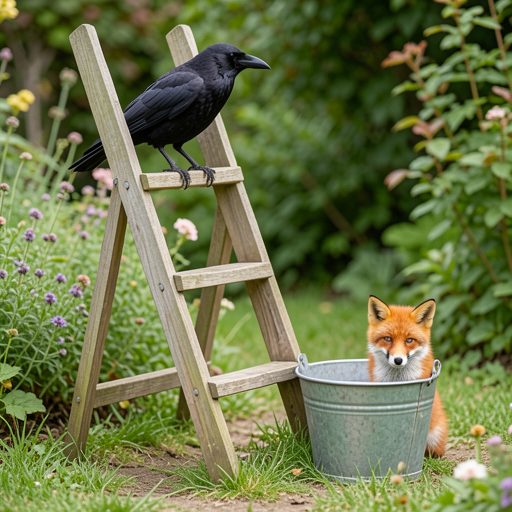 | 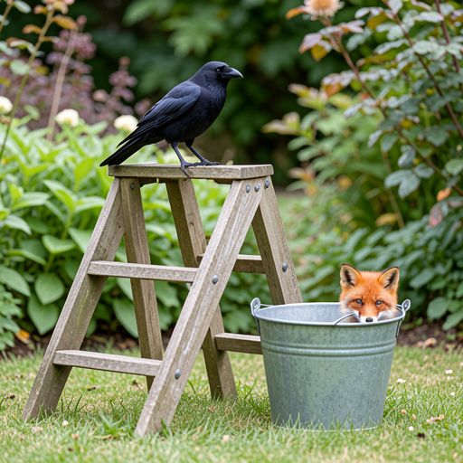 | 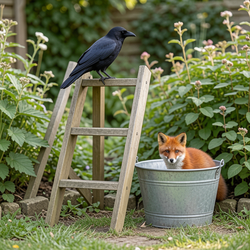
最高梯级　乌鸦　｜　桶后方　红狐 | 最高梯级　乌鸦　｜　桶后方　红狐 | 最高梯级　乌鸦　｜　桶后方　红狐 | 最高梯级　乌鸦　｜　桶后方　红狐 | 最高梯级　乌鸦　｜　桶后方　红狐

## 交换角色

小狐狸在梯子最高一档，乌鸦藏在桶后。

完整英文提示词

A short wooden ladder and a bucket stand in a garden. A small red fox sits on the highest rung. A black raven peeks out from behind the bucket. Soft natural light, still-life photograph, clear view of the contact points.

0 | 1 | 2 | 3 | 4
--- | --- | --- | --- | ---
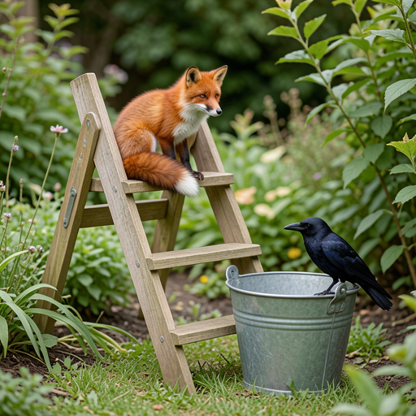 | 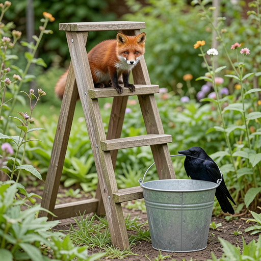 | 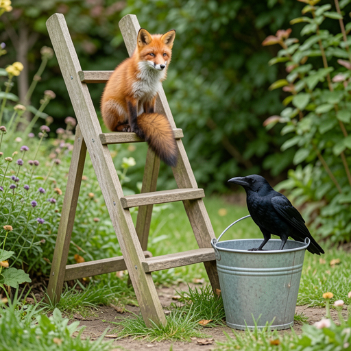 | 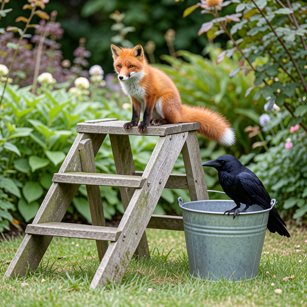 | 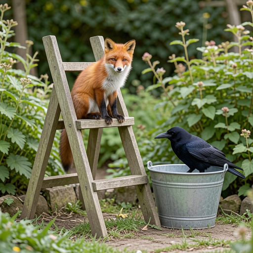
最高梯级　红狐　｜　桶后方　都没有 | 最高梯级　红狐　｜　桶后方　都没有 | 最高梯级　红狐　｜　桶后方　都没有 | 最高梯级　红狐　｜　桶后方　都没有 | 最高梯级　红狐　｜　桶后方　都没有

## LongBench 原始输入

乌鸦在梯子最高一档，小狐狸藏在桶后。

完整英文提示词

The wooden ladder, slick with dew and leaning at an uneasy angle against the weathered stone wall, is a tangled ecosystem in its own right—each rung a small shelf of potted herbs, their green tendrils spilling down like time-stained cascades of basil, rosemary, and thyme, which have begun to fuse with the bark of the wood. The sunlight, cutting through the canopy of leaves, casts shifting, long shadows that ripple across the ground like the tail of a sleeping dragon, stretching toward a rusted bicycle propped haphazardly against a splintered fence, its tires deflated, spokes entangled with the barbed wire. At the base of the ladder, a yellow rainboot, its rubber worn and split, cradles a pair of heavy garden shears, their blades catching glints of light as if anticipating the next snip, while a small bucket beside it teeters on the edge of tipping, its half-filled muddy water churning with dead dragonflies and drowned fireflies. A breeze, faint and deliberate, stirs the herbs, sending a mist of crushed leaves and spores into the air, which then settle on the rusted spokes of the bicycle, coating them in a glistening green sheen that reacts with the metal to produce a soft, almost audible hum. A single raven, perched on the highest rung, stares down at the scene, its beady eyes reflecting the chaotic harmony below, while a small fox, partially hidden behind the bucket, peeks out with cautious curiosity, sniffing the air for the scent of crushed thyme or perhaps the metallic tang of impending change. The wall itself, though solid, seems to breathe with the wind, its cracks filled with ivy that has begun to spiral outward, intertwining with the roots of the herbs and reaching for the fence like grasping fingers. A faint mist rises from the damp ground, curling around the base of the ladder and the fox’s tail, as if trying to cloak the entire scene in an ephemeral dream. In the background, a small child’s wooden hoop lies abandoned in the grass, its once-painted surface now weathered and ghostly, while a discarded teacup, half-buried in the soil, holds a dying sunflower that leans into the direction of the bicycle, as if trying to follow its path. A moth flutters through the haze, drawn to the flickering hum of the green-coated spokes, its wings catching the light and casting fractal patterns onto the wall. A second, smaller bucket, hanging precariously from the side of the ladder, slowly drips water onto the base of the rainboot, feeding a curious cluster of moss that grows upward, inch by inch, as if the earth itself is reclaiming the space. The entire scene pulses with a quiet surrealism—each object connected by subtle threads of transformation and intention, the world bending but not breaking, held together by the weight of time and the tension of the next breeze.

0 | 1 | 2 | 3 | 4
--- | --- | --- | --- | ---
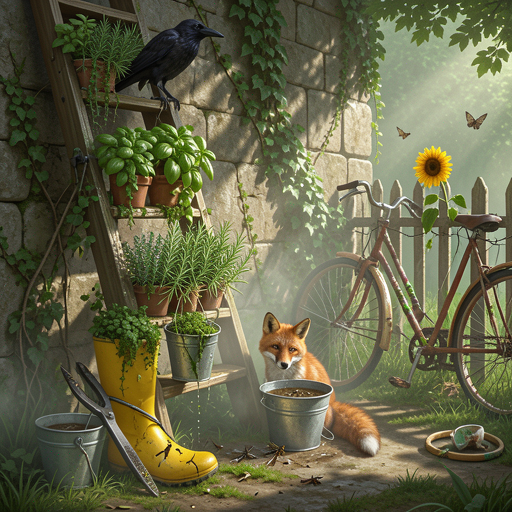 | 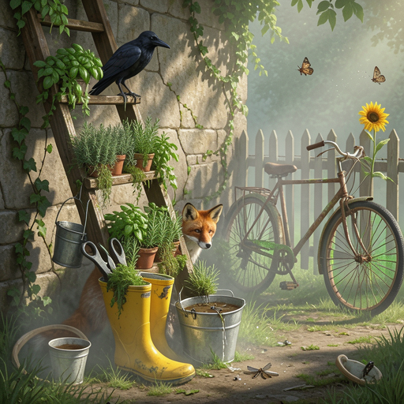 | 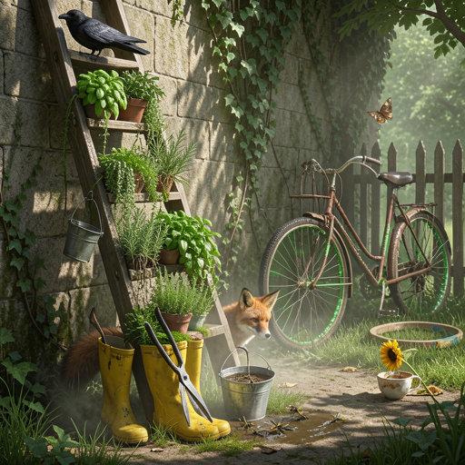 | 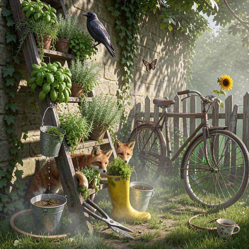 | 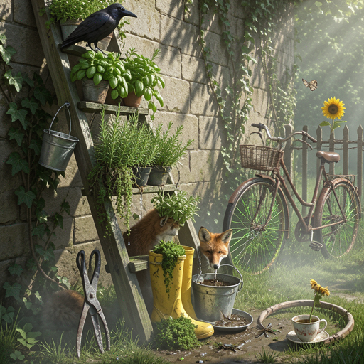
最高梯级　乌鸦　｜　桶后方　两者 | 最高梯级　乌鸦　｜　桶后方　红狐 | 最高梯级　乌鸦　｜　桶后方　看不清 | 最高梯级　乌鸦　｜　桶后方　两者 | 最高梯级　乌鸦　｜　桶后方　红狐
