# 衣服与线轴

每行依次为种子 0、1、2、3、4。判读与图片分开放置。

## 简单

墙上照片里，女子穿蓝裙，拿红色线轴。

完整英文提示词

A framed photograph on a wall shows a woman in a blue dress holding a red thread spool in one hand. Both the fabric of the dress and the thread on the spool are clearly visible. Soft natural light, still-life photograph, clear view of the contact points.

0 | 1 | 2 | 3 | 4
--- | --- | --- | --- | ---
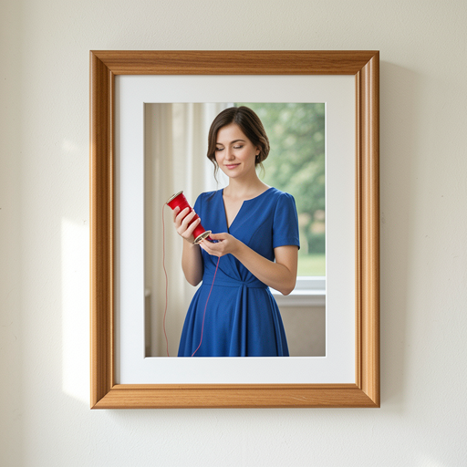 | 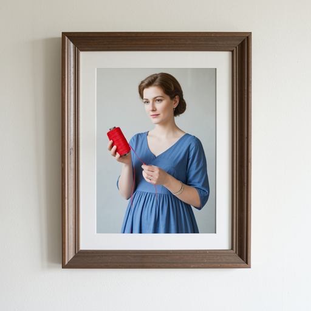 |  | 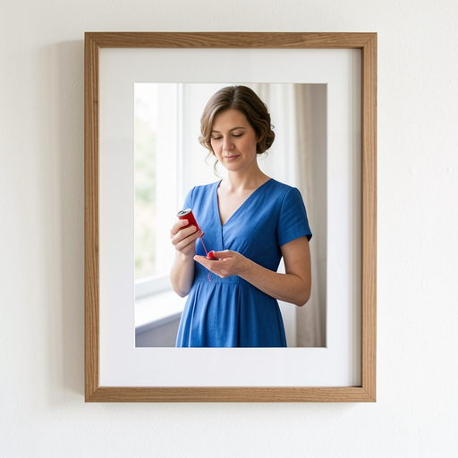 | 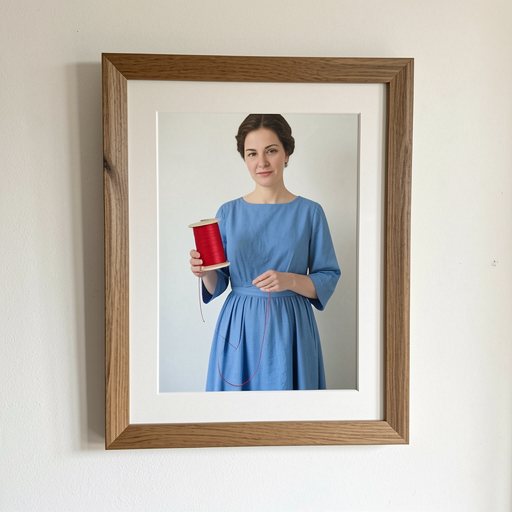
照片内裙子　蓝色　｜　照片内线轴　红色 | 照片内裙子　蓝色　｜　照片内线轴　红色 | 照片内裙子　蓝色　｜　照片内线轴　红色 | 照片内裙子　蓝色　｜　照片内线轴　红色 | 照片内裙子　蓝色　｜　照片内线轴　红色

## 交换角色

墙上照片里，女子穿红裙，拿蓝色线轴。

完整英文提示词

A framed photograph on a wall shows a woman in a red dress holding a blue thread spool in one hand. Both the fabric of the dress and the thread on the spool are clearly visible. Soft natural light, still-life photograph, clear view of the contact points.

0 | 1 | 2 | 3 | 4
--- | --- | --- | --- | ---
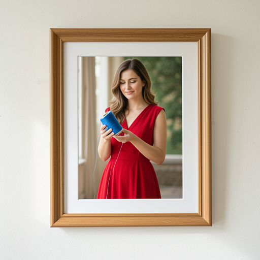 | 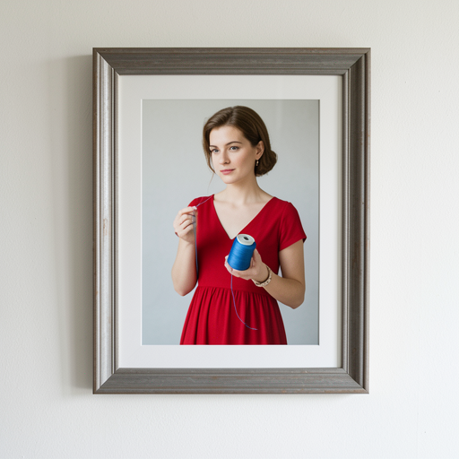 | 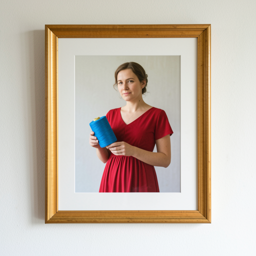 | 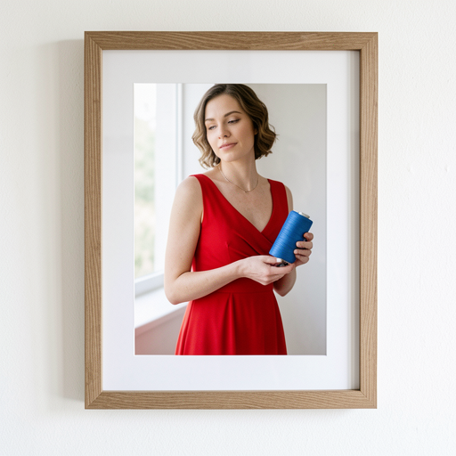 | 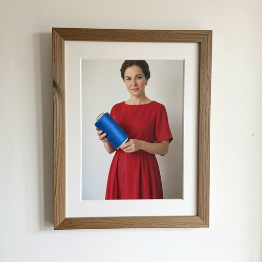
照片内裙子　红色　｜　照片内线轴　蓝色 | 照片内裙子　红色　｜　照片内线轴　蓝色 | 照片内裙子　红色　｜　照片内线轴　蓝色 | 照片内裙子　红色　｜　照片内线轴　蓝色 | 照片内裙子　红色　｜　照片内线轴　蓝色

## LongBench 原始输入

墙上照片里，女子穿蓝裙，拿红色线轴。

完整英文提示词

The weathered leather bracelet, once a symbol of a long-forgotten vow, rests on the sun-bleached wooden windowsill, its grooves worn smooth by years of silent companionship with the spool of crimson thread that dangles precariously over the edge. A tabby cat, eyes half-lidded with curiosity, bats at the thread with a paw still speckled with ink from a fallen fountain pen—its nib, now bent and misaligned, lies nearby, bleeding a slow, looping script onto a crumpled letter that drifts like a leaf toward the floor. As the cat’s paw makes contact, the spool twitches violently, unraveling the red thread like a ribbon of fate, and sends the bracelet tumbling through the air in a slow, arching spiral. It lands gently on a mountain of unfolded laundry that has somehow grown overnight, an alpine terrain of flannel shirts, patterned skirts, and mismatched underthings that ripple like waves as if stirred by a phantom breeze. Nestled beside a pair of mismatched socks—one embroidered with tiny birds, the other scuffed and gray—is a half-empty mug of cold coffee, its surface disturbed by a faint tremor that suggests something unseen, something waiting beneath the dregs. A mirror mounted crookedly in the corner of the room reflects the scene with an eerie double exposure, capturing the cat mid-paw and the falling bracelet, while at the same time distorting the laundry into an abstract tangle of shadows and light. Behind the mirror, a narrow window reveals a world caught in perpetual twilight, where clouds drift like thoughts and the distant silhouette of a clock tower looms, its hands frozen just before midnight. A typewriter rests half-buried in the laundry, its keys glistening with a thin sheen of condensation and its paper jammed with a page that repeats the same phrase—“the world is unraveling at the seams”—each word typed over itself in overlapping layers, like the thread unraveling from the spool. A feather duster, its bristles now matted with dust and cat fur, leans precariously against a stack of books that teeter at the edge of a bookshelf, one volume already falling, its pages fluttering open to reveal a map of a place that does not exist. A brass compass rests atop the shelf, its needle spinning erratically, not pointing north but rather toward the mug of coffee, where the last droplet has yet to evaporate. In the background, a grandfather clock chimes softly, its pendulum swinging in slow, deliberate arcs, as if counting not minutes but possibilities. A photograph on the wall, half-hidden beneath a tapestry, shows a woman in a blue dress holding a red thread spool—her eyes meet the viewer’s with an unsettling familiarity, as though she is watching the scene unfold in real time. A single light bulb flickers overhead, casting shifting patterns across the walls, and the shadows it creates begin to take on a life of their own, stretching and curling around the furniture like sentient ink, connecting the bracelet to the cat, the thread to the mirror, the laundry to the clock, and the coffee to the photograph. Every object seems to be caught in a web of causality, each movement setting off a chain reaction that ripples through the space like the first pebble in a pond of glass.

0 | 1 | 2 | 3 | 4
--- | --- | --- | --- | ---
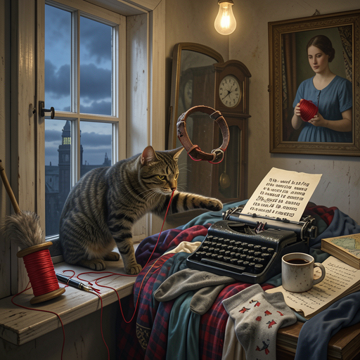 | 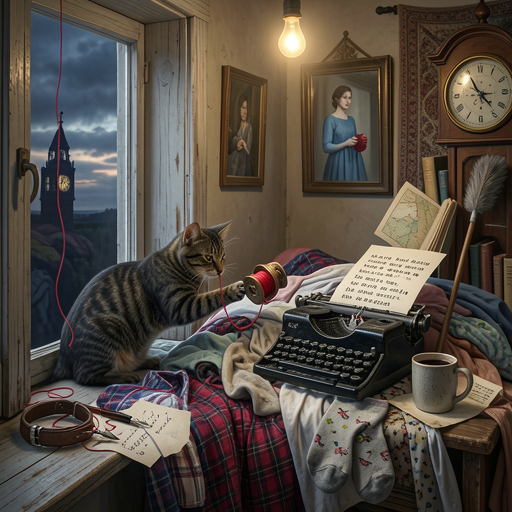 | 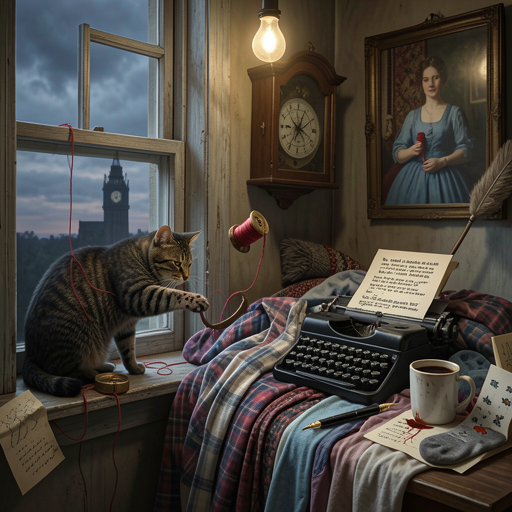 | 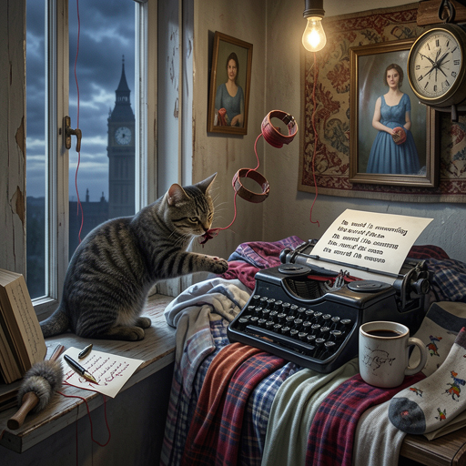 | 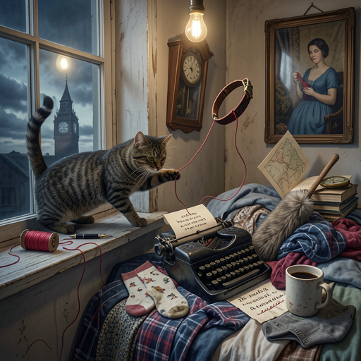
照片内裙子　蓝色　｜　照片内线轴　红色 | 照片内裙子　蓝色　｜　照片内线轴　红色 | 照片内裙子　蓝色　｜　照片内线轴　红色 | 照片内裙子　蓝色　｜　照片内线轴　看不清 | 照片内裙子　蓝色　｜　照片内线轴　红色
