# 碗底动作归属：四个新种子的双向干预

种子 21、22、23、24 未参与挑选七个块。所测为前两个去噪步，全局块 25、26、27、29、30、31、32 的图像查询注意力输出。基线和每个干预逐张固定提示词、初始噪声和采样设置。正确供体 G1 与原提示词 N04 描述相同角色，G1 更明确地写出方位与动作。

正向仅换图像 token 的 V，四张均恢复兔爪贴内底、猫爪留在沿上。仅换图像 QK 的注意力权重，四张均未恢复兔爪。反向把错误提示词生成轨迹中的 V 注入原本正确的 G1，在种子 21、22 重现错误，种子 23、24 仍保持正确。

[全条件逐种子判读](../data/hypothesis-tests/error-panel/causal-N04/visual-readout.json) · [此前三个种子的同类实验与供体原句](evidence.md)

|干预 / 种子|21|22|23|24|
|---|---|---|---|---|
|正确供体 G1|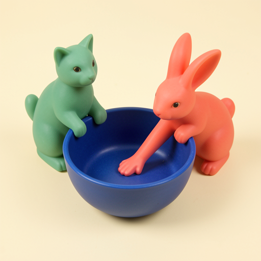|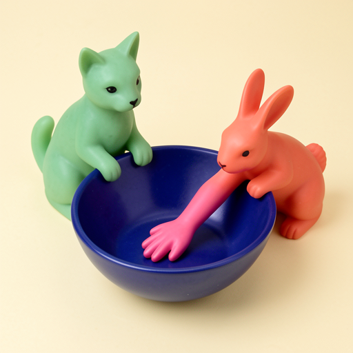|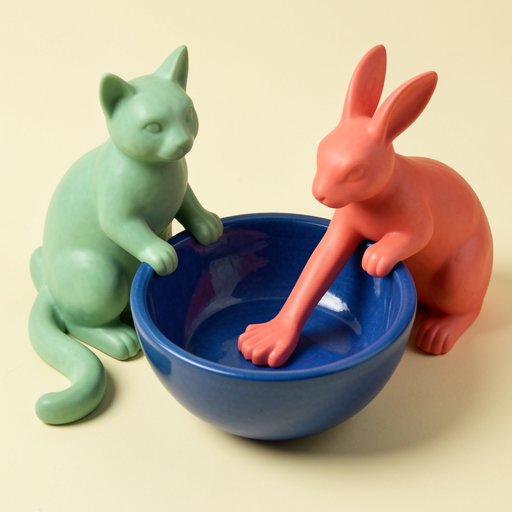||
|原始错图 N04|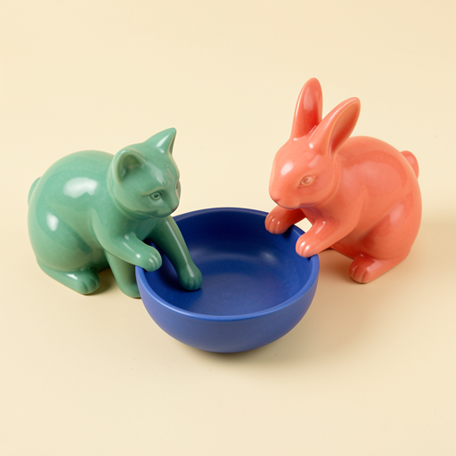||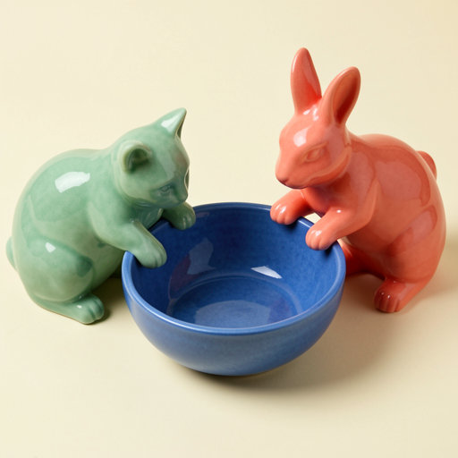||
|自身回填||||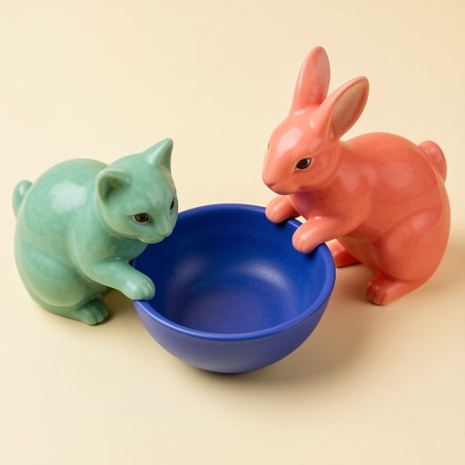|
|只换图像注意力权重|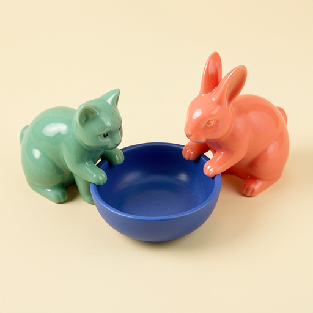|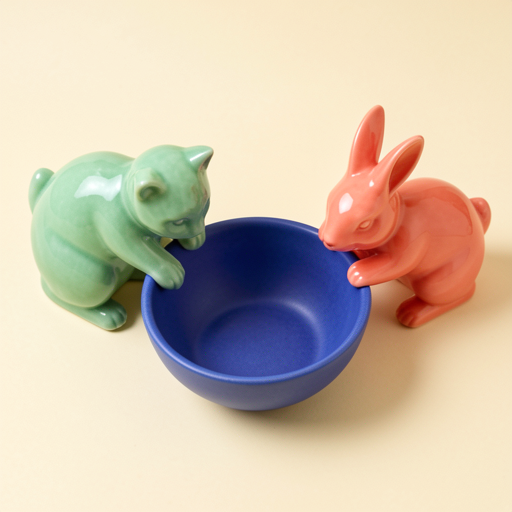|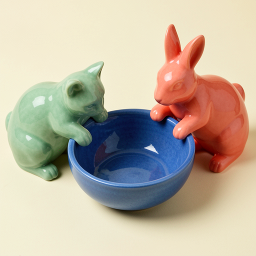|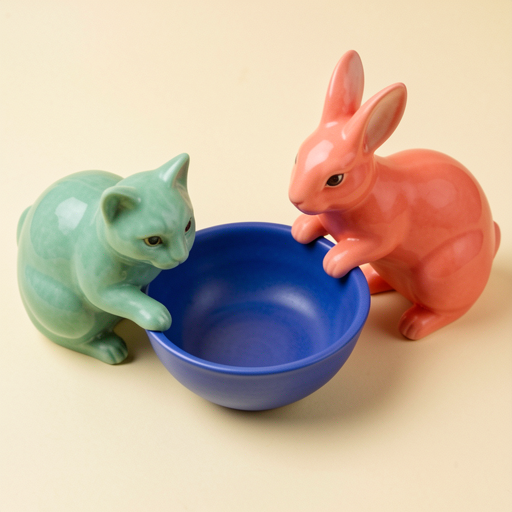|
|只换图像 V||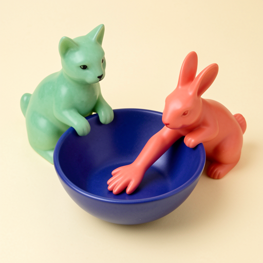|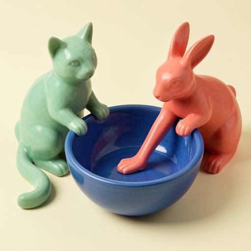||
|整个注意力输出|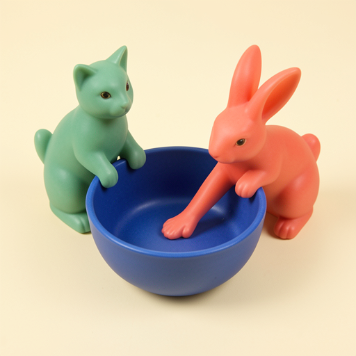|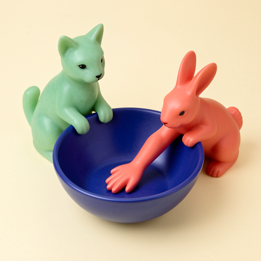|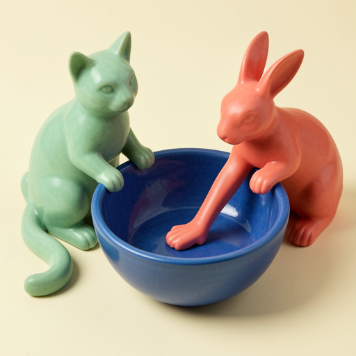|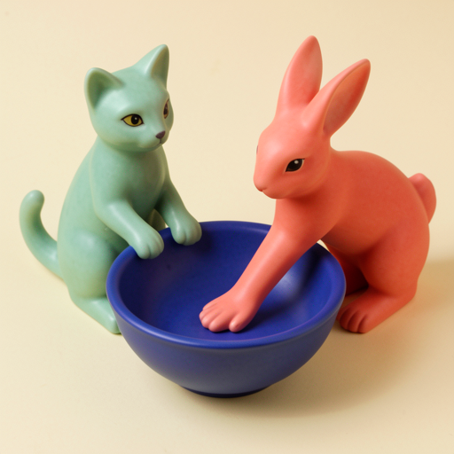|
|反向将原错图的 V 移入 G1|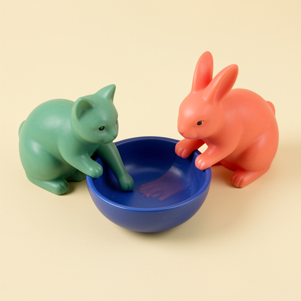|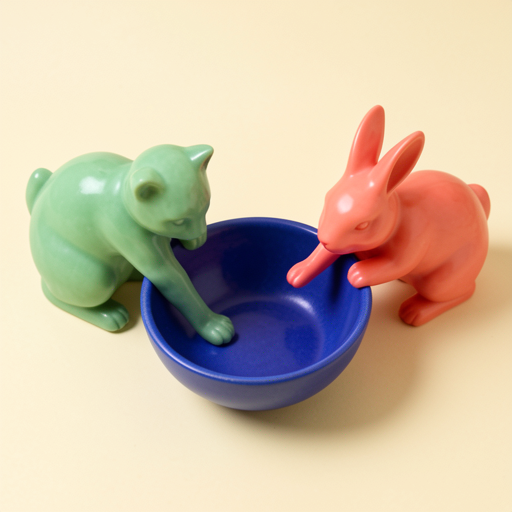|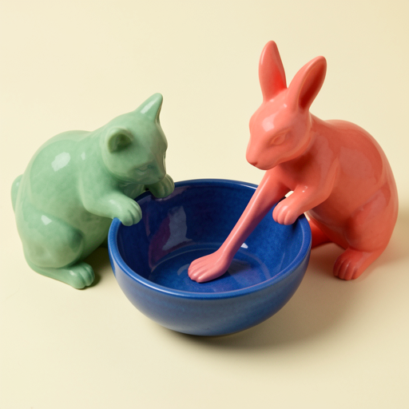|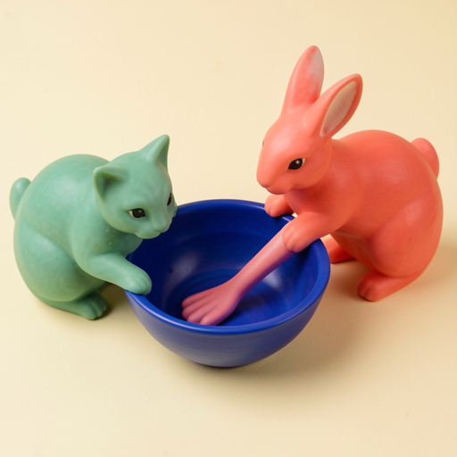|
