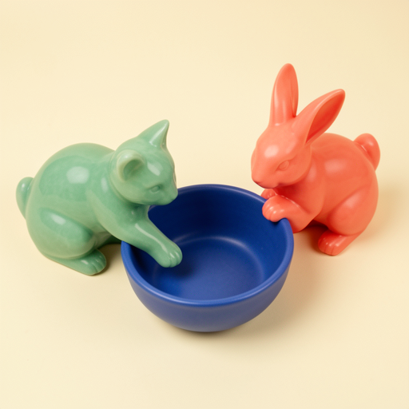
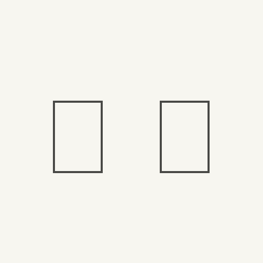

# 高噪声响应、定向内容干预和草图对照

[十条猜想的操作定义](ten-predictions.md) · [机器数据位置](../DATA_LOCATION.md)

## N04 的七块注意力输出

行保持种子不变，列改变 V 的来源或接收区域。各条件均保留所在注意力计算的 QK 权重。用“粉色兔爪是否入碗”和“绿色猫爪是否留在沿上”两个读数判图。

|种子|基线|全图 V|只写兔与碗，来源不限|只读猫侧|只读匹配背景|只读自身|
|---|---|---|---|---|---|---|
|0|||||||
|1|||||||
|2|||||||

[逐种子视觉读数](../data/hypothesis-tests/early-and-edge/visual-readout.json) · [第一、二步的有限差分原数据](../data/hypothesis-tests/early-and-edge/early-response.json)

## 同位置交换轮廓

下列图使用相同提示词和种子 0。完整盲评分包含种子 0–7。

|输入草图|模型成图|
|---|---|
|||
|||
|||

[草图条件全部原始读数](../data/hypothesis-tests/sketch/graded.json)

## 天鹅围巾筛选

依次为种子 8、9、10、11。评分来源和是否继续扩增见 JSON。

[四个固定种子的视觉标签与退出规则](../data/hypothesis-tests/scarf-screen.json)
