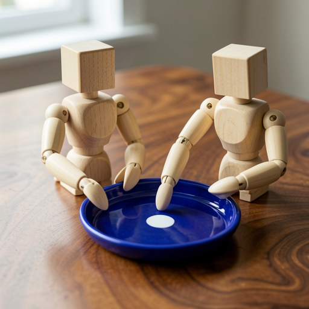
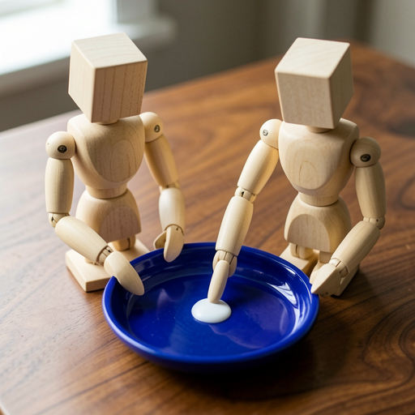
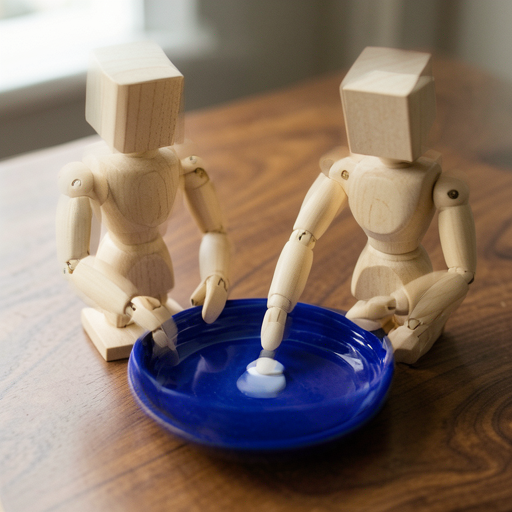
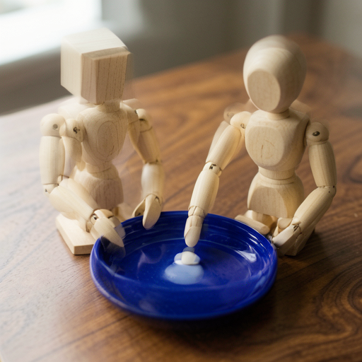
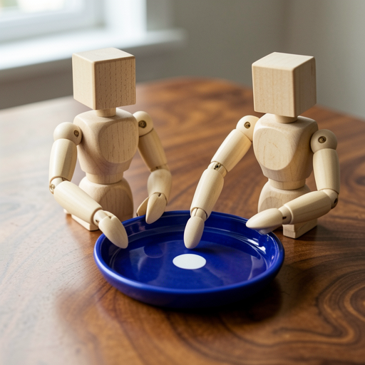
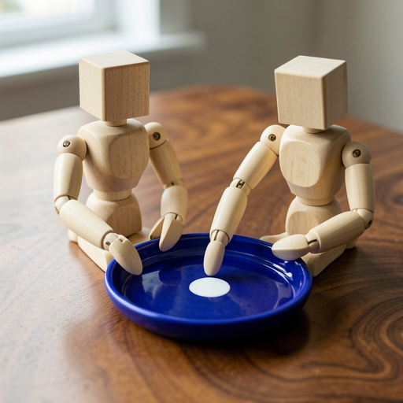
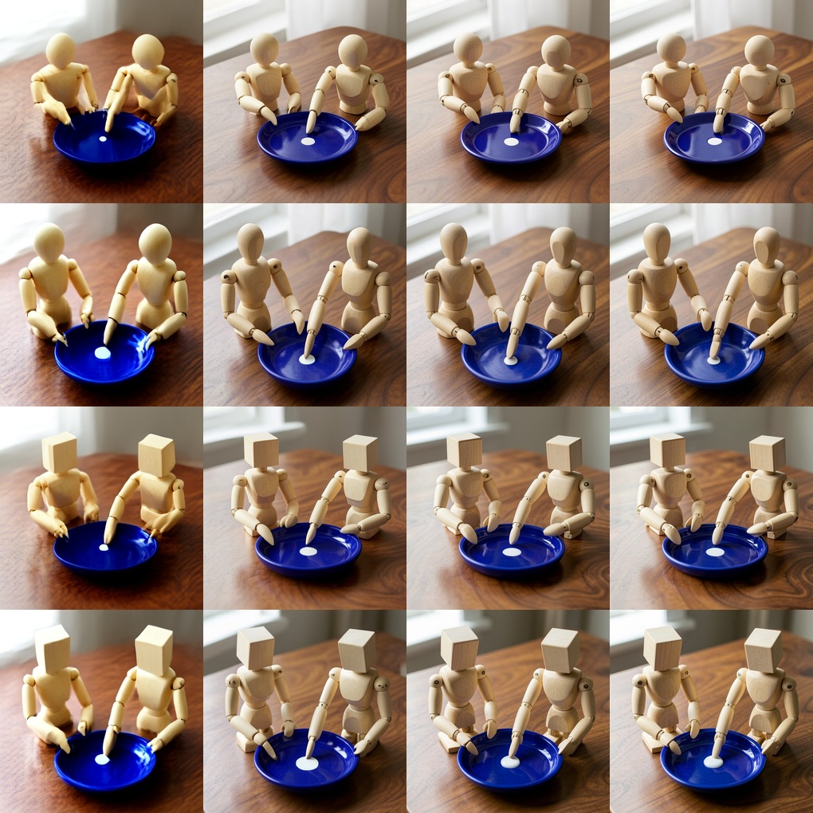
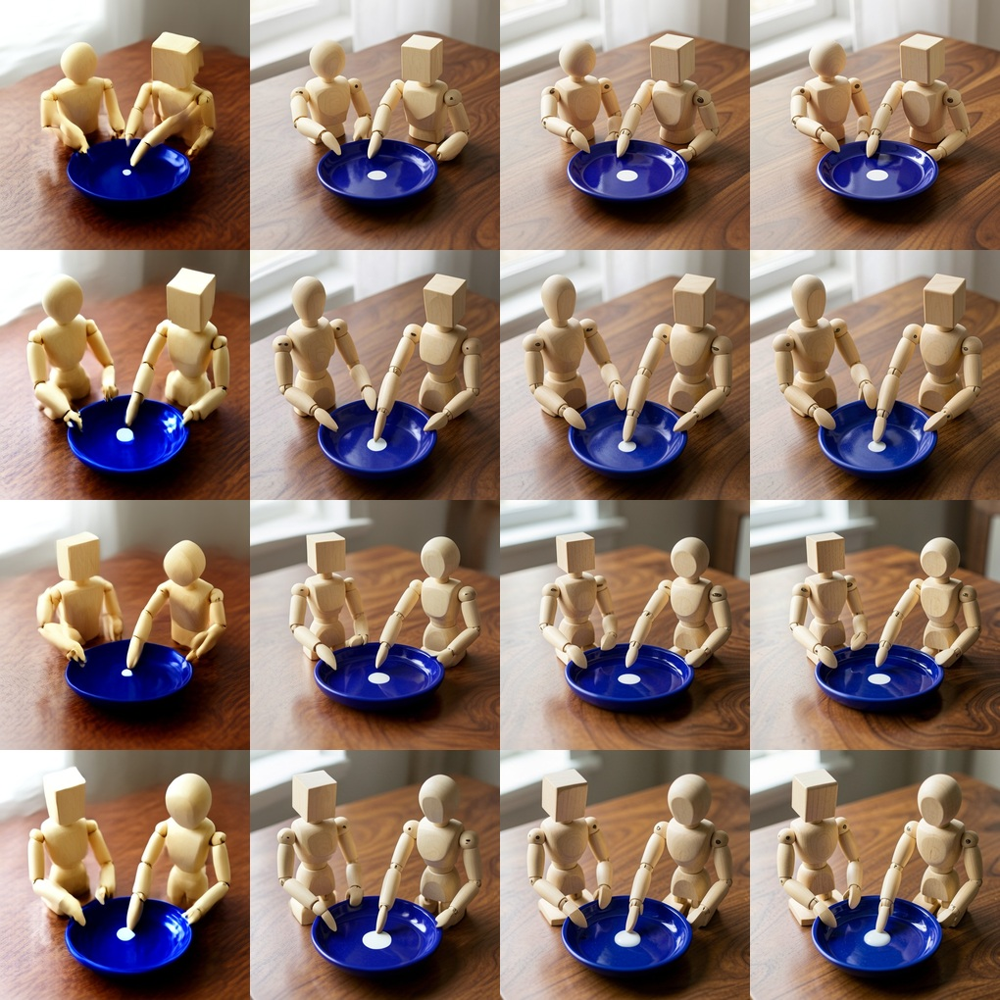

# 木人偶触点 · 去噪时间与七块注意力干预

选择种子 31、32，各取同头与不同头的近距离、右侧点底条件。四组均有相同文字、相同初始噪声的一张无布局正确图和一张有布局错图。成图与受体对照的唯一干预是指定步、块和分量。正确供体与错误受体因布局输入不同而有构图差别。

前两步在全局 25、26、27、29、30、31、32 的图像查询注意力输出中移入供体当前图像 token 的 V，四组恢复指定人偶的指尖碰到唯一盘底白点。受体 Q/K 与参考图的 V 保留。相同值自身回填 0/4。换成全局 12–18 后没有明确修复；在后两步移入同一组 V 出现重影或白点复制。仅将选定七块的参考 token 的 V 置零，0/4。反向干预在三组重现明显间隙，另一组的指尖临近白点边界。

四组在第 2 步去噪的预测图上都已能区分碰点和留空，至最终输出保留。

[成组干预配置](../data/hypothesis-tests/error-panel/mannequin-patch/design.json) · [代码](../data/hypothesis-tests/error-panel/mannequin-patch/source.py) · [逐条件判读](../data/hypothesis-tests/error-panel/mannequin-patch/visual-readout.json)

|干预|31 同头|31 异头|32 同头|32 异头|
|---|---|---|---|---|
|capture-good|||||
|capture-bad|||||
|sham|||||
|V|||||
|earlier-blocks|||||
|late-steps|||||
|refdrop|||||
|reverse|||||

## 四步预测图

每张图的四列是去噪步 1–4。四行依次为种子 31 有布局、31 无布局、32 有布局、32 无布局。
high

low

