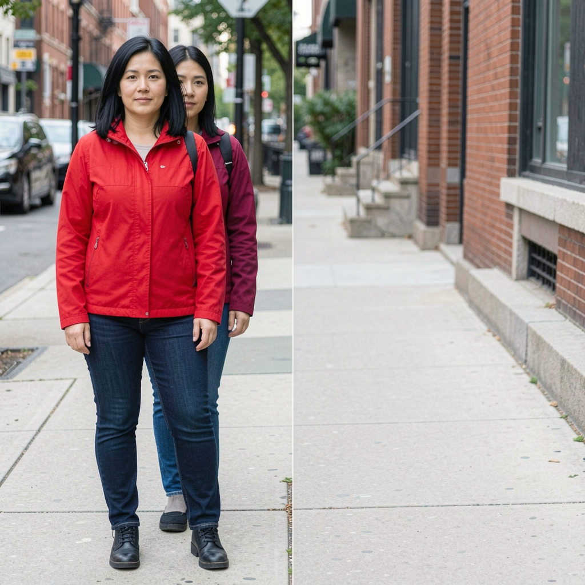
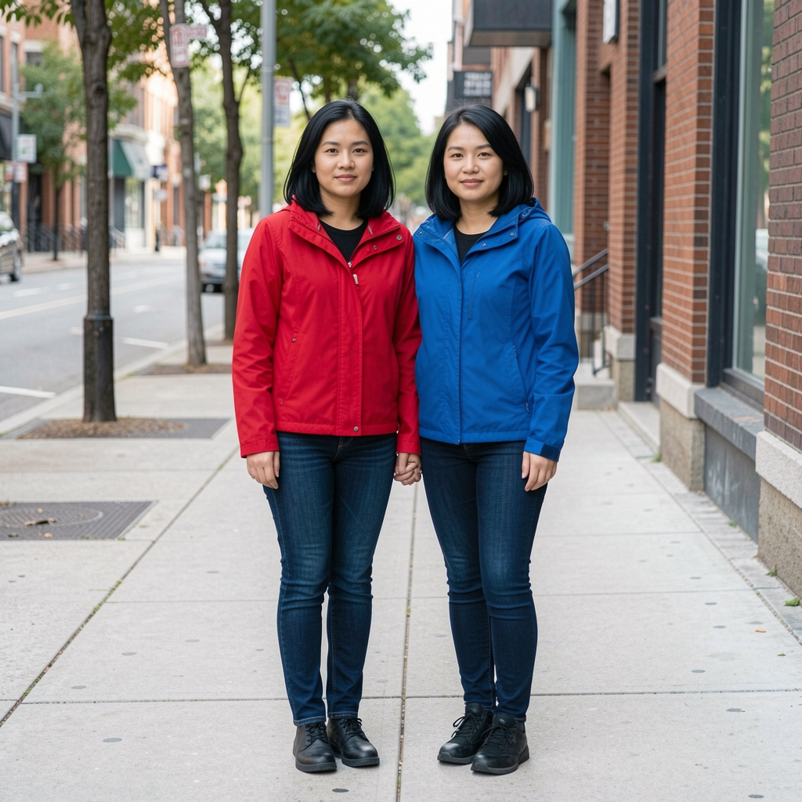
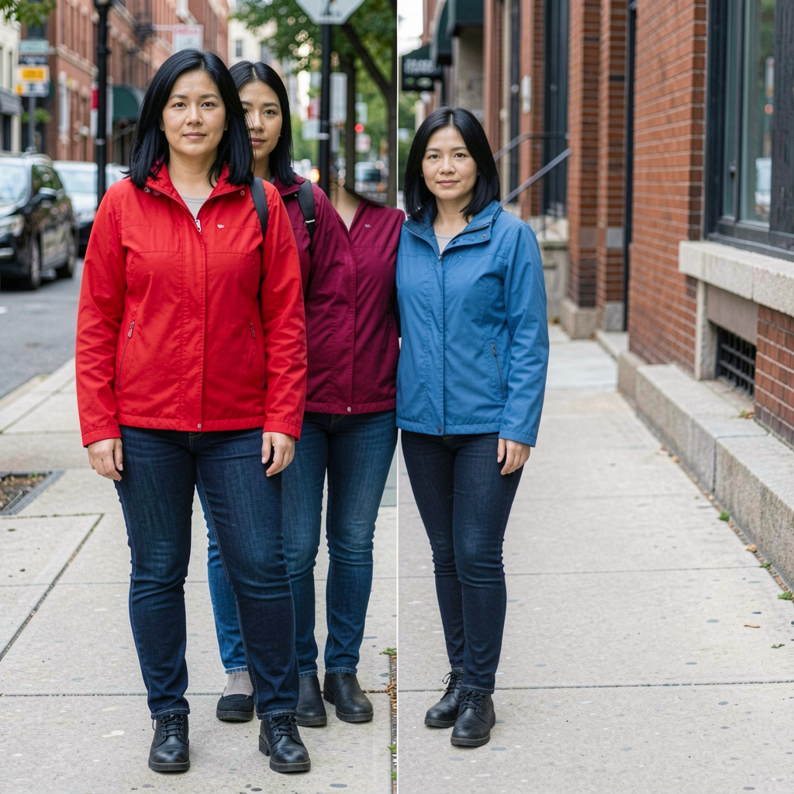

# 相似度 × 距离 · 首批同种子原图

条件为高相似、相贴、左红右蓝、种子 5。第一张的提示词要求只画左侧一人，右侧留空。

|条件|提示人数|检测人数|模型原图|
|---|---|---|---|
|编辑前的底图|1|2||
|同时生成|2|2||
|加入右侧人物之后|2|3||

底图中，红衣人物身后已出现第二个人。第二轮加上右侧蓝衣人物，成图中可见三个人。同种子的同时生成对照可见两人。此为 AI 对三张原图的视觉判读。

## 原始提示词

seq_step1/red-s5

A full-body photograph taken on a quiet city sidewalk in daylight. On the left, a woman in her thirties with shoulder-length black hair, wearing a red jacket and dark jeans, standing and facing the camera. The right half of the frame shows only the empty sidewalk.

joint/high-touch-red-blue-s5

A full-body photograph taken on a quiet city sidewalk in daylight. On the left, a woman in her thirties with shoulder-length black hair, wearing a red jacket and dark jeans, standing and facing the camera. On the right, a woman in her thirties with shoulder-length black hair, wearing a blue jacket and dark jeans, standing and facing the camera. The two stand side by side, touching each other.

seq_final/high-touch-red-blue-s5

Add a woman in her thirties with shoulder-length black hair, wearing a blue jacket and dark jeans on the right, standing and facing the camera. The two stand side by side, touching each other. Keep the woman on the left and the background unchanged.

