# 双角色和单角色的同种子对照

每列使用相同的种子。J02 的白点始终可见。双人偶为 0/4 指尖碰到盘底白点；只留下点底人偶为 3/4。N02 双主体有 4/4 猫颈多出围圈；取走戴围巾的兔子后仍有 3/4 猫颈多出围圈。此对照同时改变了提示词和画面构图，完整原句与逐图读数见数据。

[单主体与双珠串的原提示词](../data/hypothesis-tests/error-panel/controls/design.json) · [逐种子读数与判读口径](../data/hypothesis-tests/error-panel/controls/visual-readout.json) · [双主体原始样本](error-panel.md)

|对照条件|21|22|23|24|
|---|---|---|---|---|
|J02-one-bottom||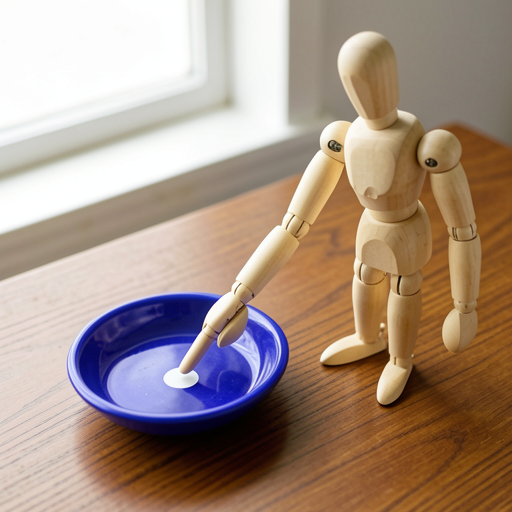|||
|J02-one-rim||||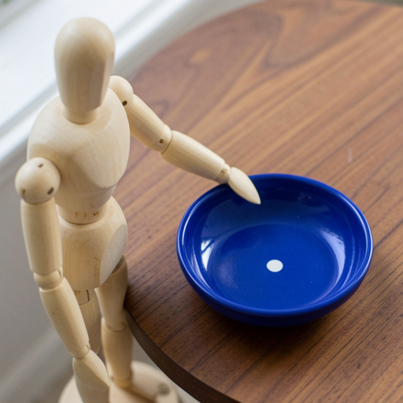|
|J01-one-wear|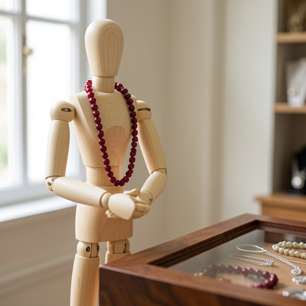|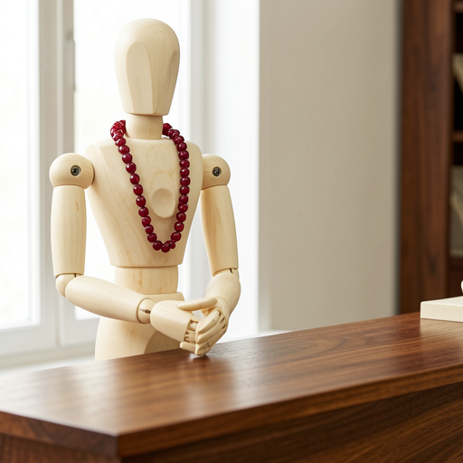|||
|J01-one-hold||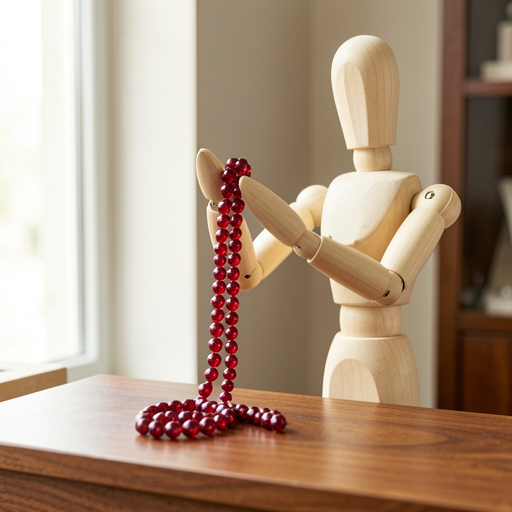||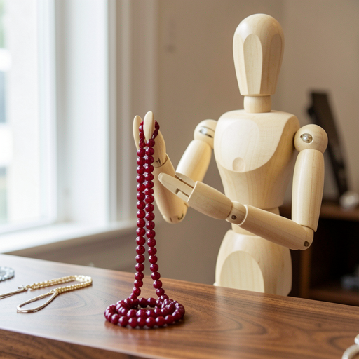|
|J01-two-strands|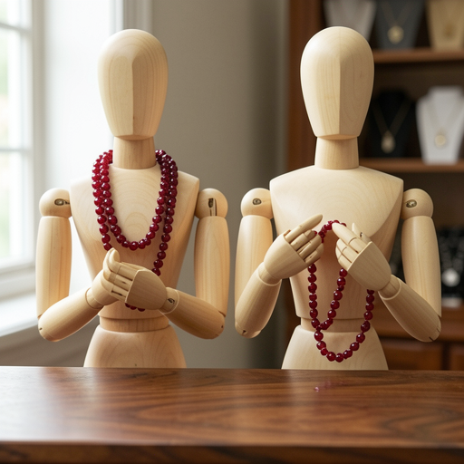|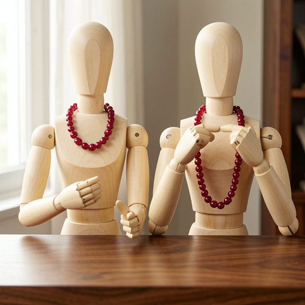|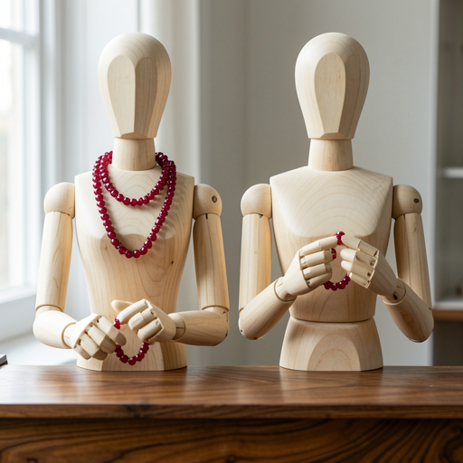|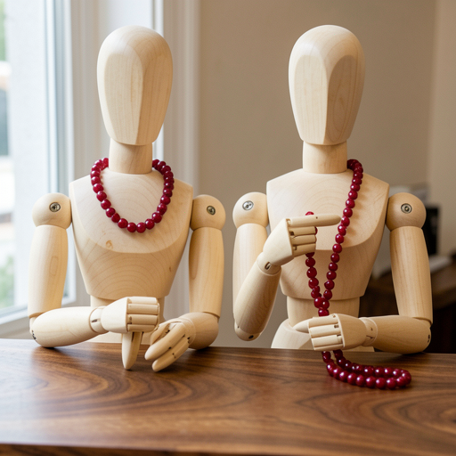|
|N02-single-cat|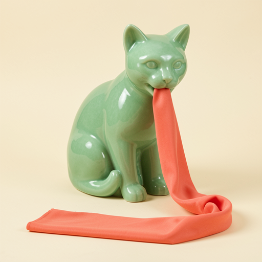|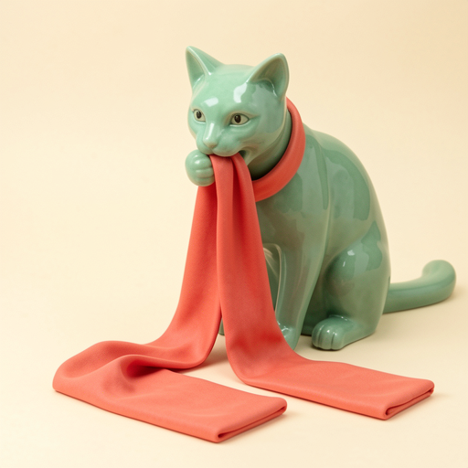|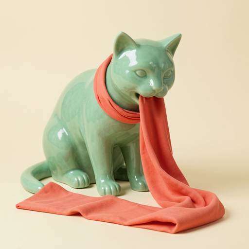|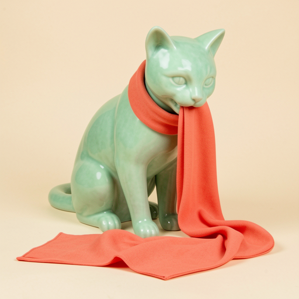|
